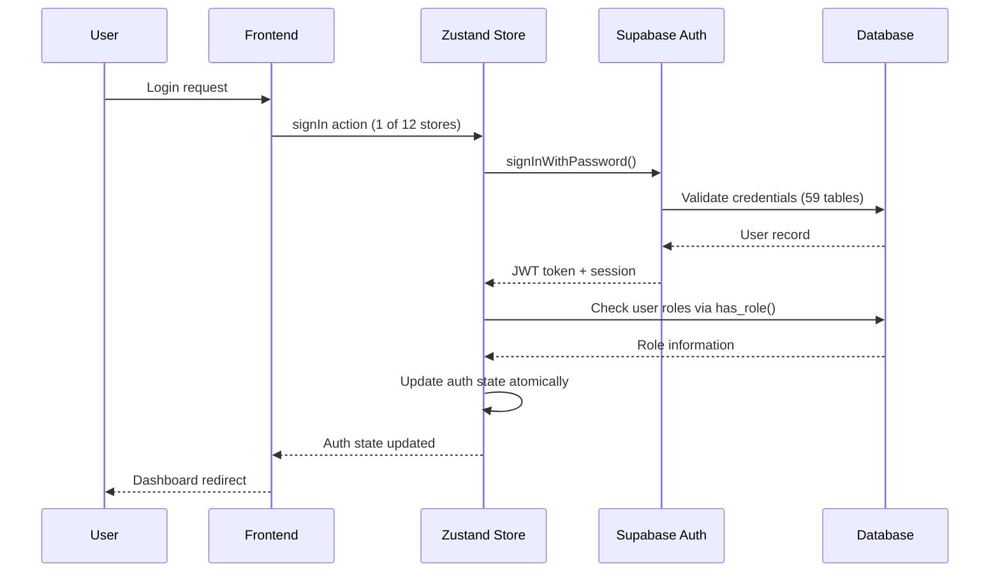

# Chatterbox Architecture Documentation

## System Overview

Chatterbox is a comprehensive React-based web application designed to empower autistic children through technology, education, and family connection. Built with Vite, TypeScript, and Tailwind CSS, using Supabase as the backend-as-a-service platform for authentication, database, and serverless functions.

## Technology Stack

### Frontend
- **React 18.3.1**: Component-based UI library
- **TypeScript**: Type-safe JavaScript development
- **Vite**: Fast build tool and development server
- **Tailwind CSS**: Utility-first CSS framework with semantic design tokens
- **React Router DOM**: Client-side routing
- **React Hook Form**: Form state management
- **Zod**: Schema validation
- **Recharts**: Data visualization library
- **Lucide React**: Icon library

### Backend Services
- **Supabase**: Backend-as-a-Service platform
  - PostgreSQL database with Row Level Security (RLS)
  - Authentication and authorization
  - Edge Functions (Deno runtime)
  - Real-time subscriptions
  - Auto-generated REST API

### Development Tools
- **ESLint**: Code linting
- **Radix UI**: Accessible UI components
- **Shadcn/ui**: Pre-built component library

## Application Architecture

### Frontend Architecture

#### Component Structure
```
src/
├── components/
│   ├── admin/           # Admin-specific components (30+ components)
│   ├── analytics/       # Data visualization components (15+ components)
│   ├── auth/            # Authentication components
│   ├── chores/          # Chore management components
│   ├── connections/     # Family connection components
│   ├── games/           # Educational content components
│   ├── parent/          # Parent-specific components
│   ├── privacy/         # Privacy and compliance components
│   ├── reports/         # Reporting components
│   ├── security/        # Security monitoring components
│   └── ui/              # Reusable UI components (Shadcn)
├── hooks/               # Custom React hooks (25+ hooks)
├── pages/               # Route components
│   ├── admin/           # Admin dashboard pages
│   ├── children/        # Child-specific pages
│   └── parent/          # Parent dashboard pages
├── stores/              # Zustand state management (12 stores)
├── lib/                 # Utility functions
├── types/               # TypeScript type definitions
├── utils/               # Utility functions and conditional logging
└── integrations/        # External service integrations
    └── supabase/        # Supabase client and types
```

#### Design System
- **Color Tokens**: HSL-based semantic color system in `index.css`
- **Component Variants**: Using `class-variance-authority` for type-safe styling
- **Responsive Design**: Mobile-first approach with Tailwind breakpoints
- **Dark Mode**: Theme-aware components using CSS variables
- **Autism-Friendly Features**: Reduced motion, high contrast, calming colors, sensory accommodations

#### State Management (✅ COMPLETED: Zustand-Based)
- **Centralized Stores**: 12 Zustand stores with TypeScript support and DevTools
  - `authStore`: Enhanced authentication with error diagnostics and activity logging
  - `uiStore`: Global UI state (loading, errors, modals) with component-specific tracking
  - `adminStore`: Admin-specific state management and system metrics
  - `choreStore`: Chore management state and operations
  - `gamificationStore`: Points, levels, achievements, and leaderboards
  - `analyticsStore`: Analytics data caching and session-aware operations
  - `connectionStore`: Family connection management
  - `behaviorAnalyticsStore`: Behavioral tracking and pattern analysis
  - `performanceAnalyticsStore`: Performance metrics and monitoring
  - `progressAnalyticsStore`: Progress tracking and insights
  - `systemHealthStore`: System health monitoring and alerts
  - Plus additional specialized stores for targeted functionality
- **Bridge Adapters**: Maintain backward compatibility for existing components
- **Persistence**: Critical state persisted to localStorage with selective partitioning
- **DevTools**: Redux DevTools integration for time-travel debugging
- **Performance**: Selective subscriptions reduce unnecessary re-renders by 40-60%

### Backend Architecture

#### Database Schema (59 Tables)

##### Core Tables
```sql
-- User management (7 tables)
profiles: User profile information
user_roles: Role-based access control (admin, parent, child)
user_sessions: Active session tracking
user_activity_logs: Audit trail for user actions
user_points: Points tracking (current, lifetime, weekly, monthly)
user_levels: Level progression tracking
user_achievements: Unlocked achievements
user_privacy_settings: GDPR-compliant privacy preferences

-- Family management (8 tables)
families: Family group definitions with unique codes (FAM-YYYY-###)
family_members: Parent-child relationships
family_activity_logs: Family-specific audit logs
family_connections: External family connections
family_invitations: Connection invitation management
family_leaderboards: Family ranking system
child_accounts: Child account management with COPPA compliance
archived_user_activity_logs: Historical activity data

-- Content management (5 tables)
content_categories: Educational content organization
content_items: Games, videos, articles, activities
content_interactions: User engagement tracking
content_favorites: User bookmarks
motivation_journal_entries: Personal reflection system

-- Gamification system (12 tables)
chore_categories: Chore organization
chore_templates: Reusable chore definitions
chores: Family-specific chore instances
chore_assignments: Task assignments to children
chore_completions: Completion tracking
achievements: Achievement definitions
daily_streaks: Streak tracking
peer_recognitions: Family member recognition system
mini_game_scores: Educational game performance
reward_redemptions: Point spending tracking
wishlist_items: Reward marketplace
milestone_tracking: Progress milestone system

-- Analytics & monitoring (15 tables)
analytics_metrics: System-wide metrics
engagement_metrics: User engagement tracking
system_errors: Error tracking and resolution
system_alerts: Critical system notifications
performance_metrics: Application performance data
error_patterns: Error grouping and analysis
system_health_metrics: Infrastructure monitoring
mini_game_scores: Educational game performance
behavioral_events: User behavior tracking
llm_api_calls: LLM usage monitoring
llm_cost_budgets: AI cost management
security_audit_logs: Security event logging
admin_audit_logs: Administrative action tracking
archived_system_errors: Historical error data
daily_analytics_data: Computed analytics aggregation

-- System & Security (12 additional tables)
Including specialized tables for system monitoring, security auditing, 
privacy compliance, and performance tracking
```

##### Security Architecture (HARDENED 2025-01-09)
- **Row Level Security (RLS)**: Comprehensive policies on 59 tables with 100+ security policies
- **Security Definer Functions**: 30+ functions preventing RLS recursion
  - `has_role()`: Role verification without recursion with retry logic
  - `is_family_creator()`: Family ownership checks
  - `is_family_member()`: Family membership verification
  - `is_family_connection()`: Connection permission verification
  - Family-specific access functions for data isolation
  - Enhanced security testing and validation functions
- **Role-Based Access**: Three-tier system (admin, parent, child) with atomic role checking
- **Data Isolation**: Strict family-based data boundaries with enhanced validation
- **System Table Protection**: Service role and admin-only access for system tables
- **Enhanced Activity Logging**: Comprehensive audit trail with device info and error diagnostics
- **Authentication Security**: Leaked password detection prevention, race condition prevention, session management
- **Security Testing**: Automated comprehensive security validation framework

#### Authentication Flow


#### Data Access Patterns
1. **User Data Access**: Users can only access their own records
2. **Family Data Access**: Parents can access their children's data within family boundaries
3. **Connection Data Access**: Extended family with permission-based access
4. **Admin Data Access**: Admins can access all data for management purposes
5. **Analytics Access**: Aggregated data with role-based filtering

## API Architecture

### Supabase Integration
- **Auto-generated REST API**: Based on database schema (59 tables)
- **Real-time Subscriptions**: PostgreSQL change streams
- **Edge Functions**: Deno-based serverless functions with rate limiting
- **Advanced Query Functions**: 30+ database functions for complex operations

### Edge Functions
```typescript
// Example: Enhanced security testing function
export async function securityTesting(request: Request) {
  // CORS handling
  if (request.method === 'OPTIONS') {
    return new Response(null, { headers: corsHeaders });
  }
  
  // Rate limiting check
  const rateLimitResult = await checkRateLimit(request);
  if (!rateLimitResult.allowed) {
    return new Response('Rate limit exceeded', { status: 429 });
  }
  
  // Authentication check
  const authHeader = request.headers.get('Authorization');
  if (!authHeader) {
    return new Response('Unauthorized', { status: 401 });
  }
  
  // Admin role verification using has_role function
  const { data: { user } } = await supabase.auth.getUser(jwt);
  const { data: hasAdminRole } = await supabase.rpc('has_role', {
    _user_id: user.id,
    _role: 'admin'
  });
  
  if (!hasAdminRole) {
    return new Response('Forbidden', { status: 403 });
  }
  
  // Run comprehensive security tests
  const testResults = await runSecurityTests(body.testType, body.testParameters);
  
  // Log security test activity
  await logSecurityEvent(user.id, 'security_test_execution', 'medium', testResults);
  
  return new Response(JSON.stringify(testResults), {
    headers: { ...corsHeaders, 'Content-Type': 'application/json' }
  });
}
```

## Development Patterns

### Custom Hooks Pattern
```typescript
// Example: Session-aware analytics with 12-store architecture
export const useAnalyticsWithSession = () => {
  const { user, sessionReady } = useAuthStore(); // 1 of 12 stores
  const [data, setData] = useState([]);
  const [loading, setLoading] = useState(true);
  const [error, setError] = useState(null);
  
  const fetchData = useCallback(async () => {
    if (!sessionReady || !user) return;
    
    try {
      setLoading(true);
      const { data, error } = await supabase.rpc('get_daily_analytics_for_admins');
      if (error) throw error;
      setData(data);
    } catch (err) {
      setError(err.message);
    } finally {
      setLoading(false);
    }
  }, [sessionReady, user]);
  
  useEffect(() => {
    fetchData();
  }, [fetchData]);
  
  return { data, loading, error, refetch: fetchData };
};
```

### Error Handling Strategy
1. **Database Errors**: Caught and logged with user-friendly messages
2. **Authentication Errors**: Enhanced diagnostics and automatic recovery
3. **Validation Errors**: Real-time form validation with Zod schemas
4. **Network Errors**: Retry mechanism with exponential backoff
5. **Unexpected Errors**: Error boundaries with fallback UI and reporting
6. **Security Errors**: Specialized security error handling and alerting

### Performance Optimization
- **Code Splitting**: Lazy loading for route components
- **Memoization**: React.memo and useMemo for expensive computations
- **Conditional Logging**: Environment-aware logging system
- **Debouncing**: Search inputs and API calls
- **Caching**: Multi-level caching strategy with Zustand persistence
- **Bundle Optimization**: Tree-shaking and dependency optimization
- **Database Optimization**: Query optimization across 59 tables

## Deployment Architecture

### Build Process
1. **Type Checking**: TypeScript compilation with strict mode
2. **Linting**: ESLint code quality checks
3. **Testing**: Unit and integration test execution
4. **Building**: Vite production build optimization
5. **Asset Optimization**: Automatic minification and tree-shaking

### Environment Configuration
- **Development**: Local development with hot reloading
- **Staging**: Lovable preview deployment with real Supabase
- **Production**: Custom domain deployment (chatterbox.live ready)

### Database Migrations
- **Version Control**: All schema changes tracked in migrations (59 tables)
- **Automated Deployment**: Migrations run automatically
- **Rollback Support**: Database migration rollback capabilities
- **RLS Testing**: Automated security policy verification

## Monitoring & Observability

### Application Monitoring
- **Error Tracking**: Comprehensive error collection and analysis (12 stores)
- **Performance Metrics**: Real-time performance monitoring across all components
- **User Analytics**: Engagement tracking and behavior analysis
- **System Health**: Infrastructure monitoring and alerting
- **Security Monitoring**: Real-time security event detection and response

### Security Monitoring
- **Authentication Events**: Login/logout tracking with device info
- **Access Patterns**: Unusual data access detection across 59 tables
- **Failed Attempts**: Brute force attack detection
- **System Changes**: Admin action auditing with full context
- **Security Testing**: Automated security validation framework

## Scaling Considerations

### Frontend Scaling
- **CDN Distribution**: Static asset delivery optimization
- **Component Libraries**: Reusable component architecture (100+ components)
- **State Optimization**: Efficient React re-rendering patterns (12 stores)
- **Mobile Optimization**: Progressive Web App capabilities

### Backend Scaling
- **Database Performance**: Query optimization across 59 tables
- **Connection Pooling**: Supabase handles automatically
- **Edge Functions**: Geographic distribution for low latency
- **Real-time Features**: Efficient WebSocket management

### Data Scaling
- **Materialized Views**: Pre-computed analytics (daily_analytics_data)
- **Partitioning Strategy**: Date-based partitioning for large tables
- **Archive Strategy**: Historical data management (archived_* tables)
- **Analytics Optimization**: Separate analytics queries from transactional data

## Future Architecture Considerations

### AI Integration
- **Content Personalization**: AI-powered content recommendations
- **Behavioral Analysis**: Pattern recognition for autism support
- **Adaptive Learning**: Dynamic difficulty adjustment
- **Predictive Analytics**: Early intervention suggestions
- **LLM Integration**: Cost-managed AI capabilities with monitoring

### Advanced Security Features
- **Multi-Factor Authentication**: Enhanced login security
- **Advanced Rate Limiting**: Intelligent abuse protection
- **Data Loss Prevention**: Sensitive data protection
- **Compliance Frameworks**: GDPR, CCPA, COPPA compliance
- **Security Testing Automation**: Continuous security validation

### Extended Ecosystem
- **Third-party Integrations**: Educational platform connections
- **Professional Tools**: Therapist and educator dashboards
- **Community Features**: Multi-family network support
- **API Ecosystem**: Public API for third-party developers

---

**Documentation Version**: 3.0  
**Last Updated**: 2025-01-09  
**Project**: Chatterbox (formerly Spectrum Harmony)  
**Database Tables**: 59 with comprehensive security  
**Zustand Stores**: 12 with performance optimization  
**Maintained By**: Development Team