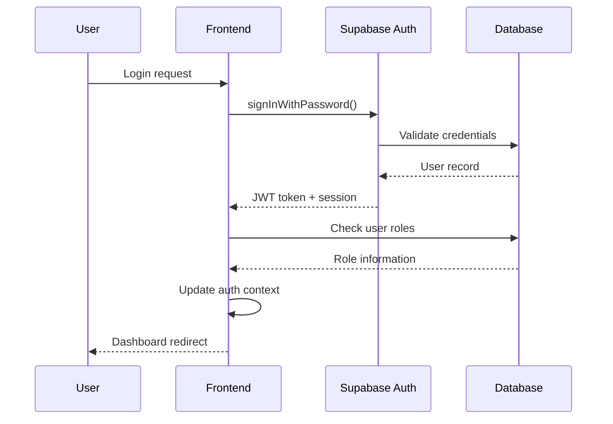

# Family Portal Architecture Documentation

## System Overview

The Family Portal is a React-based web application built with Vite, TypeScript, and Tailwind CSS, using Supabase as the backend-as-a-service platform for authentication, database, and serverless functions.

## Technology Stack

### Frontend
- **React 18.3.1**: Component-based UI library
- **TypeScript**: Type-safe JavaScript development
- **Vite**: Fast build tool and development server
- **Tailwind CSS**: Utility-first CSS framework
- **React Router DOM**: Client-side routing
- **React Hook Form**: Form state management
- **Zod**: Schema validation
- **Recharts**: Data visualization library
- **Lucide React**: Icon library

### Backend Services
- **Supabase**: Backend-as-a-Service platform
  - PostgreSQL database with Row Level Security (RLS)
  - Authentication and authorization
  - Edge Functions (Deno runtime)
  - Real-time subscriptions
  - Auto-generated REST API

### Development Tools
- **ESLint**: Code linting
- **Radix UI**: Accessible UI components
- **Shadcn/ui**: Pre-built component library

## Application Architecture

### Frontend Architecture

#### Component Structure
```
src/
├── components/
│   ├── admin/           # Admin-specific components
│   ├── analytics/       # Data visualization components  
│   ├── chores/          # Chore management components
│   ├── games/           # Educational content components
│   ├── reports/         # Reporting components
│   └── ui/              # Reusable UI components (Shadcn)
├── hooks/               # Custom React hooks
├── pages/               # Route components
│   ├── admin/           # Admin dashboard pages
│   ├── children/        # Child-specific pages
│   └── parent/          # Parent dashboard pages
├── stores/              # Zustand state management
├── lib/                 # Utility functions
└── integrations/        # External service integrations
    └── supabase/        # Supabase client and types
```

#### Design System
- **Color Tokens**: HSL-based semantic color system in `index.css`
- **Component Variants**: Using `class-variance-authority` for type-safe styling
- **Responsive Design**: Mobile-first approach with Tailwind breakpoints
- **Dark Mode**: Theme-aware components using CSS variables
- **Autism-Friendly Features**: Reduced motion, high contrast, calming colors

#### State Management (CURRENT: Zustand-Based)
- **Centralized Stores**: Zustand stores with TypeScript support
  - `authStore`: Authentication state and actions
  - `adminStore`: Admin-specific state management
  - `choreStore`: Chore management state
  - `gamificationStore`: Points, levels, achievements
  - `analyticsStore`: Analytics data caching
- **Bridge Adapters**: Compatibility layer for existing hooks
- **Persistence**: Selected state persisted to localStorage
- **DevTools**: Redux DevTools integration for debugging

### Backend Architecture

#### Database Schema

##### Core Tables
```sql
-- User management
profiles: User profile information
user_roles: Role-based access control (admin, parent, child)
user_sessions: Active session tracking
user_activity_logs: Audit trail for user actions

-- Family management  
families: Family group definitions
family_members: Parent-child relationships
family_activity_logs: Family-specific audit logs

-- Content management
content_categories: Educational content organization
content_items: Games, videos, articles, activities
content_interactions: User engagement tracking
content_favorites: User bookmarks

-- Gamification system
chore_categories: Chore organization
chore_templates: Reusable chore definitions
chores: Family-specific chore instances
chore_assignments: Task assignments to children
chore_completions: Completion tracking
achievements: Achievement definitions
user_achievements: Unlocked achievements
user_points: Point tracking (current, lifetime, weekly, monthly)
user_levels: Level progression tracking
family_leaderboards: Family ranking system

-- Analytics & monitoring
analytics_metrics: System-wide metrics
engagement_metrics: User engagement tracking
system_health_metrics: Infrastructure monitoring
system_errors: Error tracking and resolution
system_alerts: Critical system notifications
performance_metrics: Application performance data
error_patterns: Error grouping and analysis
daily_analytics: Materialized view for reporting
```

##### Security Architecture (HARDENED 2025)
- **Row Level Security (RLS)**: Comprehensive policies on 28+ tables
- **Security Definer Functions**: 15+ functions preventing RLS recursion
  - `has_role()`: Role verification without recursion
  - `is_family_creator()`: Family ownership checks
  - `is_family_member()`: Family membership verification
- **Role-Based Access**: Three-tier system (admin, parent, child)
- **Data Isolation**: Strict family-based data boundaries
- **System Table Protection**: Service role and admin-only access
- **Activity Logging**: Comprehensive audit trail for all operations

#### Authentication Flow


#### Data Access Patterns
1. **User Data Access**: Users can only access their own records
2. **Family Data Access**: Parents can access their children's data
3. **Admin Data Access**: Admins can access all data for management
4. **Analytics Access**: Aggregated data with role-based filtering

### Security Architecture

#### Authentication & Authorization
- **JWT Tokens**: Supabase-managed authentication tokens
- **Role Verification**: `has_role()` security definer function
- **Session Management**: Automatic token refresh and session tracking
- **Failed Login Protection**: Activity logging for security monitoring

#### Data Protection
- **Encryption in Transit**: HTTPS for all API communications
- **Encryption at Rest**: Supabase-managed database encryption
- **Access Logging**: Comprehensive audit trail for all data access
- **Input Validation**: Zod schemas for form and API validation

#### Row Level Security Policies
```sql
-- Example: Users can only view their own profiles
CREATE POLICY "Users can view their own profile" 
ON profiles FOR SELECT 
USING (auth.uid() = user_id);

-- Example: Parents can view family member profiles
CREATE POLICY "Parents can view their family members' profiles" 
ON profiles FOR SELECT 
USING (
  auth.uid() = user_id OR 
  (has_role(auth.uid(), 'parent'::app_role) AND EXISTS (
    SELECT 1 FROM family_members fm
    JOIN families f ON fm.family_id = f.id
    WHERE f.created_by = auth.uid() AND fm.user_id = profiles.user_id
  ))
);
```

## API Architecture

### Supabase Integration
- **Auto-generated REST API**: Based on database schema
- **Real-time Subscriptions**: PostgreSQL change streams
- **Edge Functions**: Deno-based serverless functions
- **Storage API**: File upload and management

### Edge Functions
```typescript
// Example: Admin-only family creation
export async function createTestFamily(request: Request) {
  // CORS handling
  if (request.method === 'OPTIONS') {
    return new Response(null, { headers: corsHeaders });
  }
  
  // Authentication check
  const authHeader = request.headers.get('Authorization');
  if (!authHeader) {
    return new Response('Unauthorized', { status: 401 });
  }
  
  // Admin role verification
  const { data: { user } } = await supabase.auth.getUser(jwt);
  const hasAdminRole = await checkAdminRole(user.id);
  
  if (!hasAdminRole) {
    return new Response('Forbidden', { status: 403 });
  }
  
  // Business logic implementation
  // ...
}
```

## Development Patterns

### Custom Hooks Pattern
```typescript
// Example: Analytics data fetching
export const useAnalytics = () => {
  const [data, setData] = useState([]);
  const [loading, setLoading] = useState(true);
  const [error, setError] = useState(null);
  
  const fetchData = useCallback(async () => {
    try {
      const { data, error } = await supabase.rpc('get_analytics');
      if (error) throw error;
      setData(data);
    } catch (err) {
      setError(err.message);
    } finally {
      setLoading(false);
    }
  }, []);
  
  useEffect(() => {
    fetchData();
  }, [fetchData]);
  
  return { data, loading, error, refetch: fetchData };
};
```

### Error Handling Strategy
1. **Database Errors**: Caught and logged with user-friendly messages
2. **Authentication Errors**: Redirect to login with toast notification
3. **Validation Errors**: Display inline form validation messages
4. **Network Errors**: Retry mechanism with exponential backoff
5. **Unexpected Errors**: Error boundaries catch and display fallback UI

### Performance Optimization
- **Code Splitting**: Lazy loading for route components
- **Memoization**: React.memo and useMemo for expensive computations
- **Virtualization**: For large data lists (when needed)
- **Debouncing**: Search inputs and API calls
- **Caching**: Supabase client-side caching for static data

## Deployment Architecture

### Build Process
1. **Type Checking**: TypeScript compilation
2. **Linting**: ESLint code quality checks
3. **Building**: Vite production build optimization
4. **Asset Optimization**: Automatic minification and tree-shaking

### Environment Configuration
- **Development**: Local Supabase instance or cloud project
- **Staging**: Lovable preview deployment
- **Production**: Custom domain deployment with CDN

### Database Migrations
- **Version Control**: All schema changes tracked in migrations
- **Automated Deployment**: Migrations run automatically on deployment
- **Rollback Support**: Database migration rollback capabilities

## Monitoring & Observability

### Application Monitoring
- **Error Tracking**: Frontend error boundaries and logging
- **Performance Metrics**: Page load times and user interactions
- **User Analytics**: Engagement tracking and usage patterns
- **System Health**: Database performance and API response times

### Security Monitoring
- **Authentication Events**: Login/logout tracking
- **Access Patterns**: Unusual data access detection
- **Failed Attempts**: Brute force attack detection
- **System Changes**: Admin action auditing

## Scaling Considerations

### Frontend Scaling
- **CDN Distribution**: Static asset delivery
- **Code Splitting**: Reduce initial bundle size
- **Component Libraries**: Reusable component patterns
- **State Optimization**: Efficient React re-rendering

### Backend Scaling
- **Database Performance**: Query optimization and indexing
- **Connection Pooling**: Supabase handles automatically
- **Caching Strategy**: Redis or similar for frequently accessed data
- **Edge Function Distribution**: Geographic distribution for low latency

### Data Scaling
- **Data Partitioning**: Date-based partitioning for large tables
- **Archive Strategy**: Historical data archiving
- **Read Replicas**: Read-only replicas for analytics workloads
- **Materialized Views**: Pre-computed aggregations for reporting

## Future Architecture Considerations

### Microservices Migration
- **Service Boundaries**: Clear domain separation
- **API Gateway**: Unified API management
- **Event-Driven Architecture**: Async communication between services
- **Data Consistency**: Eventual consistency patterns

### Advanced Security Features
- **Multi-Factor Authentication**: Enhanced login security
- **API Rate Limiting**: Protection against abuse
- **Data Loss Prevention**: Sensitive data protection
- **Compliance Frameworks**: GDPR, CCPA, HIPAA compliance

### Performance Enhancements
- **Database Optimization**: Advanced indexing strategies
- **Caching Layers**: Multi-tier caching architecture
- **Real-time Features**: WebSocket-based real-time updates
- **Background Processing**: Async job processing for heavy operations

---

**Documentation Version**: 1.0  
**Last Updated**: 2025-08-28  
**Maintained By**: Development Team