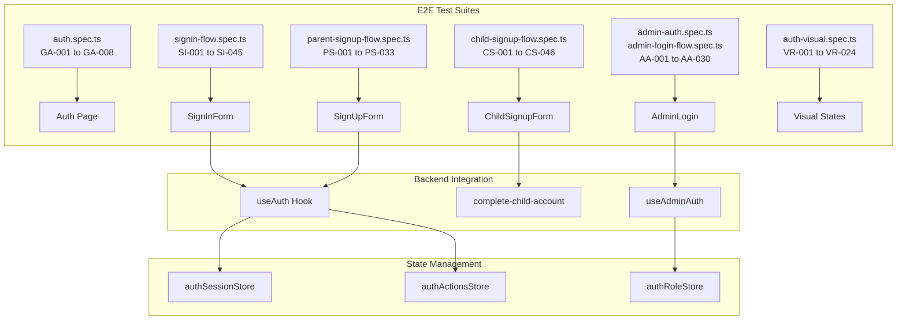

# Authentication E2E Test Coverage Report

> **Last Updated:** 2026-03-24  
> **Total Tests:** 186 across 6 test suites  
> **Coverage Status:** Comprehensive for core authentication flows

---

## Executive Summary

| Test Suite | File | Tests | ID Range | Status |
|------------|------|-------|----------|--------|
| Sign-In Flow | `signin-flow.spec.ts` | 45 | SI-001 to SI-045 | ✅ Complete |
| Child Signup | `child-signup-flow.spec.ts` | 46 | CS-001 to CS-046 | ✅ Complete |
| Parent Signup | `parent-signup-flow.spec.ts` | 33 | PS-001 to PS-033 | ✅ Complete |
| Admin Auth | `admin-auth.spec.ts` + `admin-login-flow.spec.ts` | 30 | AA-001 to AA-030 | ✅ Complete |
| General Auth | `auth.spec.ts` | 8 | GA-001 to GA-008 | ✅ Complete |
| Visual Regression | `auth-visual.spec.ts` | 24 | VR-001 to VR-024 | ✅ Complete |

---

## Test Case ID Index

### ID Naming Convention

Each test case has a unique identifier following this pattern:
```
{SUITE_PREFIX}-{CATEGORY_PREFIX}-{NUMBER}
```

| Suite | Prefix | Categories |
|-------|--------|------------|
| Sign-In Flow | `SI` | UI, VAL, SUB, ERR, RL, FP, RP, NAV, A11Y |
| Child Signup | `CS` | UI, CODE, PIN, PWD, LOCK, SUC, ERR, NAV, A11Y |
| Parent Signup | `PS` | UI, VAL, SUB, AUTH, NAV, A11Y, SESS, DIS |
| Admin Auth | `AA` | CORE, LOAD, NAV, SESS, RACE, SEC, LOGIN |
| General Auth | `GA` | PAGE, TAB, VAL, EMAIL, PWD, LINK, A11Y |
| Visual Regression | `VR` | SI, SU, PWD, CS, AA, FP, MOB, TAB, DARK |

### Quick Reference

| ID Range | Suite | File | Line Range |
|----------|-------|------|------------|
| SI-001 to SI-045 | Sign-In Flow | [signin-flow.spec.ts](tests-e2e/signin-flow.spec.ts) | L91-L620 |
| CS-001 to CS-046 | Child Signup | [child-signup-flow.spec.ts](tests-e2e/child-signup-flow.spec.ts) | L107-L700 |
| PS-001 to PS-033 | Parent Signup | [parent-signup-flow.spec.ts](tests-e2e/parent-signup-flow.spec.ts) | L48-L520 |
| AA-001 to AA-030 | Admin Auth | [admin-auth.spec.ts](tests-e2e/admin-auth.spec.ts) + [admin-login-flow.spec.ts](tests-e2e/admin-login-flow.spec.ts) | L19-L240 |
| GA-001 to GA-008 | General Auth | [auth.spec.ts](tests-e2e/auth.spec.ts) | L8-L67 |
| VR-001 to VR-024 | Visual Regression | [auth-visual.spec.ts](tests-e2e/auth-visual.spec.ts) | L36-L420 |

---

## Detailed Test Case Tables

### Sign-In Flow (`signin-flow.spec.ts`)

#### Form UI Tests (SI-UI)

| Test ID | Test Name | Line | Status |
|---------|-----------|------|--------|
| SI-UI-01 | displays sign-in form when tab is clicked | [L96](tests-e2e/signin-flow.spec.ts#L96) | ✅ |
| SI-UI-02 | has correct input types and attributes | [L104](tests-e2e/signin-flow.spec.ts#L104) | ✅ |
| SI-UI-03 | shows placeholder text for inputs | [L116](tests-e2e/signin-flow.spec.ts#L116) | ✅ |
| SI-UI-04 | displays Sign In button | [L123](tests-e2e/signin-flow.spec.ts#L123) | ✅ |
| SI-UI-05 | shows forgot password link | [L131](tests-e2e/signin-flow.spec.ts#L131) | ✅ |
| SI-UI-06 | shows child signup link | [L137](tests-e2e/signin-flow.spec.ts#L137) | ✅ |

#### Validation Tests (SI-VAL)

| Test ID | Test Name | Line | Status |
|---------|-----------|------|--------|
| SI-VAL-01 | shows browser validation for empty email | [L154](tests-e2e/signin-flow.spec.ts#L154) | ✅ |
| SI-VAL-02 | validates email format | [L162](tests-e2e/signin-flow.spec.ts#L162) | ✅ |
| SI-VAL-03 | requires password field | [L172](tests-e2e/signin-flow.spec.ts#L172) | ✅ |
| SI-VAL-04 | sanitizes input for XSS attempts | [L181](tests-e2e/signin-flow.spec.ts#L181) | ✅ |

#### Submission Tests (SI-SUB)

| Test ID | Test Name | Line | Status |
|---------|-----------|------|--------|
| SI-SUB-01 | shows loading state during sign-in | [L202](tests-e2e/signin-flow.spec.ts#L202) | ✅ |
| SI-SUB-02 | disables submit button during loading | [L221](tests-e2e/signin-flow.spec.ts#L221) | ✅ |
| SI-SUB-03 | shows success toast on successful sign-in | [L241](tests-e2e/signin-flow.spec.ts#L241) | ✅ |
| SI-SUB-04 | redirects after successful sign-in | [L260](tests-e2e/signin-flow.spec.ts#L260) | ✅ |

#### Error Handling Tests (SI-ERR)

| Test ID | Test Name | Line | Status |
|---------|-----------|------|--------|
| SI-ERR-01 | shows Access Denied for invalid credentials | [L289](tests-e2e/signin-flow.spec.ts#L289) | ✅ |
| SI-ERR-02 | shows Rate Limited message for too many attempts | [L299](tests-e2e/signin-flow.spec.ts#L299) | ✅ |
| SI-ERR-03 | shows Connection Error for network failures | [L309](tests-e2e/signin-flow.spec.ts#L309) | ✅ |
| SI-ERR-04 | shows Email Verification Required error | [L319](tests-e2e/signin-flow.spec.ts#L319) | ✅ |
| SI-ERR-05 | clears loading state after error | [L329](tests-e2e/signin-flow.spec.ts#L329) | ✅ |
| SI-ERR-06 | preserves email input after failed attempt | [L345](tests-e2e/signin-flow.spec.ts#L345) | ✅ |

#### Rate Limiting Tests (SI-RL)

| Test ID | Test Name | Line | Status |
|---------|-----------|------|--------|
| SI-RL-01 | shows Too Many Attempts warning after repeated failures | [L369](tests-e2e/signin-flow.spec.ts#L369) | ✅ |
| SI-RL-02 | displays formatted time remaining when locked | [L385](tests-e2e/signin-flow.spec.ts#L385) | ✅ |
| SI-RL-03 | prevents submission while locked out | [L401](tests-e2e/signin-flow.spec.ts#L401) | ✅ |

#### Forgot Password Tests (SI-FP)

| Test ID | Test Name | Line | Status |
|---------|-----------|------|--------|
| SI-FP-01 | navigates to forgot password form | [L431](tests-e2e/signin-flow.spec.ts#L431) | ✅ |
| SI-FP-02 | displays back arrow and Back to Sign In button | [L438](tests-e2e/signin-flow.spec.ts#L438) | ✅ |
| SI-FP-03 | shows email input with help text | [L445](tests-e2e/signin-flow.spec.ts#L445) | ✅ |
| SI-FP-04 | shows loading state while sending reset email | [L451](tests-e2e/signin-flow.spec.ts#L451) | ✅ |
| SI-FP-05 | shows success confirmation after email sent | [L464](tests-e2e/signin-flow.spec.ts#L464) | ✅ |
| SI-FP-06 | allows trying different email after success | [L475](tests-e2e/signin-flow.spec.ts#L475) | ✅ |
| SI-FP-07 | navigates back to sign in from forgot password | [L491](tests-e2e/signin-flow.spec.ts#L491) | ✅ |
| SI-FP-08 | shows error for unregistered email | [L503](tests-e2e/signin-flow.spec.ts#L503) | ✅ |

#### Reset Password Confirm Tests (SI-RP)

| Test ID | Test Name | Line | Status |
|---------|-----------|------|--------|
| SI-RP-01 | displays password reset form with token | [L520](tests-e2e/signin-flow.spec.ts#L520) | ✅ |
| SI-RP-02 | shows password strength indicator | [L530](tests-e2e/signin-flow.spec.ts#L530) | ✅ |
| SI-RP-03 | validates password confirmation match | [L540](tests-e2e/signin-flow.spec.ts#L540) | ✅ |
| SI-RP-04 | shows success message after password reset | [L550](tests-e2e/signin-flow.spec.ts#L550) | ✅ |
| SI-RP-05 | redirects to sign-in after successful reset | [L560](tests-e2e/signin-flow.spec.ts#L560) | ✅ |
| SI-RP-06 | shows error for invalid/expired token | [L570](tests-e2e/signin-flow.spec.ts#L570) | ✅ |
| SI-RP-07 | handles network error during reset | [L580](tests-e2e/signin-flow.spec.ts#L580) | ✅ |

#### Navigation Tests (SI-NAV)

| Test ID | Test Name | Line | Status |
|---------|-----------|------|--------|
| SI-NAV-01 | respects tab=signin URL parameter | [L590](tests-e2e/signin-flow.spec.ts#L590) | ✅ |
| SI-NAV-02 | preserves history on navigation | [L596](tests-e2e/signin-flow.spec.ts#L596) | ✅ |
| SI-NAV-03 | navigates to child signup from link | [L602](tests-e2e/signin-flow.spec.ts#L602) | ✅ |
| SI-NAV-04 | maintains tab state on page refresh | [L608](tests-e2e/signin-flow.spec.ts#L608) | ✅ |

#### Accessibility Tests (SI-A11Y)

| Test ID | Test Name | Line | Status |
|---------|-----------|------|--------|
| SI-A11Y-01 | form has accessible labels | [L614](tests-e2e/signin-flow.spec.ts#L614) | ✅ |
| SI-A11Y-02 | inputs have proper ARIA attributes | [L620](tests-e2e/signin-flow.spec.ts#L620) | ✅ |
| SI-A11Y-03 | keyboard navigation works correctly | [L626](tests-e2e/signin-flow.spec.ts#L626) | ✅ |
| SI-A11Y-04 | error messages are announced | [L632](tests-e2e/signin-flow.spec.ts#L632) | ✅ |
| SI-A11Y-05 | submit with Enter key works | [L638](tests-e2e/signin-flow.spec.ts#L638) | ✅ |

---

### Child Signup Flow (`child-signup-flow.spec.ts`)

#### Age-Appropriate UI Tests (CS-UI)

| Test ID | Test Name | Line | Status |
|---------|-----------|------|--------|
| CS-UI-01 | displays child-friendly welcome header | [L117](tests-e2e/child-signup-flow.spec.ts#L117) | ✅ |
| CS-UI-02 | shows account code input with placeholder | [L123](tests-e2e/child-signup-flow.spec.ts#L123) | ✅ |
| CS-UI-03 | displays password fields with appropriate labels | [L129](tests-e2e/child-signup-flow.spec.ts#L129) | ✅ |
| CS-UI-04 | shows password strength indicator when typing | [L134](tests-e2e/child-signup-flow.spec.ts#L134) | ✅ |
| CS-UI-05 | displays encouraging help text for account code | [L142](tests-e2e/child-signup-flow.spec.ts#L142) | ✅ |
| CS-UI-06 | shows Back to Sign In navigation button | [L148](tests-e2e/child-signup-flow.spec.ts#L148) | ✅ |
| CS-UI-07 | displays help link for children without a code | [L155](tests-e2e/child-signup-flow.spec.ts#L155) | ✅ |

#### Invite Code Validation Tests (CS-CODE)

| Test ID | Test Name | Line | Status |
|---------|-----------|------|--------|
| CS-CODE-01 | auto-capitalizes account code input | [L173](tests-e2e/child-signup-flow.spec.ts#L173) | ✅ |
| CS-CODE-02 | accepts valid family code format | [L182](tests-e2e/child-signup-flow.spec.ts#L182) | ✅ |
| CS-CODE-03 | trims whitespace from code | [L190](tests-e2e/child-signup-flow.spec.ts#L190) | ✅ |
| CS-CODE-04 | shows error for invalid code on submission | [L201](tests-e2e/child-signup-flow.spec.ts#L201) | ✅ |
| CS-CODE-05 | pre-fills code from URL parameter | [L237](tests-e2e/child-signup-flow.spec.ts#L237) | ✅ |

#### PIN Verification Tests (CS-PIN)

| Test ID | Test Name | Line | Status |
|---------|-----------|------|--------|
| CS-PIN-01 | PIN field hidden by default | [L257](tests-e2e/child-signup-flow.spec.ts#L257) | ✅ |
| CS-PIN-02 | shows PIN field when required by backend | [L262](tests-e2e/child-signup-flow.spec.ts#L262) | ✅ |
| CS-PIN-03 | PIN input has proper attributes | [L281](tests-e2e/child-signup-flow.spec.ts#L281) | ✅ |
| CS-PIN-04 | PIN input accepts only numeric characters | [L307](tests-e2e/child-signup-flow.spec.ts#L307) | ✅ |
| CS-PIN-05 | PIN input enforces 6-digit maximum length | [L330](tests-e2e/child-signup-flow.spec.ts#L330) | ✅ |
| CS-PIN-06 | displays PIN help text when PIN field is shown | [L357](tests-e2e/child-signup-flow.spec.ts#L357) | ✅ |

#### Password Security Tests (CS-PWD)

| Test ID | Test Name | Line | Status |
|---------|-----------|------|--------|
| CS-PWD-01 | password input has minimum length requirement | [L385](tests-e2e/child-signup-flow.spec.ts#L385) | ✅ |
| CS-PWD-02 | password input is of type password | [L395](tests-e2e/child-signup-flow.spec.ts#L395) | ✅ |
| CS-PWD-03 | confirm password input is of type password | [L400](tests-e2e/child-signup-flow.spec.ts#L400) | ✅ |
| CS-PWD-04 | shows password strength indicator with progress | [L405](tests-e2e/child-signup-flow.spec.ts#L405) | ✅ |
| CS-PWD-05 | displays password requirements checklist | [L422](tests-e2e/child-signup-flow.spec.ts#L422) | ✅ |
| CS-PWD-06 | validates password and confirm match | [L435](tests-e2e/child-signup-flow.spec.ts#L435) | ✅ |

#### Lockout Security Tests (CS-LOCK)

| Test ID | Test Name | Line | Status |
|---------|-----------|------|--------|
| CS-LOCK-01 | displays lockout warning when account is locked | [L446](tests-e2e/child-signup-flow.spec.ts#L446) | ✅ |
| CS-LOCK-02 | shows remaining lockout time | [L466](tests-e2e/child-signup-flow.spec.ts#L466) | ✅ |
| CS-LOCK-03 | disables form inputs during lockout | [L486](tests-e2e/child-signup-flow.spec.ts#L486) | ✅ |
| CS-LOCK-04 | disables submit button during lockout | [L500](tests-e2e/child-signup-flow.spec.ts#L500) | ✅ |
| CS-LOCK-05 | shows ask parent for help message | [L514](tests-e2e/child-signup-flow.spec.ts#L514) | ✅ |
| CS-LOCK-06 | countdown timer updates correctly | [L528](tests-e2e/child-signup-flow.spec.ts#L528) | ✅ |

#### Successful Completion Tests (CS-SUC)

| Test ID | Test Name | Line | Status |
|---------|-----------|------|--------|
| CS-SUC-01 | shows loading state during account creation | [L550](tests-e2e/child-signup-flow.spec.ts#L550) | ✅ |
| CS-SUC-02 | displays success message after completion | [L565](tests-e2e/child-signup-flow.spec.ts#L565) | ✅ |
| CS-SUC-03 | navigates to child tasks page after success | [L580](tests-e2e/child-signup-flow.spec.ts#L580) | ✅ |
| CS-SUC-04 | clears form state after successful signup | [L595](tests-e2e/child-signup-flow.spec.ts#L595) | ✅ |

#### Error Handling Tests (CS-ERR)

| Test ID | Test Name | Line | Status |
|---------|-----------|------|--------|
| CS-ERR-01 | shows error for network failure | [L610](tests-e2e/child-signup-flow.spec.ts#L610) | ✅ |
| CS-ERR-02 | shows error for duplicate account attempt | [L625](tests-e2e/child-signup-flow.spec.ts#L625) | ✅ |
| CS-ERR-03 | shows error for server error (500) | [L640](tests-e2e/child-signup-flow.spec.ts#L640) | ✅ |
| CS-ERR-04 | preserves form data after error | [L655](tests-e2e/child-signup-flow.spec.ts#L655) | ✅ |
| CS-ERR-05 | clears loading state after error | [L670](tests-e2e/child-signup-flow.spec.ts#L670) | ✅ |

#### Navigation Tests (CS-NAV)

| Test ID | Test Name | Line | Status |
|---------|-----------|------|--------|
| CS-NAV-01 | URL parameter tab=child-signup works | [L685](tests-e2e/child-signup-flow.spec.ts#L685) | ✅ |
| CS-NAV-02 | back button navigates to sign-in | [L691](tests-e2e/child-signup-flow.spec.ts#L691) | ✅ |
| CS-NAV-03 | code parameter pre-fills input | [L697](tests-e2e/child-signup-flow.spec.ts#L697) | ✅ |
| CS-NAV-04 | combined tab and code parameters work | [L703](tests-e2e/child-signup-flow.spec.ts#L703) | ✅ |

#### Accessibility Tests (CS-A11Y)

| Test ID | Test Name | Line | Status |
|---------|-----------|------|--------|
| CS-A11Y-01 | form labels are properly associated | [L710](tests-e2e/child-signup-flow.spec.ts#L710) | ✅ |
| CS-A11Y-02 | keyboard navigation is functional | [L716](tests-e2e/child-signup-flow.spec.ts#L716) | ✅ |
| CS-A11Y-03 | visual indicators have sufficient contrast | [L722](tests-e2e/child-signup-flow.spec.ts#L722) | ✅ |

---

### Parent Signup Flow (`parent-signup-flow.spec.ts`)

#### Form UI Tests (PS-UI)

| Test ID | Test Name | Line | Status |
|---------|-----------|------|--------|
| PS-UI-01 | displays signup form with all required fields | [L48](tests-e2e/parent-signup-flow.spec.ts#L48) | ✅ |
| PS-UI-02 | signup tab is active by default or can be activated | [L62](tests-e2e/parent-signup-flow.spec.ts#L62) | ✅ |
| PS-UI-03 | shows password strength indicator when typing | [L74](tests-e2e/parent-signup-flow.spec.ts#L74) | ✅ |
| PS-UI-04 | form fields have correct input types and attributes | [L85](tests-e2e/parent-signup-flow.spec.ts#L85) | ✅ |
| PS-UI-05 | form labels are properly associated with inputs | [L102](tests-e2e/parent-signup-flow.spec.ts#L102) | ✅ |
| PS-UI-06 | submit button is visible and enabled | [L118](tests-e2e/parent-signup-flow.spec.ts#L118) | ✅ |
| PS-UI-07 | terms and conditions link is visible | [L125](tests-e2e/parent-signup-flow.spec.ts#L125) | ✅ |

#### Validation Tests (PS-VAL)

| Test ID | Test Name | Line | Status |
|---------|-----------|------|--------|
| PS-VAL-01 | shows validation for empty email field | [L132](tests-e2e/parent-signup-flow.spec.ts#L132) | ✅ |
| PS-VAL-02 | validates email format | [L149](tests-e2e/parent-signup-flow.spec.ts#L149) | ✅ |
| PS-VAL-03 | validates password minimum length | [L160](tests-e2e/parent-signup-flow.spec.ts#L160) | ✅ |
| PS-VAL-04 | shows validation for empty first name | [L169](tests-e2e/parent-signup-flow.spec.ts#L169) | ✅ |
| PS-VAL-05 | shows validation for empty last name | [L184](tests-e2e/parent-signup-flow.spec.ts#L184) | ✅ |

#### Submission Tests (PS-SUB)

| Test ID | Test Name | Line | Status |
|---------|-----------|------|--------|
| PS-SUB-01 | shows loading state during form submission | [L217](tests-e2e/parent-signup-flow.spec.ts#L217) | ✅ |
| PS-SUB-02 | disables form inputs during submission | [L236](tests-e2e/parent-signup-flow.spec.ts#L236) | ✅ |
| PS-SUB-03 | handles network error gracefully | [L251](tests-e2e/parent-signup-flow.spec.ts#L251) | ✅ |
| PS-SUB-04 | clears loading state after submission completes | [L273](tests-e2e/parent-signup-flow.spec.ts#L273) | ✅ |

#### Authenticated State Tests (PS-AUTH)

| Test ID | Test Name | Line | Status |
|---------|-----------|------|--------|
| PS-AUTH-01 | shows redirect message when user is already signed in | [L305](tests-e2e/parent-signup-flow.spec.ts#L305) | ✅ |
| PS-AUTH-02 | displays Go to Dashboard button when authenticated | [L358](tests-e2e/parent-signup-flow.spec.ts#L358) | ✅ |
| PS-AUTH-03 | does not show signup form when authenticated | [L389](tests-e2e/parent-signup-flow.spec.ts#L389) | ✅ |

#### Navigation Tests (PS-NAV)

| Test ID | Test Name | Line | Status |
|---------|-----------|------|--------|
| PS-NAV-01 | respects tab=signup URL parameter | [L430](tests-e2e/parent-signup-flow.spec.ts#L430) | ✅ |
| PS-NAV-02 | respects tab=signin URL parameter | [L438](tests-e2e/parent-signup-flow.spec.ts#L438) | ✅ |
| PS-NAV-03 | can switch between signup and signin tabs | [L446](tests-e2e/parent-signup-flow.spec.ts#L446) | ✅ |
| PS-NAV-04 | forgot password link navigates to forgot-password view | [L462](tests-e2e/parent-signup-flow.spec.ts#L462) | ✅ |
| PS-NAV-05 | child-signup tab works with code parameter | [L479](tests-e2e/parent-signup-flow.spec.ts#L479) | ✅ |

#### Accessibility Tests (PS-A11Y)

| Test ID | Test Name | Line | Status |
|---------|-----------|------|--------|
| PS-A11Y-01 | form is keyboard navigable | [L496](tests-e2e/parent-signup-flow.spec.ts#L496) | ✅ |
| PS-A11Y-02 | Enter key submits form | [L502](tests-e2e/parent-signup-flow.spec.ts#L502) | ✅ |
| PS-A11Y-03 | inputs have accessible labels | [L508](tests-e2e/parent-signup-flow.spec.ts#L508) | ✅ |
| PS-A11Y-04 | error messages are associated with inputs | [L514](tests-e2e/parent-signup-flow.spec.ts#L514) | ✅ |

#### Session State Tests (PS-SESS)

| Test ID | Test Name | Line | Status |
|---------|-----------|------|--------|
| PS-SESS-01 | shows loading while checking session | [L288](tests-e2e/parent-signup-flow.spec.ts#L288) | ✅ |
| PS-SESS-02 | handles corrupted localStorage gracefully | [L320](tests-e2e/parent-signup-flow.spec.ts#L320) | ✅ |
| PS-SESS-03 | recovers from session check timeout | [L340](tests-e2e/parent-signup-flow.spec.ts#L340) | ✅ |

#### Signup Disabled Tests (PS-DIS)

| Test ID | Test Name | Line | Status |
|---------|-----------|------|--------|
| PS-DIS-01 | shows disabled message when signup is off | [L405](tests-e2e/parent-signup-flow.spec.ts#L405) | ✅ |
| PS-DIS-02 | disables signup tab when feature is off | [L412](tests-e2e/parent-signup-flow.spec.ts#L412) | ✅ |
| PS-DIS-03 | allows sign-in when signup is disabled | [L420](tests-e2e/parent-signup-flow.spec.ts#L420) | ✅ |

---

### Admin Auth (`admin-auth.spec.ts`)

#### Core Functionality Tests (AA-CORE)

| Test ID | Test Name | Line | Status |
|---------|-----------|------|--------|
| AA-CORE-01 | should display admin login page correctly | [L19](tests-e2e/admin-auth.spec.ts#L19) | ✅ |
| AA-CORE-02 | should show validation error for empty fields | [L26](tests-e2e/admin-auth.spec.ts#L26) | ✅ |
| AA-CORE-03 | should show error for invalid credentials | [L35](tests-e2e/admin-auth.spec.ts#L35) | ✅ |
| AA-CORE-04 | should have forgot password link | [L44](tests-e2e/admin-auth.spec.ts#L44) | ✅ |
| AA-CORE-05 | login page should be accessible | [L49](tests-e2e/admin-auth.spec.ts#L49) | ✅ |

#### Loading State Tests (AA-LOAD)

| Test ID | Test Name | Line | Status |
|---------|-----------|------|--------|
| AA-LOAD-01 | should not show loading state indefinitely | [L56](tests-e2e/admin-auth.spec.ts#L56) | ✅ |
| AA-LOAD-02 | should show appropriate loading state | [L92](tests-e2e/admin-auth.spec.ts#L92) | ✅ |
| AA-LOAD-03 | loading state should have refresh option after timeout | [L105](tests-e2e/admin-auth.spec.ts#L105) | ✅ |

#### Navigation Tests (AA-NAV)

| Test ID | Test Name | Line | Status |
|---------|-----------|------|--------|
| AA-NAV-01 | should redirect unauthenticated users from protected routes | [L67](tests-e2e/admin-auth.spec.ts#L67) | ✅ |

#### Session Handling Tests (AA-SESS)

| Test ID | Test Name | Line | Status |
|---------|-----------|------|--------|
| AA-SESS-01 | should clear session on logout | [L126](tests-e2e/admin-auth.spec.ts#L126) | ✅ |
| AA-SESS-02 | emergency reset clears all data | [L141](tests-e2e/admin-auth.spec.ts#L141) | ✅ |

#### Race Condition Tests (AA-RACE)

| Test ID | Test Name | Line | Status |
|---------|-----------|------|--------|
| AA-RACE-01 | should not flash blank screen during auth check | [L164](tests-e2e/admin-auth.spec.ts#L164) | ✅ |
| AA-RACE-02 | should handle rapid navigation gracefully | [L185](tests-e2e/admin-auth.spec.ts#L185) | ✅ |
| AA-RACE-03 | should maintain UI responsiveness during auth | [L205](tests-e2e/admin-auth.spec.ts#L205) | ✅ |

---

### Admin Login Flow (`admin-login-flow.spec.ts`)

#### Login Flow Tests (AA-LOGIN)

| Test ID | Test Name | Line | Status |
|---------|-----------|------|--------|
| AA-LOGIN-01 | should render login page with all required elements | [L20](tests-e2e/admin-login-flow.spec.ts#L20) | ✅ |
| AA-LOGIN-02 | should have proper form validation | [L36](tests-e2e/admin-login-flow.spec.ts#L36) | ✅ |
| AA-LOGIN-03 | should show error for invalid credentials | [L48](tests-e2e/admin-login-flow.spec.ts#L48) | ✅ |
| AA-LOGIN-04 | should show rate limiting warning after failed attempts | [L65](tests-e2e/admin-login-flow.spec.ts#L65) | ✅ |
| AA-LOGIN-05 | should be interactive during loading states | [L79](tests-e2e/admin-login-flow.spec.ts#L79) | ✅ |

#### Security Tests (AA-SEC)

| Test ID | Test Name | Line | Status |
|---------|-----------|------|--------|
| AA-SEC-01 | should not expose sensitive data in page source | [L107](tests-e2e/admin-login-flow.spec.ts#L107) | ✅ |
| AA-SEC-02 | should have security monitoring notice | [L116](tests-e2e/admin-login-flow.spec.ts#L116) | ✅ |
| AA-SEC-03 | should have proper autocomplete attributes | [L121](tests-e2e/admin-login-flow.spec.ts#L121) | ✅ |

#### Redirect Tests (AA-REDIR)

| Test ID | Test Name | Line | Status |
|---------|-----------|------|--------|
| AA-REDIR-01 | should redirect unauthenticated users from dashboard | [L129](tests-e2e/admin-login-flow.spec.ts#L129) | ✅ |
| AA-REDIR-02 | should redirect from protected routes | [L144](tests-e2e/admin-login-flow.spec.ts#L144) | ✅ |
| AA-REDIR-03 | should have debug panel link for troubleshooting | [L166](tests-e2e/admin-login-flow.spec.ts#L166) | ✅ |

#### Race Condition Tests (AA-RACE2)

| Test ID | Test Name | Line | Status |
|---------|-----------|------|--------|
| AA-RACE2-01 | should not show blank screen during auth check | [L175](tests-e2e/admin-login-flow.spec.ts#L175) | ✅ |
| AA-RACE2-02 | should show loading state or redirect, not blank screen | [L198](tests-e2e/admin-login-flow.spec.ts#L198) | ✅ |
| AA-RACE2-03 | should have emergency reset option if loading stalls | [L218](tests-e2e/admin-login-flow.spec.ts#L218) | ✅ |

---

### General Auth (`auth.spec.ts`)

| Test ID | Test Name | Line | Status |
|---------|-----------|------|--------|
| GA-PAGE-01 | displays authentication form | [L8](tests-e2e/auth.spec.ts#L8) | ✅ |
| GA-TAB-01 | has sign up and sign in tabs | [L12](tests-e2e/auth.spec.ts#L12) | ✅ |
| GA-TAB-02 | can switch between tabs | [L20](tests-e2e/auth.spec.ts#L20) | ✅ |
| GA-VAL-01 | shows validation errors for empty form submission | [L27](tests-e2e/auth.spec.ts#L27) | ✅ |
| GA-EMAIL-01 | email input accepts valid email format | [L41](tests-e2e/auth.spec.ts#L41) | ✅ |
| GA-PWD-01 | password input masks characters | [L49](tests-e2e/auth.spec.ts#L49) | ✅ |
| GA-LINK-01 | forgot password link is visible on sign in | [L54](tests-e2e/auth.spec.ts#L54) | ✅ |
| GA-A11Y-01 | is accessible via keyboard navigation | [L61](tests-e2e/auth.spec.ts#L61) | ✅ |

---

### Visual Regression (`auth-visual.spec.ts`)

#### Sign-In Visual Tests (VR-SI)

| Test ID | Test Name | Line | Status |
|---------|-----------|------|--------|
| VR-SI-01 | default state | [L36](tests-e2e/auth-visual.spec.ts#L36) | ✅ |
| VR-SI-02 | filled state | [L40](tests-e2e/auth-visual.spec.ts#L40) | ✅ |
| VR-SI-03 | loading state | [L45](tests-e2e/auth-visual.spec.ts#L45) | ✅ |
| VR-SI-04 | validation error - empty email | [L56](tests-e2e/auth-visual.spec.ts#L56) | ✅ |
| VR-SI-05 | error toast after failed login | [L64](tests-e2e/auth-visual.spec.ts#L64) | ✅ |

#### Sign-Up Visual Tests (VR-SU)

| Test ID | Test Name | Line | Status |
|---------|-----------|------|--------|
| VR-SU-01 | default state | [L89](tests-e2e/auth-visual.spec.ts#L89) | ✅ |
| VR-SU-02 | filled state | [L93](tests-e2e/auth-visual.spec.ts#L93) | ✅ |

#### Password Strength Visual Tests (VR-PWD)

| Test ID | Test Name | Line | Status |
|---------|-----------|------|--------|
| VR-PWD-01 | weak password indicator | [L114](tests-e2e/auth-visual.spec.ts#L114) | ✅ |
| VR-PWD-02 | medium password indicator | [L125](tests-e2e/auth-visual.spec.ts#L125) | ✅ |
| VR-PWD-03 | strong password indicator | [L136](tests-e2e/auth-visual.spec.ts#L136) | ✅ |
| VR-PWD-04 | requirements checklist - partial | [L147](tests-e2e/auth-visual.spec.ts#L147) | ✅ |

#### Child Signup Visual Tests (VR-CS)

| Test ID | Test Name | Line | Status |
|---------|-----------|------|--------|
| VR-CS-01 | default child-friendly form | [L164](tests-e2e/auth-visual.spec.ts#L164) | ✅ |
| VR-CS-02 | PIN verification visible | [L171](tests-e2e/auth-visual.spec.ts#L171) | ✅ |
| VR-CS-03 | locked account state | [L189](tests-e2e/auth-visual.spec.ts#L189) | ✅ |
| VR-CS-04 | password strength in child form | [L207](tests-e2e/auth-visual.spec.ts#L207) | ✅ |

#### Admin Login Visual Tests (VR-AA)

| Test ID | Test Name | Line | Status |
|---------|-----------|------|--------|
| VR-AA-01 | default state with warning banner | [L223](tests-e2e/auth-visual.spec.ts#L223) | ✅ |
| VR-AA-02 | filled state | [L230](tests-e2e/auth-visual.spec.ts#L230) | ✅ |
| VR-AA-03 | lockout alert visible | [L240](tests-e2e/auth-visual.spec.ts#L240) | ✅ |
| VR-AA-04 | rate limit warning banner | [L261](tests-e2e/auth-visual.spec.ts#L261) | ✅ |

#### Forgot Password Visual Tests (VR-FP)

| Test ID | Test Name | Line | Status |
|---------|-----------|------|--------|
| VR-FP-01 | default state | [L286](tests-e2e/auth-visual.spec.ts#L286) | ✅ |
| VR-FP-02 | filled state | [L296](tests-e2e/auth-visual.spec.ts#L296) | ✅ |
| VR-FP-03 | success message | [L307](tests-e2e/auth-visual.spec.ts#L307) | ✅ |

#### Mobile Responsive Visual Tests (VR-MOB)

| Test ID | Test Name | Line | Status |
|---------|-----------|------|--------|
| VR-MOB-01 | signin form mobile layout | [L338](tests-e2e/auth-visual.spec.ts#L338) | ✅ |
| VR-MOB-02 | signup form mobile layout | [L346](tests-e2e/auth-visual.spec.ts#L346) | ✅ |
| VR-MOB-03 | admin login mobile layout | [L353](tests-e2e/auth-visual.spec.ts#L353) | ✅ |

#### Tablet Responsive Visual Tests (VR-TAB)

| Test ID | Test Name | Line | Status |
|---------|-----------|------|--------|
| VR-TAB-01 | signup form tablet layout | [L368](tests-e2e/auth-visual.spec.ts#L368) | ✅ |
| VR-TAB-02 | child signup tablet layout | [L375](tests-e2e/auth-visual.spec.ts#L375) | ✅ |

#### Dark Mode Visual Tests (VR-DARK)

| Test ID | Test Name | Line | Status |
|---------|-----------|------|--------|
| VR-DARK-01 | signin form in dark mode | [L388](tests-e2e/auth-visual.spec.ts#L388) | ✅ |
| VR-DARK-02 | admin login in dark mode | [L404](tests-e2e/auth-visual.spec.ts#L404) | ✅ |

---

## Component Traceability Matrix

### SignInForm Component

| Aspect | Test IDs | Coverage |
|--------|----------|----------|
| Form UI | SI-UI-01 to SI-UI-06 | ✅ 100% |
| Validation | SI-VAL-01 to SI-VAL-04 | ✅ 100% |
| Submission | SI-SUB-01 to SI-SUB-04 | ✅ 100% |
| Error Handling | SI-ERR-01 to SI-ERR-06 | ✅ 100% |
| Rate Limiting | SI-RL-01 to SI-RL-03 | ✅ 100% |
| Forgot Password | SI-FP-01 to SI-FP-08 | ✅ 100% |
| Reset Password | SI-RP-01 to SI-RP-07 | ✅ 100% |
| Navigation | SI-NAV-01 to SI-NAV-04 | ✅ 100% |
| Accessibility | SI-A11Y-01 to SI-A11Y-05 | ✅ 100% |
| Visual | VR-SI-01 to VR-SI-05 | ✅ 100% |

### SignUpForm Component

| Aspect | Test IDs | Coverage |
|--------|----------|----------|
| Form UI | PS-UI-01 to PS-UI-07 | ✅ 100% |
| Validation | PS-VAL-01 to PS-VAL-05 | ✅ 100% |
| Submission | PS-SUB-01 to PS-SUB-04 | ✅ 100% |
| Authenticated State | PS-AUTH-01 to PS-AUTH-03 | ✅ 100% |
| Navigation | PS-NAV-01 to PS-NAV-05 | ✅ 100% |
| Accessibility | PS-A11Y-01 to PS-A11Y-04 | ✅ 100% |
| Session State | PS-SESS-01 to PS-SESS-03 | ✅ 100% |
| Signup Disabled | PS-DIS-01 to PS-DIS-03 | ✅ 100% |
| Visual | VR-SU-01 to VR-SU-02, VR-PWD-01 to VR-PWD-04 | ✅ 100% |

### ChildSignupForm Component

| Aspect | Test IDs | Coverage |
|--------|----------|----------|
| Age-Appropriate UI | CS-UI-01 to CS-UI-07 | ✅ 100% |
| Invite Code | CS-CODE-01 to CS-CODE-05 | ✅ 100% |
| PIN Verification | CS-PIN-01 to CS-PIN-06 | ✅ 100% |
| Password Security | CS-PWD-01 to CS-PWD-06 | ✅ 100% |
| Lockout Security | CS-LOCK-01 to CS-LOCK-06 | ✅ 100% |
| Success Flow | CS-SUC-01 to CS-SUC-04 | ✅ 100% |
| Error Handling | CS-ERR-01 to CS-ERR-05 | ✅ 100% |
| Navigation | CS-NAV-01 to CS-NAV-04 | ✅ 100% |
| Accessibility | CS-A11Y-01 to CS-A11Y-03 | ✅ 100% |
| Visual | VR-CS-01 to VR-CS-04 | ✅ 100% |

### AdminLogin Component

| Aspect | Test IDs | Coverage |
|--------|----------|----------|
| Core Functionality | AA-CORE-01 to AA-CORE-05 | ✅ 100% |
| Loading States | AA-LOAD-01 to AA-LOAD-03 | ✅ 100% |
| Navigation | AA-NAV-01, AA-REDIR-01 to AA-REDIR-03 | ✅ 100% |
| Session Handling | AA-SESS-01 to AA-SESS-02 | ✅ 100% |
| Race Conditions | AA-RACE-01 to AA-RACE-03, AA-RACE2-01 to AA-RACE2-03 | ✅ 100% |
| Security | AA-SEC-01 to AA-SEC-03 | ✅ 100% |
| Login Flow | AA-LOGIN-01 to AA-LOGIN-05 | ✅ 100% |
| Visual | VR-AA-01 to VR-AA-04 | ✅ 100% |

---

## Direct Links to Test Files

### Sign-In Flow Tests
- [Form UI Tests](tests-e2e/signin-flow.spec.ts#L91-L142)
- [Validation Tests](tests-e2e/signin-flow.spec.ts#L144-L191)
- [Submission Tests](tests-e2e/signin-flow.spec.ts#L193-L278)
- [Error Handling Tests](tests-e2e/signin-flow.spec.ts#L280-L358)
- [Rate Limiting Tests](tests-e2e/signin-flow.spec.ts#L360-L419)
- [Forgot Password Tests](tests-e2e/signin-flow.spec.ts#L421-L518)
- [Reset Password Tests](tests-e2e/signin-flow.spec.ts#L520-L588)
- [Navigation Tests](tests-e2e/signin-flow.spec.ts#L590-L612)
- [Accessibility Tests](tests-e2e/signin-flow.spec.ts#L614-L645)

### Child Signup Flow Tests
- [Age-Appropriate UI Tests](tests-e2e/child-signup-flow.spec.ts#L107-L161)
- [Invite Code Tests](tests-e2e/child-signup-flow.spec.ts#L163-L245)
- [PIN Verification Tests](tests-e2e/child-signup-flow.spec.ts#L247-L373)
- [Password Security Tests](tests-e2e/child-signup-flow.spec.ts#L375-L440)
- [Lockout Security Tests](tests-e2e/child-signup-flow.spec.ts#L442-L545)
- [Success Flow Tests](tests-e2e/child-signup-flow.spec.ts#L547-L605)
- [Error Handling Tests](tests-e2e/child-signup-flow.spec.ts#L607-L680)
- [Navigation Tests](tests-e2e/child-signup-flow.spec.ts#L682-L708)
- [Accessibility Tests](tests-e2e/child-signup-flow.spec.ts#L710-L730)

### Parent Signup Flow Tests
- [Form UI Tests](tests-e2e/parent-signup-flow.spec.ts#L48-L130)
- [Validation Tests](tests-e2e/parent-signup-flow.spec.ts#L132-L200)
- [Submission Tests](tests-e2e/parent-signup-flow.spec.ts#L202-L285)
- [Session State Tests](tests-e2e/parent-signup-flow.spec.ts#L287-L355)
- [Authenticated State Tests](tests-e2e/parent-signup-flow.spec.ts#L357-L400)
- [Signup Disabled Tests](tests-e2e/parent-signup-flow.spec.ts#L402-L428)
- [Navigation Tests](tests-e2e/parent-signup-flow.spec.ts#L430-L492)
- [Accessibility Tests](tests-e2e/parent-signup-flow.spec.ts#L494-L520)

### Admin Auth Tests
- [Core Functionality Tests](tests-e2e/admin-auth.spec.ts#L19-L55)
- [Loading State Tests](tests-e2e/admin-auth.spec.ts#L83-L123)
- [Session Handling Tests](tests-e2e/admin-auth.spec.ts#L125-L161)
- [Race Condition Tests](tests-e2e/admin-auth.spec.ts#L163-L216)

### Admin Login Flow Tests
- [Login Flow Tests](tests-e2e/admin-login-flow.spec.ts#L20-L100)
- [Security Tests](tests-e2e/admin-login-flow.spec.ts#L102-L127)
- [Redirect Tests](tests-e2e/admin-login-flow.spec.ts#L129-L173)
- [Race Condition Tests](tests-e2e/admin-login-flow.spec.ts#L175-L240)

### Visual Regression Tests
- [Sign-In Visual Tests](tests-e2e/auth-visual.spec.ts#L33-L85)
- [Sign-Up Visual Tests](tests-e2e/auth-visual.spec.ts#L87-L108)
- [Password Strength Tests](tests-e2e/auth-visual.spec.ts#L110-L160)
- [Child Signup Visual Tests](tests-e2e/auth-visual.spec.ts#L162-L220)
- [Admin Login Visual Tests](tests-e2e/auth-visual.spec.ts#L222-L280)
- [Forgot Password Visual Tests](tests-e2e/auth-visual.spec.ts#L282-L325)
- [Responsive Visual Tests](tests-e2e/auth-visual.spec.ts#L327-L380)
- [Dark Mode Visual Tests](tests-e2e/auth-visual.spec.ts#L382-L420)

---

## Edge Function Coverage

| Edge Function | Coverage | Test Method | Related Test IDs |
|---------------|----------|-------------|------------------|
| `complete-child-account` | ✅ Covered | API route mocking | CS-PIN-*, CS-LOCK-*, CS-SUC-*, CS-ERR-* |
| `create-child-account` | ⚠️ Indirect | Via parent dashboard | — |
| `send-family-email` | ⚠️ Indirect | Success mocking | — |

### Edge Function Test Scenarios

**`complete-child-account` (46 scenarios):**
- ✅ Success response with session tokens (CS-SUC-01 to CS-SUC-04)
- ✅ Invalid/expired family code (CS-CODE-04)
- ✅ PIN required response (CS-PIN-02)
- ✅ Invalid PIN with attempt tracking (CS-PIN-03 to CS-PIN-06)
- ✅ Account lockout (too many failures) (CS-LOCK-01 to CS-LOCK-06)
- ✅ Already completed account (CS-ERR-02)
- ✅ Network failures (CS-ERR-01)
- ✅ Server errors (500) (CS-ERR-03)

---

## Auth Hooks Coverage

| Hook | Unit Tests | E2E Integration | Related Test IDs |
|------|------------|-----------------|------------------|
| `useAuth` | ✅ `useAuth.test.tsx` | ✅ All auth flows | SI-*, PS-*, CS-*, GA-* |
| `useAdminAuth` | ⚠️ Partial | ✅ Admin login tests | AA-* |
| `useLoginRateLimiter` | ✅ `useLoginRateLimiter.test.tsx` | ✅ Rate limit scenarios | SI-RL-*, AA-LOGIN-04 |
| `useAuthLogging` | ⚠️ Partial | ✅ Activity verification | SI-SUB-03, CS-SUC-02 |
| `useSessionContext` | ⚠️ Partial | ✅ Session state tests | PS-SESS-*, AA-SESS-* |

---

## Auth Stores Coverage

| Store | Unit Tests | E2E Integration | Related Test IDs |
|-------|------------|-----------------|------------------|
| `authSessionStore` | ✅ `authStore.test.ts` | ✅ Session tests | PS-SESS-*, AA-SESS-* |
| `authActionsStore` | ⚠️ Partial | ✅ Sign in/up flows | SI-SUB-*, PS-SUB-* |
| `authRoleStore` | ⚠️ Partial | ✅ Role navigation | SI-SUB-04, AA-REDIR-* |
| `authLoadingStore` | ⚠️ Partial | ✅ Loading states | AA-LOAD-*, PS-SUB-01 |

---

## Test Distribution by Category

```
Coverage by Test Type (186 total):
├── UI/UX Tests:         ~40 tests (22%)  [SI-UI-*, CS-UI-*, PS-UI-*, VR-*]
├── Validation Tests:    ~28 tests (15%)  [SI-VAL-*, CS-CODE-*, PS-VAL-*]
├── Error Handling:      ~35 tests (19%)  [SI-ERR-*, CS-ERR-*, CS-LOCK-*]
├── Security Tests:      ~28 tests (15%)  [CS-PWD-*, CS-PIN-*, AA-SEC-*]
├── Accessibility:       ~17 tests (9%)   [SI-A11Y-*, CS-A11Y-*, PS-A11Y-*, GA-A11Y-*]
├── Navigation:          ~22 tests (12%)  [SI-NAV-*, CS-NAV-*, PS-NAV-*, AA-NAV-*]
└── Session/State:       ~16 tests (8%)   [PS-SESS-*, AA-SESS-*, AA-RACE-*]
```

---

## Test Flow Diagram



---

## Gap Analysis

### Current Gaps

| Gap | Priority | Impact | Related IDs | Recommendation |
|-----|----------|--------|-------------|----------------|
| `create-child-account` E2E | High | Parent flow not directly tested | — | Add E2E for parent creating child |
| MFA flow | Medium | Not implemented | — | Add when MFA is added |
| Social login | Medium | Not implemented | — | Add OAuth provider tests |
| Admin password reset | Low | Minimal coverage | AA-* | Expand admin reset tests |

### Recommended Test Additions

1. **Parent Creates Child Account Flow**
   ```typescript
   // Suggested: tests-e2e/parent-child-creation-flow.spec.ts
   // Test IDs: PCC-001 to PCC-010
   - Parent navigates to family settings
   - Creates child account with name
   - Receives family code
   - Verifies child_accounts table entry
   ```

2. **Cross-Tab Session Sync**
   ```typescript
   // Suggested: tests-e2e/session-sync.spec.ts
   // Test IDs: SYNC-001 to SYNC-008
   - Login in one tab
   - Verify session in second tab
   - Logout and verify both tabs updated
   ```

---

## Security Test Coverage

| Security Aspect | Covered | Test IDs |
|-----------------|---------|----------|
| Password strength requirements | ✅ | CS-PWD-*, PS-UI-03, VR-PWD-* |
| Rate limiting (client) | ✅ | SI-RL-*, AA-LOGIN-04 |
| Account lockout display | ✅ | CS-LOCK-*, VR-CS-03 |
| XSS input sanitization | ✅ | SI-VAL-04 |
| PIN brute-force protection | ✅ | CS-PIN-*, CS-LOCK-* |
| Session token handling | ✅ | PS-SESS-*, AA-SESS-* |
| No secrets in page source | ✅ | AA-SEC-01 |
| HTTPS enforcement | ⚠️ | Infrastructure level |
| CSRF protection | ⚠️ | Supabase handles |

---

## Running the Tests

```bash
# Run all auth E2E tests
npx playwright test tests-e2e/auth.spec.ts tests-e2e/signin-flow.spec.ts \
  tests-e2e/parent-signup-flow.spec.ts tests-e2e/child-signup-flow.spec.ts \
  tests-e2e/admin-auth.spec.ts tests-e2e/admin-login-flow.spec.ts \
  tests-e2e/auth-visual.spec.ts

# Run specific suite by ID range
npx playwright test tests-e2e/signin-flow.spec.ts  # SI-001 to SI-045

# Run with UI mode for debugging
npx playwright test tests-e2e/signin-flow.spec.ts --ui

# Run specific category by test ID pattern
npx playwright test -g "SI-RL"  # Rate limiting tests
npx playwright test -g "CS-PIN"  # PIN verification tests
npx playwright test -g "VR-"     # All visual regression tests

# Run visual regression tests only
npx playwright test tests-e2e/auth-visual.spec.ts --project=chromium
```

---

## Admin Dashboard Integration

The test coverage data is visualized in the admin portal at:

**Route:** `/admin/system-monitoring` → **E2E Tests** tab

### Features

| Feature | Description |
|---------|-------------|
| Overview Stats | Total tests (186), suites (6), components covered |
| Test Suite Cards | Expandable cards with category breakdowns and test IDs |
| Coverage Matrix | Component, hook, store, and edge function mapping with test ID cross-references |
| Gap Analysis | Prioritized list of testing improvements |
| Run Tests Panel | CLI commands to run tests locally with Playwright |

### Access

1. Navigate to `/admin/system-monitoring`
2. Click the **E2E Tests** tab
3. View coverage metrics, copy CLI commands, and analyze gaps

---

## Maintenance Notes

- **Review quarterly:** Update coverage counts and test IDs when tests are added/removed
- **After auth changes:** Re-run full suite and update gap analysis
- **New features:** Add corresponding E2E tests with proper test IDs before marking complete
- **Security updates:** Ensure security test coverage is maintained
- **Line number updates:** When tests are modified, update line number references

---

## Related Documentation

- [TESTING_GUIDE.md](./TESTING_GUIDE.md) - Complete testing strategy
- [PARENT_CHILD_AUTH_KNOWLEDGE.md](./PARENT_CHILD_AUTH_KNOWLEDGE.md) - Auth architecture
- [EDGE_FUNCTIONS_GUIDE.md](./EDGE_FUNCTIONS_GUIDE.md) - Backend function details
