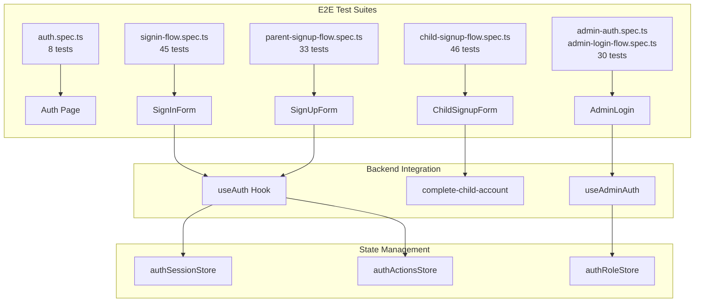

# Authentication E2E Test Coverage Report

> **Last Updated:** 2026-01-24  
> **Total Tests:** 162 across 5 test suites  
> **Coverage Status:** Comprehensive for core authentication flows

---

## Executive Summary

| Test Suite | File | Tests | Status |
|------------|------|-------|--------|
| Sign-In Flow | `signin-flow.spec.ts` | 45 | ✅ Complete |
| Child Signup | `child-signup-flow.spec.ts` | 46 | ✅ Complete |
| Parent Signup | `parent-signup-flow.spec.ts` | 33 | ✅ Complete |
| Admin Auth | `admin-auth.spec.ts` + `admin-login-flow.spec.ts` | 30 | ✅ Complete |
| General Auth | `auth.spec.ts` | 8 | ✅ Complete |

---

## Component Coverage Matrix

### Parent Authentication (`/auth`)

#### SignUpForm Component
**File:** `src/components/auth/SignUpForm.tsx`  
**Test File:** `tests-e2e/parent-signup-flow.spec.ts`  
**Tests:** 33

| Category | Tests | What's Covered |
|----------|-------|----------------|
| Form UI | 7 | Field visibility, input types, labels, password strength indicator |
| Validation | 5 | Email format, password minimum length, required fields |
| Submission | 4 | Loading states, button disable during submit, network errors |
| Authenticated State | 3 | Redirect message, dashboard button, form hidden |
| Navigation | 5 | URL params (`?tab=signup`), tab switching, forgot password link |
| Accessibility | 4 | Keyboard navigation, Enter key submit, ARIA attributes |
| Session State | 3 | Loading while checking session, corrupted localStorage |
| Signup Disabled | 3 | Feature flag handling via `site_settings` |

#### SignInForm Component
**File:** `src/components/auth/SignInForm.tsx`  
**Test File:** `tests-e2e/signin-flow.spec.ts`  
**Tests:** 45

| Category | Tests | What's Covered |
|----------|-------|----------------|
| Form UI | 6 | Element visibility, placeholders, submit button |
| Validation | 4 | Email format, password required, XSS sanitization |
| Submission | 4 | Loading indicator, success toast, redirect to dashboard |
| Error Handling | 6 | Invalid credentials, rate limiting, network errors, unconfirmed email |
| Rate Limiting | 3 | Lockout display, remaining time, disabled inputs |
| Forgot Password | 8 | Navigation, email input, success/error states |
| Reset Password Confirm | 7 | Token validation, password form, success redirect |
| Navigation | 4 | URL parameters, history preservation, link navigation |
| Accessibility | 5 | Accessible labels, ARIA attributes, keyboard navigation |

---

### Child Authentication

#### ChildSignupForm Component
**File:** `src/components/auth/ChildSignupForm.tsx`  
**Test File:** `tests-e2e/child-signup-flow.spec.ts`  
**Tests:** 46

| Category | Tests | What's Covered |
|----------|-------|----------------|
| Age-Appropriate UI | 7 | Child-friendly headers, styling, welcome text, visual design |
| Invite Code Validation | 5 | Auto-capitalization, format validation, whitespace trimming, URL pre-fill |
| PIN Verification | 6 | Field visibility, numeric-only input, 6-digit max, help text |
| Password Security | 6 | Strength indicator, requirements checklist, input masking |
| Lockout Security | 6 | Warning messages, countdown timer, disabled inputs/buttons |
| Successful Completion | 4 | Loading states, success messages, navigation to tasks |
| Error Handling | 5 | Network errors, duplicate account, server failures |
| Navigation | 4 | URL parameters, back button, code parameter handling |
| Accessibility | 3 | Labels, keyboard navigation, visual indicators |

---

### Admin Authentication

#### AdminLogin Component
**Test Files:** `tests-e2e/admin-auth.spec.ts`, `tests-e2e/admin-login-flow.spec.ts`  
**Tests:** 30

| Category | Tests | What's Covered |
|----------|-------|----------------|
| Core Functionality | 5 | Page render, form validation, error messages, rate limiting |
| Security Features | 3 | No secrets in source, security monitoring notice, autocomplete |
| Navigation & Redirects | 4 | Protected route redirects, debug panel link |
| Race Conditions | 4 | No blank screen during auth check, loading states |
| Session Handling | 3 | Logout clears session, emergency reset functionality |
| Loading States | 3 | Loading indicator, refresh option, timeout handling |

---

### General Auth Page
**Test File:** `tests-e2e/auth.spec.ts`  
**Tests:** 8

| Test | Description |
|------|-------------|
| Form Display | Authentication form renders correctly |
| Tab Visibility | Sign-up and sign-in tabs present |
| Tab Switching | Can switch between tabs |
| Validation Errors | Shows errors on empty submit |
| Email Validation | Email input accepts valid format |
| Password Masking | Password input masks characters |
| Forgot Password Link | Link visible on sign-in tab |
| Keyboard Navigation | Tab order accessibility |

---

## Edge Function Coverage

| Edge Function | Coverage | Test Method | Notes |
|---------------|----------|-------------|-------|
| `complete-child-account` | ✅ Covered | API route mocking | All response scenarios tested |
| `create-child-account` | ⚠️ Indirect | Via parent dashboard | No dedicated E2E test |
| `send-family-email` | ⚠️ Indirect | Success mocking | Notifications mocked |

### Edge Function Test Scenarios

**`complete-child-account` (46 scenarios):**
- ✅ Success response with session tokens
- ✅ Invalid/expired family code
- ✅ PIN required response
- ✅ Invalid PIN with attempt tracking
- ✅ Account lockout (too many failures)
- ✅ Already completed account
- ✅ Network failures
- ✅ Server errors (500)

---

## Auth Hooks Coverage

| Hook | Unit Tests | E2E Integration | Notes |
|------|------------|-----------------|-------|
| `useAuth` | ✅ `useAuth.test.tsx` | ✅ All auth flows | Core authentication hook |
| `useAdminAuth` | ⚠️ Partial | ✅ Admin login tests | Admin-specific logic |
| `useLoginRateLimiter` | ✅ `useLoginRateLimiter.test.tsx` | ✅ Rate limit scenarios | localStorage-based |
| `useAuthLogging` | ⚠️ Partial | ✅ Activity verification | Logging behavior |
| `useSessionContext` | ⚠️ Partial | ✅ Session state tests | Context provider |

---

## Auth Stores Coverage

| Store | Unit Tests | E2E Integration | Purpose |
|-------|------------|-----------------|---------|
| `authSessionStore` | ✅ `authStore.test.ts` | ✅ Session tests | Session state management |
| `authActionsStore` | ⚠️ Partial | ✅ Sign in/up flows | Auth actions |
| `authRoleStore` | ⚠️ Partial | ✅ Role navigation | Role-based access |
| `authLoadingStore` | ⚠️ Partial | ✅ Loading states | Loading indicators |

---

## Test Distribution by Category

```
Coverage by Test Type:
├── UI/UX Tests:         ~35 tests (22%)
├── Validation Tests:    ~25 tests (15%)
├── Error Handling:      ~30 tests (19%)
├── Security Tests:      ~25 tests (15%)
├── Accessibility:       ~15 tests (9%)
├── Navigation:          ~20 tests (12%)
└── Session/State:       ~12 tests (8%)
```

---

## Test Flow Diagram



---

## Gap Analysis

### Current Gaps

| Gap | Priority | Impact | Recommendation |
|-----|----------|--------|----------------|
| `create-child-account` E2E | High | Parent flow not directly tested | Add E2E for parent creating child |
| MFA flow | Medium | Not implemented | Add when MFA is added |
| Social login | Medium | Not implemented | Add OAuth provider tests |
| Admin password reset | Low | Minimal coverage | Expand admin reset tests |
| Visual regression | Medium | UI changes untracked | Add Playwright screenshot tests |

### Recommended Test Additions

1. **Parent Creates Child Account Flow**
   ```typescript
   // Suggested: tests-e2e/parent-child-creation-flow.spec.ts
   - Parent navigates to family settings
   - Creates child account with name
   - Receives family code
   - Verifies child_accounts table entry
   ```

2. **Visual Regression Tests**
   ```typescript
   // Suggested: tests-e2e/auth-visual.spec.ts
   - Screenshot auth forms in various states
   - Compare against baseline images
   - Detect unintended UI changes
   ```

3. **Cross-Tab Session Sync**
   ```typescript
   // Suggested: tests-e2e/session-sync.spec.ts
   - Login in one tab
   - Verify session in second tab
   - Logout and verify both tabs updated
   ```

---

## Security Test Coverage

| Security Aspect | Covered | Test Location |
|-----------------|---------|---------------|
| Password strength requirements | ✅ | All signup flows |
| Rate limiting (client) | ✅ | signin-flow, admin-login |
| Account lockout display | ✅ | child-signup-flow |
| XSS input sanitization | ✅ | signin-flow |
| PIN brute-force protection | ✅ | child-signup-flow |
| Session token handling | ✅ | All auth flows |
| No secrets in page source | ✅ | admin-login-flow |
| HTTPS enforcement | ⚠️ | Infrastructure level |
| CSRF protection | ⚠️ | Supabase handles |

---

## Visual Regression Tests

**File:** `tests-e2e/auth-visual.spec.ts`  
**Tests:** 24

Visual regression tests capture screenshots of authentication forms in various states and compare them against baseline images to detect unintended UI changes.

### Coverage

| UI State | Screenshot Name | Viewport |
|----------|-----------------|----------|
| Sign-in default | `signin-default.png` | Desktop |
| Sign-in filled | `signin-filled.png` | Desktop |
| Sign-in loading | `signin-loading.png` | Desktop |
| Sign-in error toast | `signin-error-toast.png` | Desktop |
| Sign-up default | `signup-default.png` | Desktop |
| Sign-up filled | `signup-filled.png` | Desktop |
| Password weak | `password-strength-weak.png` | Desktop |
| Password medium | `password-strength-medium.png` | Desktop |
| Password strong | `password-strength-strong.png` | Desktop |
| Admin login default | `admin-login-default.png` | Desktop |
| Admin lockout alert | `admin-login-lockout-alert.png` | Desktop |
| Admin rate warning | `admin-login-rate-warning.png` | Desktop |
| Child signup default | `child-signup-default.png` | Desktop |
| Child PIN required | `child-signup-pin-required.png` | Desktop |
| Child locked | `child-signup-locked.png` | Desktop |
| Forgot password | `forgot-password-default.png` | Desktop |
| Sign-in mobile | `signin-mobile.png` | 375x812 |
| Sign-up mobile | `signup-mobile.png` | 375x812 |
| Admin login mobile | `admin-login-mobile.png` | 375x812 |
| Sign-up tablet | `signup-tablet.png` | 768x1024 |
| Sign-in dark mode | `signin-dark-mode.png` | Desktop |
| Admin dark mode | `admin-login-dark-mode.png` | Desktop |

### Running Visual Tests

```bash
# Generate/update baseline screenshots
npx playwright test auth-visual.spec.ts --update-snapshots

# Run visual comparison tests
npx playwright test auth-visual.spec.ts

# Run only on chromium (faster)
npx playwright test auth-visual.spec.ts --project=chromium

# Run specific visual test category
npx playwright test auth-visual.spec.ts -g "Password Strength"
```

### CI/CD Integration

Visual regression tests run automatically on pull requests via `.github/workflows/security-tests.yml`:
- Baselines stored in `tests-e2e/__screenshots__/`
- Diff images uploaded as artifacts on failure
- Uses Chromium for consistent cross-platform results

---

## Running the Tests

```bash
# Run all auth E2E tests
npx playwright test tests-e2e/auth.spec.ts tests-e2e/signin-flow.spec.ts \
  tests-e2e/parent-signup-flow.spec.ts tests-e2e/child-signup-flow.spec.ts \
  tests-e2e/admin-auth.spec.ts tests-e2e/admin-login-flow.spec.ts

# Run specific suite
npx playwright test tests-e2e/child-signup-flow.spec.ts

# Run with UI mode for debugging
npx playwright test tests-e2e/signin-flow.spec.ts --ui

# Run specific category
npx playwright test -g "Rate Limiting"
```

---

## Admin Dashboard Integration

The test coverage data is visualized in the admin portal at:

**Route:** `/admin/system-monitoring` → **E2E Tests** tab

### Features

| Feature | Description |
|---------|-------------|
| Overview Stats | Total tests (162), suites (5), components covered |
| Test Suite Cards | Expandable cards with category breakdowns |
| Coverage Matrix | Component, hook, store, and edge function mapping |
| Gap Analysis | Prioritized list of testing improvements |
| Run Tests Panel | CLI commands to run tests locally with Playwright |

### Access

1. Navigate to `/admin/system-monitoring`
2. Click the **E2E Tests** tab
3. View coverage metrics, copy CLI commands, and analyze gaps

---

## Maintenance Notes

- **Review quarterly:** Update coverage counts when tests are added/removed
- **After auth changes:** Re-run full suite and update gap analysis
- **New features:** Add corresponding E2E tests before marking complete
- **Security updates:** Ensure security test coverage is maintained

---

## Related Documentation

- [TESTING_GUIDE.md](./TESTING_GUIDE.md) - Complete testing strategy
- [PARENT_CHILD_AUTH_KNOWLEDGE.md](./PARENT_CHILD_AUTH_KNOWLEDGE.md) - Auth architecture
- [EDGE_FUNCTIONS_GUIDE.md](./EDGE_FUNCTIONS_GUIDE.md) - Backend function details
