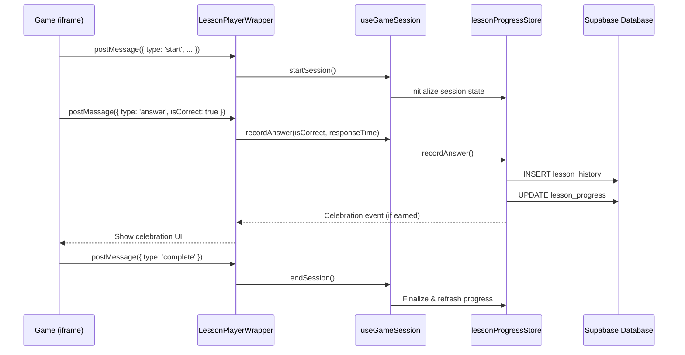
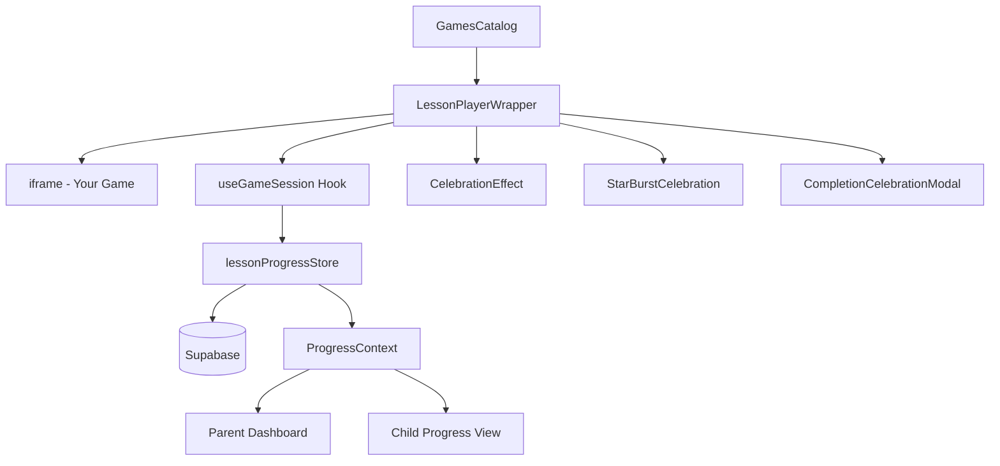

# Chatterbox Content Integration Framework

> **Version:** 1.0.0  
> **Last Updated:** January 2026  
> **Target Audience:** Game Developers, Content Creators, Educational App Builders

## Table of Contents

1. [Overview](#overview)
2. [Architecture](#architecture)
3. [Database Schema](#database-schema)
4. [PostMessage API](#postmessage-api)
5. [Complete Example Game](#complete-example-game)
6. [Content Registration](#content-registration)
7. [Celebration System](#celebration-system)
8. [Statistics & Analytics](#statistics--analytics)
9. [Testing Checklist](#testing-checklist)
10. [Advanced Topics](#advanced-topics)

---

## Overview

### Purpose

The Chatterbox Content Integration Framework enables developers to create educational games and interactive content that seamlessly integrates with Chatterbox's progress tracking system. Games communicate with the parent application via the browser's `postMessage` API, allowing for real-time progress updates, celebration triggers, and comprehensive analytics.

### Progress Model: Stars → Moons → Levels

```
┌─────────────────────────────────────────────────────────────────┐
│                    PROGRESS HIERARCHY                           │
├─────────────────────────────────────────────────────────────────┤
│                                                                 │
│   ⭐ STARS (1 per correct answer)                               │
│      │                                                          │
│      ▼ (10 stars = 1 moon)                                      │
│   🌙 MOONS                                                       │
│      │                                                          │
│      ▼ (3 moons + 80% accuracy = level up)                      │
│   📚 SKILL LEVELS: Beginner → Intermediate → Advanced           │
│      │                                                          │
│      ▼ (Complete Advanced level)                                │
│   🏆 CERTIFICATE (Category Mastery)                              │
│                                                                 │
└─────────────────────────────────────────────────────────────────┘
```

### Key Constants

| Constant | Value | Description |
|----------|-------|-------------|
| `STARS_PER_MOON` | 10 | Stars needed to earn a moon |
| `MOONS_TO_LEVEL_UP` | 3 | Moons needed to unlock next level |
| `ACCURACY_THRESHOLD` | 80% | Minimum accuracy for level progression |
| `ACCURACY_SAMPLE_SIZE` | 20 | Recent answers used for accuracy calculation |

---

## Architecture

### System Flow Diagram



### Component Architecture



### Key Source Files

| File | Purpose |
|------|---------|
| `src/components/games/LessonPlayerWrapper.tsx` | Hosts game iframe, handles postMessage |
| `src/hooks/useGameSession.ts` | Manages session state, records answers |
| `src/stores/lessonProgressStore.ts` | Zustand store for progress data |
| `src/contexts/ProgressContext.tsx` | React context for progress access |
| `src/types/gameEvents.ts` | TypeScript interfaces for events |
| `src/types/lessonProgress.ts` | Progress-related type definitions |

---

## Database Schema

### content_categories

Defines the educational categories for content grouping.

```sql
CREATE TABLE content_categories (
  id UUID PRIMARY KEY DEFAULT gen_random_uuid(),
  name TEXT NOT NULL,                    -- e.g., "Math Basics"
  description TEXT,                      -- Category description
  icon TEXT,                             -- Icon identifier (e.g., "calculator")
  is_active BOOLEAN DEFAULT true,        -- Whether category is visible
  sort_order INTEGER DEFAULT 0,          -- Display order
  created_at TIMESTAMPTZ DEFAULT now(),
  updated_at TIMESTAMPTZ DEFAULT now()
);
```

### content_items

Stores all games, videos, and educational content.

```sql
CREATE TABLE content_items (
  id UUID PRIMARY KEY DEFAULT gen_random_uuid(),
  title TEXT NOT NULL,                   -- Display title
  description TEXT,                      -- Content description
  url TEXT NOT NULL,                     -- Game/content URL
  thumbnail_url TEXT,                    -- Preview image
  content_type content_type NOT NULL,    -- 'game', 'video', 'activity', 'lesson'
  category_id UUID REFERENCES content_categories(id),
  
  -- Age targeting
  age_min INTEGER DEFAULT 3,             -- Minimum age
  age_max INTEGER DEFAULT 18,            -- Maximum age
  
  -- Skill levels this content supports
  skill_levels TEXT[] DEFAULT '{beginner}', -- Array: beginner, intermediate, advanced
  
  -- Autism-friendly features
  autism_features JSONB DEFAULT '{}',
  
  -- Metadata
  tags TEXT[] DEFAULT '{}',              -- Searchable tags
  platform TEXT DEFAULT 'web',           -- Platform compatibility
  content_rating TEXT DEFAULT 'E',       -- Age rating
  is_free BOOLEAN DEFAULT true,
  is_active BOOLEAN DEFAULT true,
  sort_order INTEGER DEFAULT 0,
  
  -- Approval workflow
  approval_status approval_status DEFAULT 'pending',
  created_by UUID,
  approved_by UUID,
  
  created_at TIMESTAMPTZ DEFAULT now(),
  updated_at TIMESTAMPTZ DEFAULT now()
);
```

### lesson_progress

Tracks per-user, per-category cumulative progress.

```sql
CREATE TABLE lesson_progress (
  id UUID PRIMARY KEY DEFAULT gen_random_uuid(),
  user_id UUID NOT NULL,                 -- Child user ID
  family_id UUID NOT NULL,               -- Family for RLS
  category_id UUID NOT NULL REFERENCES content_categories(id),
  
  -- Star/Moon tracking
  current_stars INTEGER DEFAULT 0,       -- Stars toward next moon (0-9)
  stars_to_moon INTEGER DEFAULT 10,      -- Always 10
  moons_earned INTEGER DEFAULT 0,        -- Total moons in category
  
  -- Performance tracking
  correct_answers INTEGER DEFAULT 0,     -- Total correct
  total_attempts INTEGER DEFAULT 0,      -- Total questions
  accuracy_percentage NUMERIC,           -- Calculated accuracy
  
  -- Level progression
  current_level skill_level DEFAULT 'beginner',
  unlocked_levels TEXT[] DEFAULT '{beginner}',
  
  -- Activity tracking
  last_activity_at TIMESTAMPTZ,
  created_at TIMESTAMPTZ DEFAULT now(),
  updated_at TIMESTAMPTZ DEFAULT now(),
  
  UNIQUE(user_id, category_id)
);
```

### lesson_history

Records every individual answer for detailed analytics.

```sql
CREATE TABLE lesson_history (
  id UUID PRIMARY KEY DEFAULT gen_random_uuid(),
  user_id UUID NOT NULL,
  family_id UUID NOT NULL,
  category_id UUID NOT NULL REFERENCES content_categories(id),
  content_item_id UUID REFERENCES content_items(id),
  
  was_correct BOOLEAN NOT NULL,          -- Answer correctness
  stars_earned INTEGER DEFAULT 0,        -- Stars for this answer
  response_time_ms INTEGER,              -- Time to answer (ms)
  skill_level_at_time skill_level DEFAULT 'beginner',
  
  answered_at TIMESTAMPTZ DEFAULT now()
);
```

### certificates

Awarded when a child completes all levels in a category.

```sql
CREATE TABLE certificates (
  id UUID PRIMARY KEY DEFAULT gen_random_uuid(),
  user_id UUID NOT NULL,
  family_id UUID NOT NULL,
  category_id UUID NOT NULL REFERENCES content_categories(id),
  category_name TEXT NOT NULL,           -- Snapshot of category name
  skill_level_completed skill_level NOT NULL,
  child_name TEXT NOT NULL,              -- Name on certificate
  
  certificate_data JSONB DEFAULT '{}',   -- Additional data
  -- Example: { accuracy: 92, moons_earned: 9, time_to_complete_days: 14, total_stars_earned: 90 }
  
  completed_at TIMESTAMPTZ DEFAULT now(),
  created_at TIMESTAMPTZ DEFAULT now()
);
```

---

## PostMessage API

### GameEvent Interface

All games must emit events using this structure:

```typescript
interface GameEvent {
  type: GameEventType;      // Event type
  payload: GameEventPayload; // Event data
  timestamp: number;        // Unix timestamp (Date.now())
  source: 'lovable-game';   // REQUIRED: Identifies as Chatterbox game
}

type GameEventType = 'start' | 'answer' | 'complete' | 'pause' | 'resume' | 'error';

interface GameEventPayload {
  contentItemId: string;    // REQUIRED: Your game's UUID from content_items
  categoryId: string;       // REQUIRED: Category UUID
  isCorrect?: boolean;      // For 'answer' events
  responseTimeMs?: number;  // Time to answer in milliseconds
  score?: number;           // Optional score value
  skillLevel?: 'beginner' | 'intermediate' | 'advanced';
  metadata?: Record<string, unknown>; // Additional data
}
```

### Event Types

#### 1. `start` - Game Session Started

Send when the game initializes and is ready to play.

```javascript
window.parent.postMessage({
  type: 'start',
  payload: {
    contentItemId: 'your-game-uuid',
    categoryId: 'category-uuid',
    skillLevel: 'beginner'
  },
  timestamp: Date.now(),
  source: 'lovable-game'
}, '*');
```

#### 2. `answer` - Question Answered

Send after each question/interaction. This is the most important event.

```javascript
window.parent.postMessage({
  type: 'answer',
  payload: {
    contentItemId: 'your-game-uuid',
    categoryId: 'category-uuid',
    isCorrect: true,           // REQUIRED for answer events
    responseTimeMs: 2500,      // Optional but recommended
    skillLevel: 'beginner'
  },
  timestamp: Date.now(),
  source: 'lovable-game'
}, '*');
```

#### 3. `complete` - Session Completed

Send when the game/session ends.

```javascript
window.parent.postMessage({
  type: 'complete',
  payload: {
    contentItemId: 'your-game-uuid',
    categoryId: 'category-uuid',
    score: 85,
    metadata: {
      questionsAnswered: 10,
      timeSpentSeconds: 120
    }
  },
  timestamp: Date.now(),
  source: 'lovable-game'
}, '*');
```

#### 4. `pause` / `resume` - Session State Changes

Optional events for pause/resume functionality.

```javascript
// Pause
window.parent.postMessage({
  type: 'pause',
  payload: { contentItemId: 'your-game-uuid', categoryId: 'category-uuid' },
  timestamp: Date.now(),
  source: 'lovable-game'
}, '*');

// Resume
window.parent.postMessage({
  type: 'resume',
  payload: { contentItemId: 'your-game-uuid', categoryId: 'category-uuid' },
  timestamp: Date.now(),
  source: 'lovable-game'
}, '*');
```

#### 5. `error` - Error Occurred

Report errors for debugging.

```javascript
window.parent.postMessage({
  type: 'error',
  payload: {
    contentItemId: 'your-game-uuid',
    categoryId: 'category-uuid',
    metadata: {
      error: 'Failed to load assets',
      details: 'Network timeout'
    }
  },
  timestamp: Date.now(),
  source: 'lovable-game'
}, '*');
```

### Type Guard for Validation

Use this in your parent application to validate incoming events:

```typescript
function isValidGameEvent(event: unknown): event is GameEvent {
  if (typeof event !== 'object' || event === null) return false;
  
  const e = event as Record<string, unknown>;
  
  return (
    typeof e.type === 'string' &&
    ['answer', 'complete', 'start', 'pause', 'resume', 'error'].includes(e.type) &&
    typeof e.payload === 'object' &&
    e.payload !== null &&
    typeof e.timestamp === 'number' &&
    e.source === 'lovable-game'
  );
}
```

---

## Complete Example Game

### Math Flash Cards Game

This is a fully functional game that integrates with Chatterbox. Save as an HTML file and host it.

```html
<!DOCTYPE html>
<html lang="en">
<head>
  <meta charset="UTF-8">
  <meta name="viewport" content="width=device-width, initial-scale=1.0">
  <title>Math Flash Cards</title>
  <style>
    * {
      box-sizing: border-box;
      margin: 0;
      padding: 0;
    }
    
    body {
      font-family: -apple-system, BlinkMacSystemFont, 'Segoe UI', Roboto, sans-serif;
      background: linear-gradient(135deg, #667eea 0%, #764ba2 100%);
      min-height: 100vh;
      display: flex;
      align-items: center;
      justify-content: center;
      padding: 20px;
    }
    
    .game-container {
      background: white;
      border-radius: 24px;
      padding: 40px;
      max-width: 500px;
      width: 100%;
      box-shadow: 0 20px 60px rgba(0,0,0,0.3);
      text-align: center;
    }
    
    .question {
      font-size: 4rem;
      font-weight: bold;
      color: #333;
      margin: 30px 0;
      min-height: 80px;
    }
    
    .answers {
      display: grid;
      grid-template-columns: 1fr 1fr;
      gap: 15px;
      margin: 30px 0;
    }
    
    .answer-btn {
      padding: 20px;
      font-size: 1.8rem;
      font-weight: bold;
      border: 3px solid #e0e0e0;
      border-radius: 16px;
      background: white;
      cursor: pointer;
      transition: all 0.2s ease;
    }
    
    .answer-btn:hover {
      border-color: #667eea;
      transform: scale(1.05);
    }
    
    .answer-btn:active {
      transform: scale(0.98);
    }
    
    .answer-btn.correct {
      background: #4caf50;
      border-color: #4caf50;
      color: white;
      animation: pulse 0.5s ease;
    }
    
    .answer-btn.incorrect {
      background: #f44336;
      border-color: #f44336;
      color: white;
      animation: shake 0.5s ease;
    }
    
    @keyframes pulse {
      0%, 100% { transform: scale(1); }
      50% { transform: scale(1.1); }
    }
    
    @keyframes shake {
      0%, 100% { transform: translateX(0); }
      25% { transform: translateX(-10px); }
      75% { transform: translateX(10px); }
    }
    
    .stats {
      display: flex;
      justify-content: space-around;
      margin-top: 30px;
      padding-top: 20px;
      border-top: 2px solid #eee;
    }
    
    .stat {
      text-align: center;
    }
    
    .stat-value {
      font-size: 2rem;
      font-weight: bold;
      color: #667eea;
    }
    
    .stat-label {
      font-size: 0.9rem;
      color: #666;
      margin-top: 5px;
    }
    
    .streak {
      background: linear-gradient(135deg, #ff9a56 0%, #ff6b6b 100%);
      color: white;
      padding: 10px 20px;
      border-radius: 50px;
      font-weight: bold;
      display: inline-block;
      margin-bottom: 20px;
    }
    
    .streak.hidden {
      opacity: 0;
    }
    
    h1 {
      color: #333;
      margin-bottom: 10px;
    }
    
    .subtitle {
      color: #666;
      margin-bottom: 20px;
    }
  </style>
</head>
<body>
  <div class="game-container">
    <h1>🔢 Math Flash Cards</h1>
    <p class="subtitle">Addition Practice</p>
    
    <div class="streak hidden" id="streak">🔥 Streak: 0</div>
    
    <div class="question" id="question">Loading...</div>
    
    <div class="answers" id="answers">
      <!-- Answer buttons will be generated here -->
    </div>
    
    <div class="stats">
      <div class="stat">
        <div class="stat-value" id="score">0</div>
        <div class="stat-label">Score</div>
      </div>
      <div class="stat">
        <div class="stat-value" id="correct">0</div>
        <div class="stat-label">Correct</div>
      </div>
      <div class="stat">
        <div class="stat-value" id="total">0</div>
        <div class="stat-label">Total</div>
      </div>
    </div>
  </div>

  <script>
    // ============================================================
    // CHATTERBOX INTEGRATION CONFIGURATION
    // ============================================================
    // IMPORTANT: Replace these with your actual IDs from the database
    const CONTENT_ITEM_ID = 'your-content-item-uuid-here';
    const CATEGORY_ID = 'your-category-uuid-here';
    const SKILL_LEVEL = 'beginner'; // beginner | intermediate | advanced
    
    // ============================================================
    // CHATTERBOX BRIDGE - Handles all communication with parent
    // ============================================================
    const ChatterboxBridge = {
      /**
       * Send an event to the Chatterbox parent application
       * @param {string} type - Event type: start, answer, complete, pause, resume, error
       * @param {object} payload - Event data
       */
      sendEvent(type, payload = {}) {
        const event = {
          type: type,
          payload: {
            contentItemId: CONTENT_ITEM_ID,
            categoryId: CATEGORY_ID,
            skillLevel: SKILL_LEVEL,
            ...payload
          },
          timestamp: Date.now(),
          source: 'lovable-game' // REQUIRED: Must be exactly 'lovable-game'
        };
        
        // Send to parent window
        window.parent.postMessage(event, '*');
        
        // Debug logging (remove in production)
        console.log('[ChatterboxBridge] Sent event:', type, event);
      },
      
      /**
       * Notify that the game has started
       */
      notifyStart() {
        this.sendEvent('start');
      },
      
      /**
       * Record an answer
       * @param {boolean} isCorrect - Whether the answer was correct
       * @param {number} responseTimeMs - Time taken to answer in milliseconds
       */
      notifyAnswer(isCorrect, responseTimeMs) {
        this.sendEvent('answer', {
          isCorrect: isCorrect,
          responseTimeMs: responseTimeMs
        });
      },
      
      /**
       * Notify that the game session is complete
       * @param {object} stats - Final game statistics
       */
      notifyComplete(stats = {}) {
        this.sendEvent('complete', {
          score: stats.score || 0,
          metadata: {
            correctAnswers: stats.correct || 0,
            totalQuestions: stats.total || 0,
            accuracy: stats.accuracy || 0,
            longestStreak: stats.longestStreak || 0
          }
        });
      },
      
      /**
       * Report an error
       * @param {string} message - Error message
       * @param {object} details - Additional error details
       */
      notifyError(message, details = {}) {
        this.sendEvent('error', {
          metadata: {
            error: message,
            details: details
          }
        });
      }
    };
    
    // ============================================================
    // GAME STATE
    // ============================================================
    const GameState = {
      currentQuestion: null,
      correctAnswer: null,
      questionStartTime: null,
      score: 0,
      correct: 0,
      total: 0,
      streak: 0,
      longestStreak: 0,
      isAnswering: false
    };
    
    // ============================================================
    // GAME LOGIC
    // ============================================================
    
    /**
     * Generate a new math question
     */
    function generateQuestion() {
      // Generate two random numbers based on skill level
      let max;
      switch (SKILL_LEVEL) {
        case 'advanced':
          max = 50;
          break;
        case 'intermediate':
          max = 20;
          break;
        default:
          max = 10;
      }
      
      const num1 = Math.floor(Math.random() * max) + 1;
      const num2 = Math.floor(Math.random() * max) + 1;
      
      GameState.correctAnswer = num1 + num2;
      GameState.currentQuestion = `${num1} + ${num2} = ?`;
      GameState.questionStartTime = Date.now();
      GameState.isAnswering = false;
      
      return {
        question: GameState.currentQuestion,
        correctAnswer: GameState.correctAnswer
      };
    }
    
    /**
     * Generate answer options (1 correct + 3 wrong)
     */
    function generateAnswerOptions(correctAnswer) {
      const options = [correctAnswer];
      
      while (options.length < 4) {
        // Generate wrong answers close to the correct one
        const offset = Math.floor(Math.random() * 10) - 5;
        const wrongAnswer = correctAnswer + offset;
        
        if (wrongAnswer > 0 && !options.includes(wrongAnswer)) {
          options.push(wrongAnswer);
        }
      }
      
      // Shuffle options
      return options.sort(() => Math.random() - 0.5);
    }
    
    /**
     * Handle answer selection
     */
    function handleAnswer(selectedAnswer, buttonElement) {
      // Prevent double-clicking
      if (GameState.isAnswering) return;
      GameState.isAnswering = true;
      
      const responseTime = Date.now() - GameState.questionStartTime;
      const isCorrect = selectedAnswer === GameState.correctAnswer;
      
      // Update game state
      GameState.total++;
      
      if (isCorrect) {
        GameState.correct++;
        GameState.score += 10 + Math.max(0, Math.floor((5000 - responseTime) / 100)); // Bonus for speed
        GameState.streak++;
        GameState.longestStreak = Math.max(GameState.longestStreak, GameState.streak);
        buttonElement.classList.add('correct');
      } else {
        GameState.streak = 0;
        buttonElement.classList.add('incorrect');
        
        // Highlight correct answer
        document.querySelectorAll('.answer-btn').forEach(btn => {
          if (parseInt(btn.textContent) === GameState.correctAnswer) {
            btn.classList.add('correct');
          }
        });
      }
      
      // ========================================
      // CRITICAL: Notify Chatterbox of answer
      // ========================================
      ChatterboxBridge.notifyAnswer(isCorrect, responseTime);
      
      // Update UI
      updateStats();
      updateStreak();
      
      // Next question after delay
      setTimeout(() => {
        showNextQuestion();
      }, isCorrect ? 800 : 1500);
    }
    
    /**
     * Display the next question
     */
    function showNextQuestion() {
      const { question } = generateQuestion();
      const options = generateAnswerOptions(GameState.correctAnswer);
      
      // Update question display
      document.getElementById('question').textContent = question;
      
      // Generate answer buttons
      const answersContainer = document.getElementById('answers');
      answersContainer.innerHTML = options.map(option => 
        `<button class="answer-btn" onclick="handleAnswer(${option}, this)">${option}</button>`
      ).join('');
    }
    
    /**
     * Update statistics display
     */
    function updateStats() {
      document.getElementById('score').textContent = GameState.score;
      document.getElementById('correct').textContent = GameState.correct;
      document.getElementById('total').textContent = GameState.total;
    }
    
    /**
     * Update streak display
     */
    function updateStreak() {
      const streakElement = document.getElementById('streak');
      if (GameState.streak >= 3) {
        streakElement.textContent = `🔥 Streak: ${GameState.streak}`;
        streakElement.classList.remove('hidden');
      } else {
        streakElement.classList.add('hidden');
      }
    }
    
    // ============================================================
    // INITIALIZATION
    // ============================================================
    
    /**
     * Initialize the game
     */
    function initGame() {
      try {
        // Notify Chatterbox that game has started
        ChatterboxBridge.notifyStart();
        
        // Show first question
        showNextQuestion();
        updateStats();
        
        console.log('[MathFlashCards] Game initialized successfully');
      } catch (error) {
        console.error('[MathFlashCards] Initialization error:', error);
        ChatterboxBridge.notifyError('Failed to initialize game', { error: error.message });
      }
    }
    
    // Handle page visibility changes (pause/resume)
    document.addEventListener('visibilitychange', () => {
      if (document.hidden) {
        ChatterboxBridge.sendEvent('pause');
      } else {
        ChatterboxBridge.sendEvent('resume');
      }
    });
    
    // Handle page unload (complete session)
    window.addEventListener('beforeunload', () => {
      ChatterboxBridge.notifyComplete({
        score: GameState.score,
        correct: GameState.correct,
        total: GameState.total,
        accuracy: GameState.total > 0 ? Math.round((GameState.correct / GameState.total) * 100) : 0,
        longestStreak: GameState.longestStreak
      });
    });
    
    // Start the game when DOM is ready
    if (document.readyState === 'loading') {
      document.addEventListener('DOMContentLoaded', initGame);
    } else {
      initGame();
    }
  </script>
</body>
</html>
```

### Integration Walkthrough

1. **Set Configuration**: Replace `CONTENT_ITEM_ID` and `CATEGORY_ID` with your actual database UUIDs.

2. **ChatterboxBridge Object**: This helper handles all `postMessage` communication. Use it throughout your game.

3. **Start Event**: Call `ChatterboxBridge.notifyStart()` when your game initializes.

4. **Answer Events**: Call `ChatterboxBridge.notifyAnswer(isCorrect, responseTimeMs)` after each answer.

5. **Complete Event**: Call `ChatterboxBridge.notifyComplete(stats)` when the session ends.

6. **Error Handling**: Use `ChatterboxBridge.notifyError(message, details)` to report issues.

---

## Content Registration

### Method 1: Admin Portal (Recommended)

1. Navigate to `/admin/content` in the Chatterbox admin panel
2. Click "Add New Content"
3. Fill in the required fields:
   - **Title**: Display name of your game
   - **URL**: Hosted URL of your game
   - **Category**: Select the appropriate category
   - **Content Type**: Select "game"
   - **Age Range**: Set minimum and maximum ages
   - **Skill Levels**: Check applicable levels
4. Configure autism-friendly features
5. Submit for approval

### Method 2: Direct SQL Insert

```sql
-- First, find your category ID
SELECT id, name FROM content_categories WHERE is_active = true;

-- Insert your content item
INSERT INTO content_items (
  title,
  description,
  url,
  thumbnail_url,
  content_type,
  category_id,
  age_min,
  age_max,
  skill_levels,
  autism_features,
  tags,
  is_active,
  approval_status
) VALUES (
  'Math Flash Cards',
  'Practice addition with colorful flash cards. Earn stars for correct answers!',
  'https://your-domain.com/games/math-flash-cards.html',
  'https://your-domain.com/thumbnails/math-flash-cards.png',
  'game',
  'category-uuid-here',  -- Replace with actual category UUID
  5,   -- Minimum age
  12,  -- Maximum age
  ARRAY['beginner', 'intermediate', 'advanced'],
  '{
    "reducedAnimations": false,
    "highContrast": false,
    "simplifiedUI": true,
    "audioSupport": true,
    "visualTimers": true,
    "predictablePatterns": true,
    "calmingColors": true,
    "clearInstructions": true,
    "positiveReinforcement": true,
    "noTimePressure": false,
    "sensoryConsiderations": {
      "noFlashing": true,
      "softSounds": true,
      "adjustableVolume": true
    }
  }'::jsonb,
  ARRAY['math', 'addition', 'flash-cards', 'practice'],
  true,
  'pending'  -- Will need admin approval
);
```

### Autism Features Configuration

The `autism_features` JSONB field supports these options:

```typescript
interface AutismFeatures {
  // Visual accommodations
  reducedAnimations?: boolean;    // Minimize motion
  highContrast?: boolean;         // High contrast mode available
  simplifiedUI?: boolean;         // Clean, uncluttered interface
  calmingColors?: boolean;        // Soft, non-stimulating colors
  
  // Audio accommodations
  audioSupport?: boolean;         // Audio instructions available
  
  // Interaction accommodations
  visualTimers?: boolean;         // Visual countdown timers
  predictablePatterns?: boolean;  // Consistent, predictable flow
  noTimePressure?: boolean;       // No time limits on responses
  clearInstructions?: boolean;    // Step-by-step instructions
  
  // Feedback
  positiveReinforcement?: boolean; // Encouraging feedback
  
  // Sensory considerations
  sensoryConsiderations?: {
    noFlashing?: boolean;         // No flashing lights
    softSounds?: boolean;         // Gentle audio
    adjustableVolume?: boolean;   // Volume controls
  };
}
```

### Skill Levels Array

Content can support one or more skill levels:

```sql
-- Single level
skill_levels = ARRAY['beginner']

-- Multiple levels (progressive difficulty)
skill_levels = ARRAY['beginner', 'intermediate', 'advanced']

-- Skip beginner (for advanced content)
skill_levels = ARRAY['intermediate', 'advanced']
```

---

## Celebration System

### Celebration Triggers

Celebrations are automatically triggered when children achieve milestones:

| Event | Trigger Condition | Celebration Type |
|-------|-------------------|------------------|
| Star Earned | Any correct answer | `StarBurstCelebration` |
| Moon Reached | `current_stars` reaches 10 | `CelebrationEffect` + sound |
| Level Completed | 3 moons + 80% accuracy | `CompletionCelebrationModal` |
| Category Mastered | Complete Advanced level | Certificate generation |

### Celebration Event Types

```typescript
interface CelebrationEvent {
  type: 'starEarned' | 'moonReached' | 'levelCompleted' | 'categoryMastered';
  categoryId: string;
  level?: 'beginner' | 'intermediate' | 'advanced';
  starsEarned?: number;
  moonsEarned?: number;
}
```

### Triggering Extra Stars (Streak Bonus)

Games can earn bonus stars through streaks:

```typescript
// Default configuration in useGameSession
const config = {
  starsPerCorrect: 1,      // Base stars per correct answer
  streakBonusStars: 1,     // Bonus stars when streak threshold hit
  streakThreshold: 3       // Streak count to trigger bonus
};

// When child gets 3+ correct in a row, they earn 2 stars instead of 1
```

---

## Statistics & Analytics

### Tracked Metrics Per Session

| Metric | Description | Location |
|--------|-------------|----------|
| `correctAnswers` | Correct answers in session | `GameSessionStats` |
| `incorrectAnswers` | Wrong answers in session | `GameSessionStats` |
| `currentStreak` | Current consecutive correct | `GameSessionStats` |
| `longestStreak` | Best streak in session | `GameSessionStats` |
| `starsEarned` | Stars earned in session | `GameSessionStats` |
| `averageResponseTimeMs` | Mean response time | `GameSessionStats` |
| `durationSeconds` | Session length | `GameSessionStats` |

### Tracked Metrics Per Category (Cumulative)

| Metric | Description | Table Column |
|--------|-------------|--------------|
| `current_stars` | Stars toward next moon | `lesson_progress.current_stars` |
| `moons_earned` | Total moons | `lesson_progress.moons_earned` |
| `correct_answers` | Lifetime correct | `lesson_progress.correct_answers` |
| `total_attempts` | Lifetime attempts | `lesson_progress.total_attempts` |
| `accuracy_percentage` | Rolling accuracy | `lesson_progress.accuracy_percentage` |
| `current_level` | Current skill level | `lesson_progress.current_level` |
| `unlocked_levels` | Available levels | `lesson_progress.unlocked_levels` |

### Accuracy Calculation

Accuracy is calculated from the most recent 20 answers:

```sql
-- Accuracy formula (from last 20 answers)
SELECT 
  ROUND(
    (COUNT(CASE WHEN was_correct THEN 1 END)::NUMERIC / COUNT(*)::NUMERIC) * 100,
    2
  ) as accuracy
FROM (
  SELECT was_correct
  FROM lesson_history
  WHERE user_id = $1 AND category_id = $2
  ORDER BY answered_at DESC
  LIMIT 20  -- ACCURACY_SAMPLE_SIZE
) recent;
```

---

## Testing Checklist

### Pre-Submission Verification

Before submitting your content for approval, verify:

#### 1. Configuration Check
- [ ] `CONTENT_ITEM_ID` is set (will be assigned after registration)
- [ ] `CATEGORY_ID` matches an existing category
- [ ] `SKILL_LEVEL` is one of: `beginner`, `intermediate`, `advanced`
- [ ] `source` field is exactly `'lovable-game'`

#### 2. Event Verification
- [ ] `start` event fires on game initialization
- [ ] `answer` events fire for every question with correct `isCorrect` value
- [ ] `responseTimeMs` is included in answer events (optional but recommended)
- [ ] `complete` event fires on session end
- [ ] `error` events fire when exceptions occur

#### 3. Browser Console Test

Open browser DevTools (F12) and check:

```javascript
// You should see logs like:
[ChatterboxBridge] Sent event: start {...}
[ChatterboxBridge] Sent event: answer {isCorrect: true, responseTimeMs: 1234}
[ChatterboxBridge] Sent event: answer {isCorrect: false, responseTimeMs: 5678}
[ChatterboxBridge] Sent event: complete {...}
```

#### 4. Event Structure Validation

Each event must have:
```javascript
{
  type: 'answer',                    // ✓ Valid type
  payload: {
    contentItemId: 'uuid-here',      // ✓ Required
    categoryId: 'uuid-here',         // ✓ Required
    isCorrect: true                  // ✓ Required for answer events
  },
  timestamp: 1704067200000,          // ✓ Unix timestamp
  source: 'lovable-game'             // ✓ Exact string required
}
```

#### 5. Iframe Compatibility
- [ ] Game loads correctly in an iframe
- [ ] No CORS errors in console
- [ ] No `X-Frame-Options` blocking
- [ ] Responsive design works in iframe

#### 6. Accessibility Check
- [ ] Keyboard navigation works
- [ ] Screen reader compatible
- [ ] Color contrast meets WCAG AA
- [ ] No auto-playing audio without controls

### Common Issues & Solutions

| Issue | Solution |
|-------|----------|
| Events not received | Check `source: 'lovable-game'` is exact |
| Stars not incrementing | Verify `isCorrect: true` in answer events |
| Progress not saving | Check `contentItemId` and `categoryId` are valid UUIDs |
| Celebrations not showing | Ensure answer events fire before complete |
| Iframe blocked | Add proper CORS headers to game host |

---

## Advanced Topics

### Multi-Level Games

For games with built-in difficulty progression:

```javascript
// Track current level internally
let currentLevel = 'beginner';

// Update level and notify
function setDifficulty(level) {
  currentLevel = level;
  
  // Include in all subsequent events
  ChatterboxBridge.sendEvent('answer', {
    isCorrect: true,
    skillLevel: currentLevel  // 'beginner' | 'intermediate' | 'advanced'
  });
}
```

### Custom Metadata

Send additional data for analytics:

```javascript
ChatterboxBridge.notifyAnswer(true, 1500);
ChatterboxBridge.sendEvent('answer', {
  contentItemId: CONTENT_ITEM_ID,
  categoryId: CATEGORY_ID,
  isCorrect: true,
  responseTimeMs: 1500,
  metadata: {
    questionType: 'multiplication',
    difficulty: 3,
    hintsUsed: 1,
    attemptNumber: 2
  }
});
```

### Listening for Parent Messages

Receive configuration or commands from Chatterbox:

```javascript
window.addEventListener('message', (event) => {
  // Validate origin in production
  // if (event.origin !== 'https://your-chatterbox-domain.com') return;
  
  const message = event.data;
  
  if (message.type === 'config') {
    // Apply settings from parent
    applySettings(message.settings);
  }
  
  if (message.type === 'end-session') {
    // Parent requested session end
    endGameSession();
  }
});
```

### Performance Best Practices

1. **Lazy Load Assets**: Don't block `start` event with asset loading
2. **Batch Events**: If many rapid answers, debounce if needed
3. **Minimize Payload**: Keep `metadata` objects small
4. **Handle Offline**: Queue events if connectivity lost

```javascript
// Event queue for offline resilience
const eventQueue = [];
let isOnline = navigator.onLine;

window.addEventListener('online', () => {
  isOnline = true;
  flushEventQueue();
});

window.addEventListener('offline', () => {
  isOnline = false;
});

function sendEventWithQueue(event) {
  if (isOnline) {
    window.parent.postMessage(event, '*');
  } else {
    eventQueue.push(event);
  }
}

function flushEventQueue() {
  while (eventQueue.length > 0) {
    const event = eventQueue.shift();
    window.parent.postMessage(event, '*');
  }
}
```

### Accessibility Considerations

Ensure your game follows WCAG guidelines:

```html
<!-- Proper ARIA labels -->
<button 
  class="answer-btn" 
  aria-label="Answer: 42"
  role="button"
  tabindex="0"
>
  42
</button>

<!-- Announce results to screen readers -->
<div 
  role="status" 
  aria-live="polite" 
  aria-atomic="true"
  class="sr-only"
>
  Correct! You earned a star.
</div>
```

---

## Quick Reference Card

```
┌─────────────────────────────────────────────────────────────────┐
│                    QUICK REFERENCE                              │
├─────────────────────────────────────────────────────────────────┤
│                                                                 │
│  REQUIRED EVENT STRUCTURE:                                      │
│  {                                                              │
│    type: 'start' | 'answer' | 'complete',                       │
│    payload: { contentItemId, categoryId, ... },                 │
│    timestamp: Date.now(),                                       │
│    source: 'lovable-game'  ← MUST BE EXACT                      │
│  }                                                              │
│                                                                 │
│  KEY PAYLOAD FIELDS:                                            │
│  • contentItemId: string (UUID) - REQUIRED                      │
│  • categoryId: string (UUID) - REQUIRED                         │
│  • isCorrect: boolean - REQUIRED for 'answer' events            │
│  • responseTimeMs: number - Recommended                         │
│                                                                 │
│  PROGRESS MODEL:                                                │
│  • 1 correct answer = 1 star                                    │
│  • 10 stars = 1 moon                                            │
│  • 3 moons + 80% accuracy = level up                            │
│  • Complete Advanced = Certificate                              │
│                                                                 │
│  SUPPORT: Contact support@chatterbox.app                        │
│                                                                 │
└─────────────────────────────────────────────────────────────────┘
```

---

## Changelog

| Version | Date | Changes |
|---------|------|---------|
| 1.0.0 | January 2026 | Initial release |

---

*This documentation is maintained by the Chatterbox development team. For questions or contributions, please contact the development team or open an issue in the repository.*
