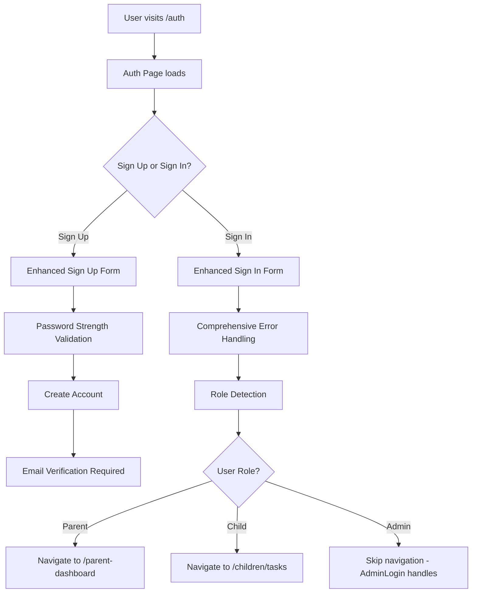

# Parent & Child Authentication System Knowledge Base

## Overview

The Spectrum Harmony application implements a sophisticated parent and child authentication system designed with autism-friendly features, comprehensive security measures, and role-based access control.

## Authentication Architecture

### Core Components

1. **Auth Store (`src/stores/authStore.ts`)** - Centralized Zustand store managing authentication state
2. **Auth Hook (`src/hooks/useAuth.tsx`)** - Bridge adapter providing clean interface to auth store
3. **Auth Page (`src/pages/Auth.tsx`)** - Main authentication interface for parents and children
4. **Auth Navigation (`src/hooks/useAuthNavigation.tsx`)** - Role-based navigation logic
5. **Security Components** - Password validation and security banners

### Authentication Flow



## Security Features

### 1. Password Security

#### Real-time Password Validation
- **Minimum 8 characters** with visual feedback
- **Character variety requirements**: uppercase, lowercase, numbers, special characters
- **Common pattern detection**: prevents "123456", "qwerty", keyboard patterns
- **Compromised password checking**: blocks common weak passwords
- **Strength scoring**: 0-5 scale with descriptive feedback

#### Password Requirements Display
```typescript
interface PasswordRequirements {
  minLength: boolean;        // At least 8 characters
  hasUppercase: boolean;     // One uppercase letter (A-Z)
  hasLowercase: boolean;     // One lowercase letter (a-z)
  hasNumbers: boolean;       // One number (0-9)
  hasSpecialChars: boolean;  // One special character (!@#$%^&*)
  noCommonPatterns: boolean; // No common patterns
  notCompromised: boolean;   // Not a common password
}
```

### 2. Enhanced Error Handling

#### Comprehensive Error Categorization
- **Invalid Credentials**: "Invalid email or password. Please check your credentials and try again."
- **Rate Limiting**: "Too many login attempts. Please wait a moment and try again."
- **Network Errors**: "Network error. Please check your internet connection and try again."
- **Account Exists**: "An account with this email already exists. Please sign in instead."
- **Email Verification**: "Please check your email and click the verification link to complete your account setup."
- **Password Requirements**: "Password does not meet security requirements. Please choose a stronger password."

### 3. Security Banners

#### Context-Aware Security Messaging
- **Parent Accounts**: Warning about family management access and credential security
- **Child Accounts**: Reassurance about safety monitoring by parents
- **General Users**: Standard security reminders

### 4. Rate Limiting Protection

The system includes built-in protection against brute force attacks with user-friendly feedback when rate limits are encountered.

## User Experience Features

### 1. Autism-Friendly Design

#### Password Creation Assistance
- **Visual strength indicators** with color-coded progress bars
- **Real-time requirement checklist** with check/X icons
- **Positive reinforcement** messages for strong passwords
- **Helpful suggestions** for creating memorable passwords

#### Example Password Suggestions:
```
- "Create a sentence and use the first letter of each word: 'My Dog Likes 2 Play Outside!' becomes 'MDL2PO!'"
- "Use a favorite hobby or interest with numbers and symbols: 'Reading7Books#Fun'"
- "Combine two favorite things with a year: 'Pizza&Soccer2024'"
```

### 2. Enhanced Loading States

#### Detailed Progress Feedback
- **Sign Up**: "Creating Account & Setting Up Profile..."
- **Sign In**: "Signing In & Verifying Access..."
- **Password Reset**: "Sending Reset Instructions..."

### 3. Accessibility Features

#### ARIA Support
- Proper labeling for screen readers
- Descriptive error announcements
- Keyboard navigation improvements
- High contrast design tokens

#### Responsive Design
- Mobile-optimized touch targets
- Larger interaction areas for motor difficulties
- Clear visual hierarchy

## Password Reset Functionality

### Implementation
```typescript
// Supports both admin and user reset flows
resetPassword: async (email: string, userType: 'admin' | 'user' = 'user') => {
  const redirectUrl = userType === 'admin' 
    ? `${window.location.origin}/admin/reset-password-confirm`
    : `${window.location.origin}/auth?tab=reset-confirm`;
    
  const { error } = await supabase.auth.resetPasswordForEmail(email, {
    redirectTo: redirectUrl,
  });
  
  return { error };
}
```

### User Experience
- **Forgot Password Link**: Available on sign-in form
- **Email Validation**: Real-time feedback on email format
- **Success Confirmation**: Visual confirmation with email address display
- **Retry Options**: Easy way to try different email or return to sign in

## Role-Based Navigation

### Navigation Logic (`useAuthNavigation.tsx`)

```typescript
// Prevents navigation conflicts with admin users
if (userRole === 'admin') {
  console.log('Skipping navigation for admin user - AdminLogin will handle');
  return;
}

// Role-based redirection for authenticated users
switch (userRole) {
  case 'parent':
    navigate('/parent-dashboard');
    break;
  case 'child':
    navigate('/children/tasks');
    break;
  default:
    navigate('/parent-dashboard');
    break;
}
```

### Race Condition Prevention
- Admin users are explicitly skipped to prevent conflicts with AdminLogin
- Only redirects from `/auth` page to prevent navigation loops
- Waits for role detection before navigation

## Technical Implementation Details

### State Management

#### Zustand Store Structure
```typescript
interface AuthState {
  user: User | null;
  session: Session | null;
  userRole: string | null;
  isAdmin: boolean;
  loading: boolean;
  isCheckingRole: boolean;
  sessionReady: boolean;
  signingOut: boolean;
}
```

### Authentication Methods

#### Sign Up Flow
```typescript
signUp: async (email: string, password: string, firstName?: string, lastName?: string) => {
  const { data, error } = await supabase.auth.signUp({
    email,
    password,
    options: {
      emailRedirectTo: `${window.location.origin}/`,
      data: {
        first_name: firstName,
        last_name: lastName,
      },
    },
  });
  // ... error handling and logging
}
```

#### Sign In Flow with Atomic State Updates
```typescript
signIn: async (email: string, password: string) => {
  // Synchronously check role to prevent race conditions
  const userRole = await get().fetchUserRole(data.user.id);
  const isAdmin = userRole === 'admin';
  
  // Set ALL auth state atomically in single operation
  set({
    user: data.user,
    session: data.session,
    userRole,
    isAdmin,
    loading: false,
    isCheckingRole: false,
    sessionReady: true
  });
}
```

## Security Considerations

### 1. Leaked Password Protection
- **CRITICAL**: Must be enabled in Supabase Auth settings
- Protects against credential stuffing attacks
- Essential for production deployment

### 2. Row Level Security (RLS)
- Profile data access is properly restricted
- Family-based data isolation
- Role-based permissions enforcement

### 3. Activity Logging
- All authentication events are logged
- Includes device information and session tracking
- Supports audit trail requirements

### 4. Session Management
- Automatic token refresh
- Proper session cleanup on signout
- Timeout protection for auth operations

## Design System Integration

### Color Tokens Used
```css
--success: 142 69% 58%;      /* Green for successful validations */
--warning: 25 95% 65%;       /* Orange for warnings */
--destructive: 0 84.2% 60.2%; /* Red for errors */
--primary: 213 94% 68%;      /* Blue for primary actions */
```

### Component Architecture
- `PasswordStrengthIndicator` - Reusable password validation component
- `SecurityBanner` - Context-aware security messaging
- Semantic token usage throughout for consistent theming

## Testing Considerations

### Manual Testing Checklist
- [ ] Password strength validation works in real-time
- [ ] All error types display appropriate messages
- [ ] Navigation works correctly for each user role
- [ ] Password reset flow completes successfully
- [ ] Security banners display appropriate context
- [ ] Loading states provide clear feedback
- [ ] Accessibility features work with screen readers
- [ ] Mobile responsive design functions properly

### Security Testing
- [ ] Leaked password protection is enabled in Supabase
- [ ] Rate limiting protects against brute force attacks
- [ ] Profile data is properly restricted by RLS policies
- [ ] Session tokens refresh automatically
- [ ] Signout clears all authentication state

## Future Enhancements

### Planned Features (Phase 2+)
1. **Multi-Factor Authentication** for parent accounts
2. **Social Login Integration** (Google, Apple)
3. **Parent-Supervised Login** for children
4. **Customizable UI Themes** for sensory sensitivities
5. **Voice-Guided Login** for reading difficulties
6. **Picture-Based Passwords** for children with autism
7. **Account Recovery Options** beyond email
8. **Session Management** with remote logout capability

### Child-Specific Enhancements
- Visual authentication aids for children with autism
- Color-coded success/error states
- Simplified language in all messages
- Autism-friendly design patterns
- Sensory consideration options

## Troubleshooting

### Common Issues

#### "Invalid login credentials" Error
- Check email format validation
- Verify password meets all requirements
- Ensure account is email verified

#### Navigation Not Working
- Check user role detection in auth store
- Verify useAuthNavigation hook is called
- Ensure navigation paths exist in routing

#### Password Reset Not Working
- Verify Supabase email templates are configured
- Check redirect URLs in Supabase settings
- Ensure email delivery service is working

#### Rate Limiting Issues
- Check Supabase rate limiting settings
- Verify error message displays correctly
- Test with appropriate wait times

## Dependencies

### Required Packages
- `@supabase/supabase-js` - Authentication backend
- `zustand` - State management
- `react-router-dom` - Navigation
- `lucide-react` - Icons
- `tailwindcss` - Styling system

### Custom Components
- `PasswordStrengthIndicator` - Password validation UI
- `SecurityBanner` - Security messaging
- `useAuth` - Authentication hook
- `useAuthNavigation` - Navigation logic

## Maintenance Notes

### Regular Updates Required
- Monitor Supabase security recommendations
- Update compromised password lists
- Review and update error messages
- Test authentication flows after updates
- Verify accessibility compliance

### Security Monitoring
- Monitor authentication logs for unusual patterns
- Review failed login attempts
- Check for new security vulnerabilities
- Update password requirements as needed