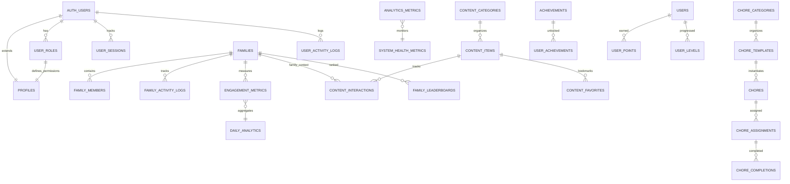

# Spectrum Harmony - Enhanced Project Knowledge Base
**Comprehensive Technical Documentation, Site Logic, Database Schema Design & System Architecture**

---

## 📋 PROJECT OVERVIEW

**Project Name:** Spectrum Harmony  
**Purpose:** A comprehensive web platform designed for autistic children, featuring educational games, communication support, and family engagement tools  
**Technology Stack:** React + TypeScript + Vite + Supabase + Tailwind CSS + Zustand  
**Target Users:** Autistic children, their parents/caregivers, and administrators  

### 🎯 Core Mission
Empowering autistic children through technology, education, and family connection with personalized learning experiences, communication support, and progress tracking in a secure, autism-friendly environment.

---

## 🏗️ CURRENT ARCHITECTURE STATUS (2025)

### **State Management Migration (COMPLETED)**
The application has fully migrated from React Context to Zustand for centralized state management:

```typescript
// NEW: Centralized Zustand Auth Store
interface AuthState {
  user: User | null;
  session: Session | null;
  userRole: string | null;
  isAdmin: boolean;
  loading: boolean;
  // Actions
  initialize: () => void;
  signUp: (email: string, password: string, firstName?: string, lastName?: string) => Promise<{ error: any }>;
  signIn: (email: string, password: string) => Promise<{ error: any }>;
  signOut: () => Promise<{ error: any }>;
}

// Bridge adapters maintain compatibility
export const useAuth = (): AuthContextType => {
  const store = useAuthStore();
  return {
    user: store.user,
    session: store.session,
    userRole: store.userRole,
    loading: store.loading,
    signUp: store.signUp,
    signIn: store.signIn,
    signOut: store.signOut
  };
};
```

### **Security Architecture (HARDENED + ENHANCED 2025)**
Recent security fixes and new enhancements include:
- **RLS Policy Hardening**: Removed dangerous "deny all" policies
- **Authentication Centralization**: Single source of truth for auth state
- **Admin Security**: Proper role verification with security definer functions
- **System Table Protection**: Service role and admin-only access for 14+ system tables
- **🆕 Rate Limiting**: Comprehensive rate limiting on all edge functions
- **🆕 Enhanced Password Security**: Strong password validation with autism-friendly feedback
- **🆕 Admin Action Monitoring**: Enhanced audit logging for all administrative actions
- **🆕 Security Utilities**: Centralized rate limiting and password validation systems

#### **⚠️ CRITICAL SECURITY WARNING**
- **Leaked Password Protection**: Currently DISABLED in Supabase Auth settings
- **Action Required**: Enable in Supabase Dashboard → Authentication → Settings
- **Risk Level**: HIGH - Users can use compromised passwords

---

## 🧠 SITE LOGIC & APPLICATION FLOW

### **Core Business Logic Patterns**

#### **Family-Centric Architecture**
All data is organized around family units with unique family codes following the pattern `FAM-YYYY-###`:
```typescript
// Family code generation logic
const generateFamilyCode = () => {
  const year = new Date().getFullYear();
  const sequence = getNextSequenceForYear(year);
  return `FAM-${year}-${sequence.toString().padStart(3, '0')}`;
};
// Examples: FAM-2025-001, FAM-2025-002, FAM-2025-003
```

#### **Role-Based Permission Hierarchy**
```typescript
type AppRole = 'admin' | 'parent' | 'child';

const permissionHierarchy = {
  admin: [
    'system_access', 'family_management', 'user_management', 
    'analytics', 'content_moderation', 'global_settings'
  ],
  parent: [
    'family_access', 'child_management', 'activity_monitoring',
    'family_settings', 'progress_reports'
  ],
  child: [
    'personal_data', 'educational_content', 'supervised_interaction',
    'progress_viewing', 'games_access'
  ]
};
```

#### **Automated User Provisioning Workflow**
Complex family creation handled by edge functions with atomic transactions:

1. **Validation Phase**: Verify admin permissions and input data
2. **Family Creation**: Generate unique family code and create family record
3. **User Creation**: Create Supabase auth accounts for all family members
4. **Profile Setup**: Auto-create profiles via database triggers
5. **Role Assignment**: Assign appropriate roles (parent/children)
6. **Family Association**: Link all members to family structure
7. **Activity Logging**: Record all creation activities for audit trail

### **Authentication State Management (CURRENT)**

#### **Centralized Zustand Store**
```typescript
// Current Implementation: Single source of truth
export const useAuthStore = create<AuthState>()(
  devtools(
    persist(
      (set, get) => ({
        // State
        user: null,
        session: null,
        userRole: null,
        isAdmin: false,
        loading: true,
        
        // Initialize auth listener
        initialize: async () => {
          const { data: { session }, error } = await supabase.auth.getSession();
          if (session) {
            set({ user: session.user, session });
            await get().fetchUserRole(session.user.id);
          }
          
          // Set up auth state change listener
          supabase.auth.onAuthStateChange(async (event, session) => {
            set({ user: session?.user || null, session });
            if (session?.user) {
              await get().fetchUserRole(session.user.id);
            } else {
              set({ userRole: null, isAdmin: false });
            }
            set({ loading: false });
          });
        },
        
        // Sign in with comprehensive logging
        signIn: async (email: string, password: string) => {
          const { data, error } = await supabase.auth.signInWithPassword({
            email,
            password
          });
          
          if (error) {
            await get().logActivity(null, 'failed_login', false, error.message);
            return { error };
          }
          
          await get().logActivity(data.user.id, 'login', true);
          return { error: null };
        }
      }),
      {
        name: 'auth-storage',
        partialize: (state) => ({ userRole: state.userRole, isAdmin: state.isAdmin })
      }
    ),
    { name: 'auth-store' }
  )
);
```

#### **Portal Routing Logic**
```typescript
const portalRouting = {
  admin: {
    path: '/admin/login',
    description: 'System administration and family management',
    securityLevel: 'high',
    features: ['analytics', 'user_management', 'content_control']
  },
  parent: {
    path: '/auth',
    description: 'Family dashboard and child management', 
    securityLevel: 'medium',
    features: ['family_overview', 'child_accounts', 'progress_tracking']
  },
  child: {
    path: '/games',
    description: 'Educational games and activities',
    securityLevel: 'supervised',
    features: ['educational_content', 'progress_viewing', 'safe_interaction']
  }
};
```

### **Activity Tracking & Session Management**
```typescript
interface ActivityLogging {
  user_activity: {
    events: ['login', 'logout', 'signup', 'profile_update', 'family_action'];
    metadata: 'ip_address, user_agent, device_info, session_duration';
    purpose: 'security_monitoring, usage_analytics, audit_compliance';
  };
  family_activity: {
    events: ['member_added', 'settings_changed', 'content_accessed', 'progress_updated'];
    scope: 'family-level interactions and changes';
    visibility: 'family_members and admins';
  };
}
```

---

## 🏗️ DATABASE SCHEMA DESIGN & ARCHITECTURE

### **Entity Relationship Architecture**



### **Database Design Principles**

#### **UUID Primary Keys for Distributed Architecture**
```sql
-- Consistent UUID usage across all entities
CREATE TABLE example_table (
  id UUID NOT NULL DEFAULT gen_random_uuid() PRIMARY KEY,
  -- other columns...
);

-- Benefits: Security, scalability, no integer sequence conflicts
```

#### **Comprehensive Audit Trail Design**
```sql
-- Standard timestamp pattern for all tables
CREATE TABLE audit_enabled_table (
  id UUID PRIMARY KEY DEFAULT gen_random_uuid(),
  -- business columns...
  created_at TIMESTAMP WITH TIME ZONE NOT NULL DEFAULT now(),
  updated_at TIMESTAMP WITH TIME ZONE NOT NULL DEFAULT now()
);

-- Automatic update trigger
CREATE TRIGGER update_updated_at_column
BEFORE UPDATE ON audit_enabled_table
FOR EACH ROW EXECUTE FUNCTION update_updated_at_column();
```

#### **JSONB Metadata for Extensibility**
```sql
-- Flexible metadata storage pattern
CREATE TABLE extensible_table (
  id UUID PRIMARY KEY DEFAULT gen_random_uuid(),
  -- core structured data...
  metadata JSONB DEFAULT '{}'::jsonb,           -- General extensibility
  device_info JSONB DEFAULT '{}'::jsonb,        -- Device/browser context
  activity_details JSONB DEFAULT '{}'::jsonb,   -- Specific interaction data
  autism_features JSONB DEFAULT '{}'::jsonb     -- Accessibility customizations
);

-- JSONB indexing for performance
CREATE INDEX idx_table_metadata_gin ON extensible_table USING GIN(metadata);
```

#### **Enum Constraints for Type Safety**
```sql
-- Custom PostgreSQL enums for controlled vocabularies
CREATE TYPE app_role AS ENUM ('admin', 'parent', 'child');
CREATE TYPE approval_status AS ENUM ('pending', 'approved', 'rejected');
CREATE TYPE content_type AS ENUM ('game', 'video', 'article', 'activity');
CREATE TYPE interaction_type AS ENUM ('view', 'play', 'complete', 'favorite', 'share');
CREATE TYPE chore_difficulty AS ENUM ('easy', 'medium', 'hard');
CREATE TYPE chore_status AS ENUM ('assigned', 'in_progress', 'completed', 'verified');
CREATE TYPE achievement_type AS ENUM ('streak', 'milestone', 'collaboration', 'skill');

-- Usage in table definitions
CREATE TABLE content_items (
  id UUID PRIMARY KEY DEFAULT gen_random_uuid(),
  content_type content_type NOT NULL,
  approval_status approval_status DEFAULT 'pending'
);
```

### **Core Database Tables & Relationships**

#### **User Management Schema (CURRENT)**
```sql
-- Extended user profiles (auth.users managed by Supabase)
CREATE TABLE profiles (
  id UUID PRIMARY KEY DEFAULT gen_random_uuid(),
  user_id UUID NOT NULL UNIQUE,              -- References auth.users(id)
  first_name TEXT,
  last_name TEXT, 
  email TEXT,                                 -- Cached from auth for easy access
  created_at TIMESTAMP WITH TIME ZONE NOT NULL DEFAULT now(),
  updated_at TIMESTAMP WITH TIME ZONE NOT NULL DEFAULT now()
);

-- Role assignments with enum constraints
CREATE TABLE user_roles (
  id UUID PRIMARY KEY DEFAULT gen_random_uuid(),
  user_id UUID NOT NULL,                     -- References auth.users(id)
  role app_role NOT NULL,
  created_at TIMESTAMP WITH TIME ZONE NOT NULL DEFAULT now(),
  UNIQUE(user_id, role)                      -- Prevent duplicate role assignments
);

-- Comprehensive session tracking
CREATE TABLE user_sessions (
  id UUID PRIMARY KEY DEFAULT gen_random_uuid(),
  user_id UUID NOT NULL,
  family_id UUID,                            -- Context for family-based sessions
  session_id TEXT NOT NULL,
  ip_address INET,
  user_agent TEXT,
  device_info JSONB DEFAULT '{}'::jsonb,
  started_at TIMESTAMP WITH TIME ZONE NOT NULL DEFAULT now(),
  ended_at TIMESTAMP WITH TIME ZONE,
  last_activity TIMESTAMP WITH TIME ZONE NOT NULL DEFAULT now(),
  is_active BOOLEAN NOT NULL DEFAULT true,
  created_at TIMESTAMP WITH TIME ZONE NOT NULL DEFAULT now(),
  updated_at TIMESTAMP WITH TIME ZONE NOT NULL DEFAULT now()
);

-- Activity logging with detailed metadata
CREATE TABLE user_activity_logs (
  id UUID PRIMARY KEY DEFAULT gen_random_uuid(),
  user_id UUID NOT NULL,
  activity_type TEXT NOT NULL,               -- 'login', 'logout', 'signup', etc.
  ip_address INET,
  user_agent TEXT,
  device_info JSONB DEFAULT '{}'::jsonb,
  session_id TEXT,
  success BOOLEAN NOT NULL DEFAULT true,
  failure_reason TEXT,
  metadata JSONB DEFAULT '{}'::jsonb,
  timestamp TIMESTAMP WITH TIME ZONE NOT NULL DEFAULT now(),
  created_at TIMESTAMP WITH TIME ZONE NOT NULL DEFAULT now()
);
```

#### **Family Management Schema**
```sql
-- Core family entities with auto-generated codes
CREATE TABLE families (
  id UUID PRIMARY KEY DEFAULT gen_random_uuid(),
  family_code TEXT NOT NULL UNIQUE,          -- Generated: FAM-YYYY-XXX
  display_name TEXT NOT NULL,               -- User-friendly name
  name TEXT NOT NULL,                       -- Internal: display_name + family_code
  created_by UUID NOT NULL,                 -- Parent who created family
  created_at TIMESTAMP WITH TIME ZONE NOT NULL DEFAULT now(),
  updated_at TIMESTAMP WITH TIME ZONE NOT NULL DEFAULT now()
);

-- Family composition and member roles
CREATE TABLE family_members (
  id UUID PRIMARY KEY DEFAULT gen_random_uuid(),
  family_id UUID NOT NULL,                  -- References families(id)
  user_id UUID NOT NULL,                   -- References auth.users(id) 
  role app_role NOT NULL DEFAULT 'child',
  invited_by UUID,                         -- Who added this member
  joined_at TIMESTAMP WITH TIME ZONE DEFAULT now(),
  created_at TIMESTAMP WITH TIME ZONE NOT NULL DEFAULT now(),
  UNIQUE(family_id, user_id)               -- Prevent duplicate memberships
);

-- Family-level activity tracking
CREATE TABLE family_activity_logs (
  id UUID PRIMARY KEY DEFAULT gen_random_uuid(),
  family_id UUID,
  user_id UUID NOT NULL,                   -- Who performed the action
  member_role app_role NOT NULL,           -- Role context of the action
  parent_user_id UUID,                     -- Parent context for child actions
  activity_type TEXT NOT NULL,
  activity_details JSONB DEFAULT '{}'::jsonb,
  timestamp TIMESTAMP WITH TIME ZONE NOT NULL DEFAULT now(),
  created_at TIMESTAMP WITH TIME ZONE NOT NULL DEFAULT now()
);
```

#### **Gamification & Chore Management Schema**
```sql
-- Chore category system
CREATE TABLE chore_categories (
  id UUID PRIMARY KEY DEFAULT gen_random_uuid(),
  name TEXT NOT NULL,
  description TEXT,
  icon TEXT,                               -- Lucide icon name
  color TEXT DEFAULT '#6366f1',
  sort_order INTEGER DEFAULT 0,
  is_active BOOLEAN DEFAULT true,
  autism_friendly_features JSONB DEFAULT '{}'::jsonb,
  created_at TIMESTAMP WITH TIME ZONE NOT NULL DEFAULT now(),
  updated_at TIMESTAMP WITH TIME ZONE NOT NULL DEFAULT now()
);

-- Reusable chore templates
CREATE TABLE chore_templates (
  id UUID PRIMARY KEY DEFAULT gen_random_uuid(),
  title TEXT NOT NULL,
  description TEXT,
  category_id UUID,                        -- References chore_categories(id)
  difficulty chore_difficulty DEFAULT 'medium',
  base_points INTEGER DEFAULT 10,
  estimated_duration INTEGER DEFAULT 15,   -- Minutes
  age_min INTEGER DEFAULT 3,
  age_max INTEGER DEFAULT 18,
  instructions JSONB DEFAULT '[]'::jsonb,  -- Step-by-step instructions
  autism_accommodations JSONB DEFAULT '{}'::jsonb,
  sensory_considerations JSONB DEFAULT '{}'::jsonb,
  is_active BOOLEAN DEFAULT true,
  created_by UUID,
  created_at TIMESTAMP WITH TIME ZONE NOT NULL DEFAULT now(),
  updated_at TIMESTAMP WITH TIME ZONE NOT NULL DEFAULT now()
);

-- Family-specific chore instances
CREATE TABLE chores (
  id UUID PRIMARY KEY DEFAULT gen_random_uuid(),
  family_id UUID,                         -- References families(id)
  template_id UUID,                       -- References chore_templates(id)
  title TEXT NOT NULL,
  description TEXT,
  category_id UUID,
  difficulty chore_difficulty DEFAULT 'medium',
  base_points INTEGER DEFAULT 10,
  estimated_duration INTEGER DEFAULT 15,
  instructions JSONB DEFAULT '[]'::jsonb,
  custom_settings JSONB DEFAULT '{}'::jsonb,
  is_active BOOLEAN DEFAULT true,
  created_by UUID NOT NULL,
  created_at TIMESTAMP WITH TIME ZONE NOT NULL DEFAULT now(),
  updated_at TIMESTAMP WITH TIME ZONE NOT NULL DEFAULT now()
);

-- Chore assignments to family members
CREATE TABLE chore_assignments (
  id UUID PRIMARY KEY DEFAULT gen_random_uuid(),
  chore_id UUID,                          -- References chores(id)
  family_id UUID,                        -- References families(id)
  assigned_to UUID NOT NULL,             -- Child assigned to complete
  assigned_by UUID NOT NULL,             -- Parent who assigned
  due_date DATE,
  recurrence_pattern JSONB DEFAULT '{}'::jsonb,
  status chore_status DEFAULT 'assigned',
  assigned_at TIMESTAMP WITH TIME ZONE NOT NULL DEFAULT now(),
  started_at TIMESTAMP WITH TIME ZONE,
  completed_at TIMESTAMP WITH TIME ZONE,
  points_earned INTEGER DEFAULT 0,
  time_bonus INTEGER DEFAULT 0,
  streak_bonus INTEGER DEFAULT 0,
  completion_notes TEXT,
  parent_feedback TEXT,
  is_verified BOOLEAN DEFAULT false,
  verified_by UUID,
  verified_at TIMESTAMP WITH TIME ZONE,
  created_at TIMESTAMP WITH TIME ZONE NOT NULL DEFAULT now(),
  updated_at TIMESTAMP WITH TIME ZONE NOT NULL DEFAULT now()
);

-- Chore completion tracking
CREATE TABLE chore_completions (
  id UUID PRIMARY KEY DEFAULT gen_random_uuid(),
  assignment_id UUID,                    -- References chore_assignments(id)
  chore_id UUID,                        -- References chores(id)
  family_id UUID,                       -- References families(id)
  user_id UUID NOT NULL,                -- Child who completed
  completion_date DATE NOT NULL DEFAULT CURRENT_DATE,
  time_started TIMESTAMP WITH TIME ZONE,
  time_completed TIMESTAMP WITH TIME ZONE NOT NULL DEFAULT now(),
  actual_duration INTEGER,               -- Actual time taken in minutes
  points_earned INTEGER DEFAULT 0,
  difficulty_rating INTEGER,            -- Child's perceived difficulty (1-5)
  satisfaction_rating INTEGER,          -- Child's satisfaction (1-5)
  completion_notes TEXT,
  completion_photos TEXT[],             -- Photo evidence URLs
  mini_game_scores JSONB DEFAULT '{}'::jsonb,
  metadata JSONBOOK DEFAULT '{}'::jsonb,
  created_at TIMESTAMP WITH TIME ZONE NOT NULL DEFAULT now()
);
```

#### **Achievement & Points System**
```sql
-- Achievement definitions
CREATE TABLE achievements (
  id UUID PRIMARY KEY DEFAULT gen_random_uuid(),
  name TEXT NOT NULL,
  description TEXT NOT NULL,
  achievement_type achievement_type NOT NULL,
  unlock_criteria JSONB NOT NULL,         -- Conditions for unlocking
  point_reward INTEGER DEFAULT 0,
  xp_reward INTEGER DEFAULT 0,
  icon TEXT,                             -- Achievement icon
  rarity TEXT DEFAULT 'common',          -- common, rare, epic, legendary
  is_secret BOOLEAN DEFAULT false,       -- Hidden until unlocked
  is_active BOOLEAN DEFAULT true,
  created_at TIMESTAMP WITH TIME ZONE NOT NULL DEFAULT now(),
  updated_at TIMESTAMP WITH TIME ZONE NOT NULL DEFAULT now()
);

-- User achievement unlocks
CREATE TABLE user_achievements (
  id UUID PRIMARY KEY DEFAULT gen_random_uuid(),
  user_id UUID NOT NULL,
  family_id UUID,
  achievement_id UUID,                   -- References achievements(id)
  unlocked_at TIMESTAMP WITH TIME ZONE NOT NULL DEFAULT now(),
  progress JSONB DEFAULT '{}'::jsonb,    -- Progress towards achievement
  metadata JSONB DEFAULT '{}'::jsonb
);

-- User point tracking
CREATE TABLE user_points (
  id UUID PRIMARY KEY DEFAULT gen_random_uuid(),
  user_id UUID NOT NULL,
  family_id UUID,
  current_points INTEGER DEFAULT 0,      -- Available to spend
  lifetime_points INTEGER DEFAULT 0,     -- Total earned ever
  weekly_points INTEGER DEFAULT 0,       -- This week's points
  monthly_points INTEGER DEFAULT 0,      -- This month's points
  created_at TIMESTAMP WITH TIME ZONE NOT NULL DEFAULT now(),
  updated_at TIMESTAMP WITH TIME ZONE NOT NULL DEFAULT now(),
  UNIQUE(user_id, family_id)
);

-- User level progression
CREATE TABLE user_levels (
  id UUID PRIMARY KEY DEFAULT gen_random_uuid(),
  user_id UUID NOT NULL,
  family_id UUID,
  current_level INTEGER DEFAULT 1,
  level_name TEXT DEFAULT 'Rookie Helper',
  current_xp INTEGER DEFAULT 0,          -- XP towards next level
  total_xp INTEGER DEFAULT 0,            -- Total XP earned
  next_level_xp INTEGER DEFAULT 100,     -- XP needed for next level
  level_up_date TIMESTAMP WITH TIME ZONE,
  created_at TIMESTAMP WITH TIME ZONE NOT NULL DEFAULT now(),
  updated_at TIMESTAMP WITH TIME ZONE NOT NULL DEFAULT now(),
  UNIQUE(user_id, family_id)
);

-- Family leaderboards
CREATE TABLE family_leaderboards (
  id UUID PRIMARY KEY DEFAULT gen_random_uuid(),
  family_id UUID,
  user_id UUID NOT NULL,
  leaderboard_type TEXT NOT NULL,        -- 'weekly', 'monthly', 'all_time'
  rank INTEGER DEFAULT 1,
  points INTEGER DEFAULT 0,
  chores_completed INTEGER DEFAULT 0,
  achievements_unlocked INTEGER DEFAULT 0,
  collaboration_score NUMERIC DEFAULT 0,
  period_start DATE NOT NULL,
  period_end DATE NOT NULL,
  last_updated TIMESTAMP WITH TIME ZONE NOT NULL DEFAULT now()
);
```

### **Custom Database Functions & Business Logic**

#### **Family Code Generation System**
```sql
CREATE OR REPLACE FUNCTION generate_family_code()
RETURNS TEXT
LANGUAGE plpgsql
SECURITY DEFINER
SET search_path TO 'public'
AS $$
DECLARE
  current_year TEXT;
  next_number INTEGER;
  new_family_code TEXT;
BEGIN
  -- Get current year for code generation
  current_year := EXTRACT(YEAR FROM NOW())::TEXT;
  
  -- Find the next sequential number for this year
  SELECT COALESCE(MAX(
    CASE 
      WHEN f.family_code LIKE 'FAM-' || current_year || '-%' 
      THEN CAST(SPLIT_PART(f.family_code, '-', 3) AS INTEGER)
      ELSE 0
    END
  ), 0) + 1
  INTO next_number
  FROM public.families f
  WHERE f.family_code IS NOT NULL;
  
  -- Format the family code: FAM-YYYY-XXX
  new_family_code := 'FAM-' || current_year || '-' || LPAD(next_number::TEXT, 3, '0');
  
  RETURN new_family_code;
END;
$$;
```

#### **Role Checking (Prevents RLS Recursion)**
```sql
CREATE OR REPLACE FUNCTION has_role(_user_id UUID, _role app_role)
RETURNS BOOLEAN
LANGUAGE sql
STABLE SECURITY DEFINER
SET search_path TO 'public'
AS $$
  SELECT EXISTS (
    SELECT 1
    FROM public.user_roles
    WHERE user_id = _user_id
      AND role = _role
  )
$$;
```

#### **Family Access Control Functions**
```sql
-- Check if user created a family
CREATE OR REPLACE FUNCTION is_family_creator(family_id_param UUID, user_id_param UUID)
RETURNS BOOLEAN
LANGUAGE sql
STABLE SECURITY DEFINER
SET search_path TO 'public'
AS $$
  SELECT EXISTS (
    SELECT 1 FROM public.families 
    WHERE id = family_id_param AND created_by = user_id_param
  );
$$;

-- Check if user is member of a family
CREATE OR REPLACE FUNCTION is_family_member(family_id_param UUID, user_id_param UUID)
RETURNS BOOLEAN
LANGUAGE sql
STABLE SECURITY DEFINER
SET search_path TO 'public'
AS $$
  SELECT EXISTS (
    SELECT 1 FROM public.family_members 
    WHERE family_id = family_id_param AND user_id = user_id_param
  );
$$;
```

#### **Gamification Logic Functions**
```sql
-- Calculate points with bonuses
CREATE OR REPLACE FUNCTION calculate_chore_points(
  base_points INTEGER,
  difficulty chore_difficulty,
  completion_time INTEGER DEFAULT NULL,
  estimated_time INTEGER DEFAULT NULL,
  streak_count INTEGER DEFAULT 0
)
RETURNS INTEGER
LANGUAGE plpgsql
SECURITY DEFINER
SET search_path TO 'public'
AS $$
DECLARE
  final_points INTEGER;
  difficulty_multiplier NUMERIC;
  time_bonus NUMERIC := 0;
  streak_bonus NUMERIC := 0;
BEGIN
  -- Base points with difficulty multiplier
  CASE difficulty
    WHEN 'easy' THEN difficulty_multiplier := 1.0;
    WHEN 'medium' THEN difficulty_multiplier := 1.5;
    WHEN 'hard' THEN difficulty_multiplier := 2.0;
    ELSE difficulty_multiplier := 1.0;
  END CASE;
  
  final_points := ROUND(base_points * difficulty_multiplier);
  
  -- Time bonus for completing faster than estimated
  IF completion_time IS NOT NULL AND estimated_time IS NOT NULL THEN
    IF completion_time < estimated_time THEN
      time_bonus := ROUND(final_points * 0.2); -- 20% bonus for speed
    END IF;
  END IF;
  
  -- Streak bonus
  IF streak_count > 0 THEN
    streak_bonus := LEAST(streak_count * 2, final_points * 0.5); -- Max 50% streak bonus
  END IF;
  
  RETURN final_points + time_bonus::INTEGER + streak_bonus::INTEGER;
END;
$$;

-- Calculate user level progression
CREATE OR REPLACE FUNCTION calculate_level_progression(current_xp INTEGER)
RETURNS TABLE(level INTEGER, level_name TEXT, next_level_xp INTEGER)
LANGUAGE plpgsql
SECURITY DEFINER
SET search_path TO 'public'
AS $$
DECLARE
  calculated_level INTEGER;
  level_names TEXT[] := ARRAY[
    'Rookie Helper', 'Task Learner', 'Chore Champion', 'Daily Hero', 'Family Star',
    'Organization Expert', 'Time Master', 'Responsibility Leader', 'Household Guardian', 'Family Champion'
  ];
BEGIN
  -- Simple XP to level calculation (exponential growth)
  calculated_level := LEAST(FLOOR(SQRT(current_xp / 100.0)) + 1, 10);
  
  RETURN QUERY SELECT 
    calculated_level,
    COALESCE(level_names[calculated_level], 'Ultimate Champion'),
    (calculated_level * calculated_level * 100)::INTEGER;
END;
$$;
```

---

## 🔒 SECURITY ARCHITECTURE (CURRENT STATE)

### **Row Level Security Implementation**
The application uses comprehensive RLS policies across all tables:

#### **Profile Access Control**
```sql
-- Users can view their own profile
CREATE POLICY "Users can view own profile" 
ON profiles FOR SELECT 
USING (auth.uid() = user_id);

-- Parents can view family member profiles
CREATE POLICY "Parents view family profiles" 
ON profiles FOR SELECT 
USING (
  has_role(auth.uid(), 'parent'::app_role) AND (
    EXISTS (
      SELECT 1 FROM family_members fm
      JOIN families f ON fm.family_id = f.id
      WHERE f.created_by = auth.uid() AND fm.user_id = profiles.user_id
    )
  )
);

-- Admins can view all profiles
CREATE POLICY "Admins view all profiles" 
ON profiles FOR SELECT 
USING (has_role(auth.uid(), 'admin'::app_role));
```

#### **Family Data Access**
```sql
-- Family creators can update their families
CREATE POLICY "Parents can update their families" 
ON families FOR UPDATE 
USING (
  auth.uid() = created_by AND 
  has_role(auth.uid(), 'parent'::app_role)
);

-- Family members can view family data
CREATE POLICY "Family members can view their family members" 
ON family_members FOR SELECT 
USING (is_family_member(family_id, auth.uid()));
```

#### **System Table Protection**
```sql
-- Analytics metrics - Service role and admins only
CREATE POLICY "Authenticated system can insert analytics metrics" 
ON analytics_metrics FOR INSERT 
WITH CHECK (
  auth.role() = 'service_role' OR 
  (auth.uid() IS NOT NULL)
);

-- System errors - Service role and admins only
CREATE POLICY "Authenticated system can insert errors" 
ON system_errors FOR INSERT 
WITH CHECK (
  auth.role() = 'service_role' OR 
  (auth.uid() IS NOT NULL)
);
```

### **Authentication Security**
```typescript
// Comprehensive auth logging
const logActivity = async (
  userId: string | null,
  activityType: 'login' | 'logout' | 'signup' | 'failed_login',
  success: boolean = true,
  failureReason?: string,
  metadata?: any
) => {
  const deviceInfo = getDeviceInfo();
  
  await supabase.rpc('log_user_activity', {
    p_user_id: userId,
    p_activity_type: activityType,
    p_device_info: deviceInfo,
    p_success: success,
    p_failure_reason: failureReason,
    p_metadata: metadata || {}
  });
};
```

---

## 🎮 GAMIFICATION SYSTEM

### **Points & Rewards System**
```typescript
interface GamificationLogic {
  points: {
    base_calculation: 'difficulty_multiplier * base_points';
    bonuses: {
      speed_bonus: '20% if completed faster than estimated';
      streak_bonus: 'up to 50% based on consecutive days';
      collaboration_bonus: '10% for helping family members';
    };
  };
  
  levels: {
    calculation: 'sqrt(total_xp / 100) + 1';
    max_level: 10;
    titles: [
      'Rookie Helper', 'Task Learner', 'Chore Champion', 
      'Daily Hero', 'Family Star', 'Organization Expert',
      'Time Master', 'Responsibility Leader', 
      'Household Guardian', 'Family Champion'
    ];
  };
  
  achievements: {
    types: ['streak', 'milestone', 'collaboration', 'skill'];
    unlock_criteria: 'JSONB field with flexible conditions';
    rewards: 'points + xp + special recognition';
  };
}
```

### **Family Collaboration Features**
```typescript
// Peer recognition system
interface PeerRecognition {
  recognition_types: ['high_five', 'thank_you', 'great_job', 'helpful'];
  points_awarded: 'small amount (1-5 points)';
  family_visibility: 'all family members see recognitions';
  motivation_boost: 'positive reinforcement system';
}

// Family challenges
interface FamilyChallenge {
  challenge_types: ['collaboration', 'consistency', 'improvement'];
  participant_tracking: 'individual contributions to family goal';
  reward_sharing: 'bonus points distributed to all participants';
  progress_visualization: 'family dashboard shows collective progress';
}
```

---

## 📊 ANALYTICS & REPORTING

### **Multi-Level Analytics**
```typescript
interface AnalyticsArchitecture {
  user_level: {
    metrics: ['engagement_score', 'session_duration', 'actions_performed'];
    privacy: 'user sees own data only';
    retention_tracking: 'login frequency and patterns';
  };
  
  family_level: {
    metrics: ['family_engagement', 'child_progress', 'chore_completion_rates'];
    visibility: 'parents see family aggregate data';
    insights: 'trends and improvement suggestions';
  };
  
  system_level: {
    metrics: ['active_users', 'content_interactions', 'system_health'];
    access: 'admin-only comprehensive dashboard';
    monitoring: 'real-time alerts and performance tracking';
  };
}
```

### **Materialized Views for Performance**
```sql
-- Pre-computed daily analytics
CREATE MATERIALIZED VIEW daily_analytics AS
SELECT 
  date_trunc('day', created_at)::date as date,
  COUNT(DISTINCT user_id) as active_users,
  COUNT(*) FILTER (WHERE activity_type = 'login') as total_logins,
  COUNT(DISTINCT user_id) FILTER (WHERE activity_type = 'signup') as new_signups,
  AVG(
    CASE WHEN activity_type = 'login' 
    THEN EXTRACT(EPOCH FROM (updated_at - created_at))
    END
  ) as avg_session_duration
FROM user_activity_logs
GROUP BY date_trunc('day', created_at)::date
ORDER BY date DESC;

-- Refresh function for automated updates
CREATE OR REPLACE FUNCTION refresh_analytics_automated()
RETURNS TEXT
LANGUAGE plpgsql
SECURITY DEFINER
AS $$
BEGIN
  REFRESH MATERIALIZED VIEW CONCURRENTLY daily_analytics;
  
  INSERT INTO analytics_metrics (
    metric_type, metric_name, metric_value, metadata
  ) VALUES (
    'system_performance', 'analytics_refresh', 1,
    json_build_object('refreshed_at', now(), 'automated', true)
  );
  
  RETURN 'Analytics refreshed successfully at ' || now()::text;
END;
$$;
```

---

## 🚀 SYSTEM PERFORMANCE & OPTIMIZATION

### **Frontend Performance**
```typescript
// Code splitting for large components
const AdminDashboard = lazy(() => import('./pages/admin/AdminDashboard'));
const GamesCatalog = lazy(() => import('./pages/GamesCatalog'));

// Memoized expensive computations
const analytics = useMemo(() => {
  return processAnalyticsData(rawData);
}, [rawData]);

// Optimized re-renders
const MemoizedComponent = React.memo(({ data, onUpdate }) => {
  return <ExpensiveComponent data={data} onUpdate={onUpdate} />;
});
```

### **Database Performance**
```sql
-- Strategic indexing for common queries
CREATE INDEX idx_user_activity_logs_user_id_timestamp 
ON user_activity_logs(user_id, timestamp DESC);

CREATE INDEX idx_family_members_family_id 
ON family_members(family_id) WHERE role = 'child';

CREATE INDEX idx_chore_assignments_assigned_to_status 
ON chore_assignments(assigned_to, status) WHERE status != 'completed';

-- JSONB indexing for metadata searches
CREATE INDEX idx_content_items_autism_features 
ON content_items USING GIN(autism_features);
```

---

## 🔧 CURRENT DEVELOPMENT STATUS

### **Completed Components**
- ✅ **Authentication System**: Zustand-based centralized auth
- ✅ **Admin Dashboard**: Family management and system monitoring
- ✅ **RLS Security**: Comprehensive row-level security policies
- ✅ **Analytics Engine**: Multi-level reporting and metrics
- ✅ **Family Management**: Creation, member management, activity tracking
- ✅ **Content System**: Games catalog with autism-friendly features
- ✅ **Gamification Core**: Points, levels, achievements system

### **In Progress**
- 🔄 **Chore Management**: Assignment and completion workflows
- 🔄 **Real-time Features**: Live family activity updates
- 🔄 **Advanced Analytics**: Predictive insights and recommendations
- 🔄 **Mobile Responsiveness**: Enhanced mobile experience

### **Planned Features**
- 📋 **Communication Tools**: Family messaging and check-ins
- 📋 **Progress Visualization**: Interactive charts and progress bars
- 📋 **Customization Engine**: Autism-specific accommodation settings
- 📋 **Integration APIs**: Third-party educational content integration

### **Technical Debt & Improvements**
- 🔧 **Bridge Adapter Removal**: Phase out compatibility layers
- 🔧 **Hook Dependency Resolution**: Resolve circular dependencies in useAuthLogging
- 🔧 **Performance Optimization**: Query optimization and caching strategies
- 🔧 **Test Coverage**: Comprehensive unit and integration testing

---

## 🏗️ DEPLOYMENT & INFRASTRUCTURE

### **Current Deployment**
- **Platform**: Lovable.dev hosting
- **Database**: Supabase PostgreSQL with global distribution
- **CDN**: Automatic asset optimization and caching
- **SSL**: Automatic HTTPS with custom domain support

### **Monitoring & Observability**
```typescript
// Error tracking and performance monitoring
interface MonitoringSystem {
  error_tracking: {
    frontend_errors: 'React error boundaries with detailed logging';
    backend_errors: 'Supabase function error logging';
    user_impact: 'Error rate tracking per user session';
  };
  
  performance_monitoring: {
    page_load_times: 'Core Web Vitals tracking';
    api_response_times: 'Database query performance';
    user_interaction_lag: 'UI responsiveness measurements';
  };
  
  security_monitoring: {
    failed_login_attempts: 'Brute force detection';
    unusual_access_patterns: 'Anomaly detection algorithms';
    data_access_auditing: 'Comprehensive audit trail';
  };
}
```

---

## 🎯 AUTISM-SPECIFIC DESIGN PRINCIPLES

### **Sensory-Friendly Design**
```css
/* Reduced motion preferences */
@media (prefers-reduced-motion: reduce) {
  * {
    animation-duration: 0.01ms !important;
    animation-iteration-count: 1 !important;
    transition-duration: 0.01ms !important;
  }
}

/* High contrast mode support */
@media (prefers-contrast: high) {
  :root {
    --border: hsl(0 0% 0%);
    --background: hsl(0 0% 100%);
    --foreground: hsl(0 0% 0%);
  }
}

/* Customizable color themes */
:root {
  --calming-blue: hsl(210 50% 85%);
  --soft-green: hsl(120 30% 85%);
  --warm-yellow: hsl(48 85% 88%);
  --gentle-purple: hsl(270 30% 85%);
}
```

### **Cognitive Load Reduction**
```typescript
interface AutismFriendlyFeatures {
  navigation: {
    consistent_layout: 'Same navigation pattern across all pages';
    clear_breadcrumbs: 'Always show current location';
    limited_options: 'Maximum 7 items per menu level';
  };
  
  content_presentation: {
    chunked_information: 'Break complex tasks into small steps';
    visual_hierarchy: 'Clear headings and section separation';
    progress_indicators: 'Show completion status for all tasks';
  };
  
  interaction_design: {
    predictable_responses: 'Consistent feedback for all actions';
    confirmation_dialogs: 'Prevent accidental destructive actions';
    multiple_input_methods: 'Support keyboard, mouse, and touch';
  };
}
```

---

## 📚 API REFERENCE

### **Custom Supabase RPC Functions**
```typescript
// Analytics functions
await supabase.rpc('get_engagement_analytics', { days_back: 30 });
await supabase.rpc('calculate_user_retention', { days_back: 30 });
await supabase.rpc('get_daily_analytics_for_admins', { days_back: 7 });

// Family management
await supabase.rpc('generate_family_code');
await supabase.rpc('is_family_creator', { family_id_param: familyId, user_id_param: userId });
await supabase.rpc('is_family_member', { family_id_param: familyId, user_id_param: userId });

// Activity logging
await supabase.rpc('log_user_activity', {
  p_user_id: userId,
  p_activity_type: 'login',
  p_success: true,
  p_metadata: { login_method: 'email' }
});

await supabase.rpc('log_family_activity', {
  p_family_id: familyId,
  p_user_id: userId,
  p_member_role: 'child',
  p_activity_type: 'chore_completed',
  p_activity_details: { chore_id: choreId, points_earned: 15 }
});

// Gamification functions
await supabase.rpc('calculate_chore_points', {
  base_points: 10,
  difficulty: 'medium',
  completion_time: 8,
  estimated_time: 15,
  streak_count: 3
});

await supabase.rpc('check_and_award_achievements', {
  p_user_id: userId,
  p_family_id: familyId,
  p_completion_data: { chore_type: 'cleaning', difficulty: 'hard' }
});

await supabase.rpc('update_user_gamification_stats', {
  p_user_id: userId,
  p_family_id: familyId,
  p_points_earned: 25,
  p_xp_earned: 30
});

// System administration
await supabase.rpc('get_error_statistics', { days_back: 7 });
await supabase.rpc('resolve_system_error', { error_id: errorId });
await supabase.rpc('refresh_daily_analytics_secure');
```

### **Edge Functions**
```typescript
// Admin password reset endpoint with enhanced security
POST /functions/v1/admin-update-user
Headers: { Authorization: Bearer <admin_jwt_token> }
Body: {
  userId: "user_uuid",
  newPassword: "SecureP@ssw0rd123",
  forcePasswordChange: false
}
Features: Rate limiting (3 resets per 15 minutes), Strong password validation, Activity logging

// Family creation endpoint for admin testing
POST /functions/v1/create-test-family
Headers: { Authorization: Bearer <admin_jwt_token> }
Body: {
  displayName: "Smith Family",
  parent1: {
    firstName: "John",
    lastName: "Smith", 
    email: "john.smith@example.com"
  },
  parent2?: {
    firstName: "Jane",
    lastName: "Smith",
    email: "jane.smith@example.com"
  },
  children: [
    {
      firstName: "Alex",
      lastName: "Smith",
      email: "alex.smith@example.com"
    }
  ],
  createdBy: "admin_user_id"
}
Features: Atomic family creation, Automatic user provisioning, Temporary password generation

// Error collection endpoint with rate limiting
POST /functions/v1/error-collector
Body: {
  errorType: "javascript_error",
  severity: "high",
  message: "Cannot read property 'id' of undefined",
  stackTrace: "...",
  componentName: "GameCard",
  routePath: "/games",
  userId?: "user_uuid",
  sessionId?: "session_id",
  browserInfo: { userAgent: "...", language: "en-US" },
  deviceInfo: { screenWidth: 1920, screenHeight: 1080 },
  metadata: { gameId: "abc123" }
}
Features: Rate limiting (50 errors per minute), Pattern deduplication, Critical error alerting

// Analytics query endpoint for admin insights
POST /functions/v1/supabase-analytics-query
Headers: { Authorization: Bearer <admin_jwt_token> }
Body: {
  query: "SELECT * FROM postgres_logs ORDER BY timestamp DESC LIMIT 100",
  filters: {
    severity?: "ERROR",
    limit?: 50
  }
}
Features: Rate limiting (20 queries per minute), Secure admin-only access, Fallback data when RPC unavailable
```

---

## 🔮 FUTURE ROADMAP

### **Phase 1: Enhanced Gamification (Q1 2025)**
- Advanced achievement system with custom family achievements
- Reward redemption marketplace with real-world rewards
- Collaborative family challenges with shared goals
- Progress visualization with interactive charts

### **Phase 2: AI-Powered Insights (Q2 2025)**
- Personalized task recommendations based on child preferences
- Predictive analytics for optimal task scheduling
- Autism-specific accommodation suggestions
- Behavioral pattern recognition and insights

### **Phase 3: Extended Family Network (Q3 2025)**
- Multi-family connections (grandparents, extended family)
- Shared achievement celebrations across families
- Resource sharing and recommendation engine
- Community challenges and events

### **Phase 4: Integration Ecosystem (Q4 2025)**
- Educational platform integrations (Khan Academy, IXL)
- Smart home device integration for task reminders
- Wearable device support for activity tracking
- Third-party therapy tool integrations

---

**Documentation Version**: 3.1  
**Last Updated**: 2025-08-29  
**Migration Status**: Zustand Implementation Complete  
**Security Status**: Enhanced with Rate Limiting & Password Validation  
**🚨 Action Required**: Enable Leaked Password Protection in Supabase Auth  
**Next Review**: Q1 2025