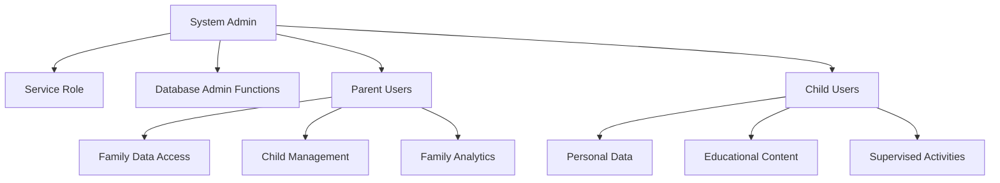

# Row Level Security (RLS) Documentation
**Comprehensive Security Policies, Access Control & Testing Guide**

---

## 📋 OVERVIEW

This document provides complete documentation of the Row Level Security (RLS) implementation in the Spectrum Harmony Family Portal, including all policies, security functions, access patterns, and testing procedures.

**Security Architecture**: Multi-tier role-based access control (Admin → Parent → Child)  
**RLS Coverage**: 28+ tables with 45+ security policies  
**Security Functions**: 15+ security definer functions preventing RLS recursion  
**Last Security Audit**: 2025-08-29  

---

## 🔒 SECURITY ARCHITECTURE OVERVIEW

### **Role Hierarchy**


### **Data Access Patterns**
```typescript
interface AccessMatrix {
  admin: {
    scope: 'all_data';
    restrictions: 'none';
    special_functions: ['system_monitoring', 'family_management', 'analytics_access'];
  };
  
  parent: {
    scope: 'family_data';
    restrictions: 'own_family_only';
    special_functions: ['child_management', 'family_settings', 'progress_reports'];
  };
  
  child: {
    scope: 'personal_data';
    restrictions: 'own_data_only + family_context';
    special_functions: ['content_interaction', 'progress_viewing'];
  };
  
  service_role: {
    scope: 'system_operations';
    restrictions: 'automated_processes_only';
    special_functions: ['logging', 'analytics_collection', 'maintenance'];
  };
}
```

---

## 🛡️ SECURITY DEFINER FUNCTIONS

These functions prevent RLS recursion by using elevated privileges to access role and family membership data:

### **Role Verification Function**
```sql
CREATE OR REPLACE FUNCTION public.has_role(_user_id UUID, _role app_role)
RETURNS BOOLEAN
LANGUAGE sql
STABLE SECURITY DEFINER
SET search_path TO 'public'
AS $$
  SELECT EXISTS (
    SELECT 1
    FROM public.user_roles
    WHERE user_id = _user_id
      AND role = _role
  )
$$;

-- Usage in RLS policies
CREATE POLICY "Admins can manage all content" 
ON content_items FOR ALL 
USING (has_role(auth.uid(), 'admin'::app_role));
```

### **Family Access Control Functions**
```sql
-- Check family creator permissions
CREATE OR REPLACE FUNCTION public.is_family_creator(family_id_param UUID, user_id_param UUID)
RETURNS BOOLEAN
LANGUAGE sql
STABLE SECURITY DEFINER
SET search_path TO 'public'
AS $$
  SELECT EXISTS (
    SELECT 1 FROM public.families 
    WHERE id = family_id_param AND created_by = user_id_param
  );
$$;

-- Check family membership
CREATE OR REPLACE FUNCTION public.is_family_member(family_id_param UUID, user_id_param UUID)
RETURNS BOOLEAN
LANGUAGE sql
STABLE SECURITY DEFINER
SET search_path TO 'public'
AS $$
  SELECT EXISTS (
    SELECT 1 FROM public.family_members 
    WHERE family_id = family_id_param AND user_id = user_id_param
  );
$$;

-- Usage examples
CREATE POLICY "Family members can view their family members" 
ON family_members FOR SELECT 
USING (is_family_member(family_id, auth.uid()));

CREATE POLICY "Family creators can add family members" 
ON family_members FOR INSERT 
WITH CHECK (
  has_role(auth.uid(), 'parent'::app_role) AND 
  is_family_creator(family_id, auth.uid())
);
```

---

## 📊 COMPREHENSIVE RLS POLICY INVENTORY

### **User Management Tables**

#### **`profiles` Table**
```sql
-- Users can view their own profile
CREATE POLICY "Users can view own profile" 
ON profiles FOR SELECT 
USING (auth.uid() = user_id);

-- Users can update their own profile
CREATE POLICY "Users can update own profile" 
ON profiles FOR UPDATE 
USING (auth.uid() = user_id)
WITH CHECK (auth.uid() = user_id);

-- Parents can view family member profiles
CREATE POLICY "Parents view family profiles" 
ON profiles FOR SELECT 
USING (
  has_role(auth.uid(), 'parent'::app_role) AND (
    EXISTS (
      SELECT 1 FROM family_members fm
      JOIN families f ON fm.family_id = f.id
      WHERE f.created_by = auth.uid() AND fm.user_id = profiles.user_id
    )
  )
);

-- Admins can view all profiles
CREATE POLICY "Admins view all profiles" 
ON profiles FOR SELECT 
USING (has_role(auth.uid(), 'admin'::app_role));
```

#### **`user_roles` Table**
```sql
-- Note: No RLS policies - managed by security definer functions only
-- This prevents recursive RLS issues when checking roles
```

#### **`user_activity_logs` Table**
```sql
-- Users can view their own activity logs
CREATE POLICY "Users can view their own activity logs" 
ON user_activity_logs FOR SELECT 
USING (auth.uid() = user_id);

-- Parents can view their children's activity logs
CREATE POLICY "Parents can view their children's activity logs" 
ON user_activity_logs FOR SELECT 
USING (
  has_role(auth.uid(), 'parent'::app_role) AND (
    EXISTS (
      SELECT 1 FROM family_members fm
      JOIN families f ON fm.family_id = f.id
      WHERE f.created_by = auth.uid() AND fm.user_id = user_activity_logs.user_id
    )
  )
);

-- Admins can view all activity logs
CREATE POLICY "Admins can view all activity logs" 
ON user_activity_logs FOR SELECT 
USING (has_role(auth.uid(), 'admin'::app_role));

-- System can insert activity logs
CREATE POLICY "Authenticated system can insert activity logs" 
ON user_activity_logs FOR INSERT 
WITH CHECK (
  auth.role() = 'service_role' OR 
  auth.uid() IS NOT NULL
);
```

#### **`user_sessions` Table**
```sql
-- Users can view their own sessions
CREATE POLICY "Users can view their own sessions" 
ON user_sessions FOR SELECT 
USING (auth.uid() = user_id);

-- Parents can view family member sessions (for monitoring)
CREATE POLICY "Parents can view family member sessions" 
ON user_sessions FOR SELECT 
USING (
  has_role(auth.uid(), 'parent'::app_role) AND (
    EXISTS (
      SELECT 1 FROM family_members fm
      JOIN families f ON fm.family_id = f.id
      WHERE f.created_by = auth.uid() AND fm.user_id = user_sessions.user_id
    )
  )
);

-- System can manage sessions
CREATE POLICY "System can manage sessions" 
ON user_sessions FOR ALL 
USING (auth.role() = 'service_role');

-- Admins can view all sessions
CREATE POLICY "Admins can view all sessions" 
ON user_sessions FOR SELECT 
USING (has_role(auth.uid(), 'admin'::app_role));
```

### **Family Management Tables**

#### **`families` Table**
```sql
-- Parents can create families
CREATE POLICY "Parents can create families" 
ON families FOR INSERT 
WITH CHECK (
  auth.uid() = created_by AND 
  has_role(auth.uid(), 'parent'::app_role)
);

-- Parents can view families they created
CREATE POLICY "Parents can view families they created" 
ON families FOR SELECT 
USING (auth.uid() = created_by);

-- Parents can update their families
CREATE POLICY "Parents can update their families" 
ON families FOR UPDATE 
USING (
  auth.uid() = created_by AND 
  has_role(auth.uid(), 'parent'::app_role)
);

-- Admins can view all families (implicit - covered by admin policies on related tables)
```

#### **`family_members` Table**
```sql
-- Family members can view their family members
CREATE POLICY "Family members can view their family members" 
ON family_members FOR SELECT 
USING (is_family_member(family_id, auth.uid()));

-- Family creators can add family members
CREATE POLICY "Family creators can add family members" 
ON family_members FOR INSERT 
WITH CHECK (
  has_role(auth.uid(), 'parent'::app_role) AND 
  is_family_creator(family_id, auth.uid())
);

-- Admins can view all family members
CREATE POLICY "Admins can view all family members" 
ON family_members FOR SELECT 
USING (has_role(auth.uid(), 'admin'::app_role));
```

#### **`family_activity_logs` Table**
```sql
-- Family members can view family activity logs
CREATE POLICY "Family members can view family activity logs" 
ON family_activity_logs FOR SELECT 
USING (
  EXISTS (
    SELECT 1 FROM family_members fm
    WHERE fm.family_id = family_activity_logs.family_id 
    AND fm.user_id = auth.uid()
  )
);

-- System can insert family activity logs
CREATE POLICY "Authenticated system can insert family activity logs" 
ON family_activity_logs FOR INSERT 
WITH CHECK (
  auth.role() = 'service_role' OR 
  auth.uid() IS NOT NULL
);

-- Admins can view all family activity logs
CREATE POLICY "Admins can view all family activity logs" 
ON family_activity_logs FOR SELECT 
USING (has_role(auth.uid(), 'admin'::app_role));
```

### **Content Management Tables**

#### **`content_categories` Table**
```sql
-- Authenticated users can view active categories
CREATE POLICY "Authenticated users can view active categories" 
ON content_categories FOR SELECT 
USING (is_active = true AND auth.uid() IS NOT NULL);

-- Admins can manage categories
CREATE POLICY "Admins can manage categories" 
ON content_categories FOR ALL 
USING (has_role(auth.uid(), 'admin'::app_role));
```

#### **`content_items` Table**
```sql
-- Authenticated users can view approved active content
CREATE POLICY "Authenticated users can view approved active content" 
ON content_items FOR SELECT 
USING (
  is_active = true AND 
  approval_status = 'approved' AND 
  auth.uid() IS NOT NULL
);

-- Admins can manage all content
CREATE POLICY "Admins can manage all content" 
ON content_items FOR ALL 
USING (has_role(auth.uid(), 'admin'::app_role));
```

#### **`content_favorites` Table**
```sql
-- Users can manage their own favorites
CREATE POLICY "Users can manage their own favorites" 
ON content_favorites FOR ALL 
USING (auth.uid() = user_id);

-- Admins can view all favorites
CREATE POLICY "Admins can view all favorites" 
ON content_favorites FOR SELECT 
USING (has_role(auth.uid(), 'admin'::app_role));
```

#### **`content_interactions` Table**
```sql
-- Users can view their own interactions
CREATE POLICY "Users can view their own interactions" 
ON content_interactions FOR SELECT 
USING (auth.uid() = user_id);

-- Users can log their own interactions
CREATE POLICY "Users can log their own interactions" 
ON content_interactions FOR INSERT 
WITH CHECK (auth.uid() = user_id);

-- Parents can view their family interactions
CREATE POLICY "Parents can view their family interactions" 
ON content_interactions FOR SELECT 
USING (
  has_role(auth.uid(), 'parent'::app_role) AND (
    EXISTS (
      SELECT 1 FROM families f
      WHERE f.id = content_interactions.family_id 
      AND f.created_by = auth.uid()
    )
  )
);

-- Admins can view all interactions
CREATE POLICY "Admins can view all interactions" 
ON content_interactions FOR SELECT 
USING (has_role(auth.uid(), 'admin'::app_role));
```

### **Gamification Tables**

#### **`chore_categories` Table**
```sql
-- Authenticated users can view active chore categories
CREATE POLICY "Authenticated users can view active chore categories" 
ON chore_categories FOR SELECT 
USING (is_active = true AND auth.uid() IS NOT NULL);

-- Admins can manage chore categories
CREATE POLICY "Admins can manage chore categories" 
ON chore_categories FOR ALL 
USING (has_role(auth.uid(), 'admin'::app_role));
```

#### **`chore_templates` Table**
```sql
-- Authenticated users can view active chore templates
CREATE POLICY "Authenticated users can view active chore templates" 
ON chore_templates FOR SELECT 
USING (is_active = true AND auth.uid() IS NOT NULL);

-- Admins can manage chore templates
CREATE POLICY "Admins can manage chore templates" 
ON chore_templates FOR ALL 
USING (has_role(auth.uid(), 'admin'::app_role));
```

#### **`chores` Table**
```sql
-- Family members can view family chores
CREATE POLICY "Family members can view family chores" 
ON chores FOR SELECT 
USING (
  (EXISTS (
    SELECT 1 FROM family_members fm
    WHERE fm.family_id = chores.family_id 
    AND fm.user_id = auth.uid()
  )) OR 
  has_role(auth.uid(), 'admin'::app_role)
);

-- Parents can manage family chores
CREATE POLICY "Parents can manage family chores" 
ON chores FOR ALL 
USING (
  (has_role(auth.uid(), 'parent'::app_role) AND (
    EXISTS (
      SELECT 1 FROM families f
      WHERE f.id = chores.family_id 
      AND f.created_by = auth.uid()
    )
  )) OR 
  has_role(auth.uid(), 'admin'::app_role)
);
```

#### **`chore_assignments` Table**
```sql
-- Family members can view assignments
CREATE POLICY "Family members can view assignments" 
ON chore_assignments FOR SELECT 
USING (
  (EXISTS (
    SELECT 1 FROM family_members fm
    WHERE fm.family_id = chore_assignments.family_id 
    AND fm.user_id = auth.uid()
  )) OR 
  has_role(auth.uid(), 'admin'::app_role)
);

-- Parents can manage assignments
CREATE POLICY "Parents can manage assignments" 
ON chore_assignments FOR ALL 
USING (
  (has_role(auth.uid(), 'parent'::app_role) AND (
    EXISTS (
      SELECT 1 FROM families f
      WHERE f.id = chore_assignments.family_id 
      AND f.created_by = auth.uid()
    )
  )) OR 
  has_role(auth.uid(), 'admin'::app_role)
);

-- Children can update their assignments
CREATE POLICY "Children can update their assignments" 
ON chore_assignments FOR UPDATE 
USING (
  assigned_to = auth.uid() AND (
    EXISTS (
      SELECT 1 FROM family_members fm
      WHERE fm.family_id = chore_assignments.family_id 
      AND fm.user_id = auth.uid()
    )
  )
);
```

#### **`chore_completions` Table**
```sql
-- Family members can view completions
CREATE POLICY "Family members can view completions" 
ON chore_completions FOR SELECT 
USING (
  (EXISTS (
    SELECT 1 FROM family_members fm
    WHERE fm.family_id = chore_completions.family_id 
    AND fm.user_id = auth.uid()
  )) OR 
  has_role(auth.uid(), 'admin'::app_role)
);

-- Users can create their own completions
CREATE POLICY "Users can create their own completions" 
ON chore_completions FOR INSERT 
WITH CHECK (
  user_id = auth.uid() AND (
    EXISTS (
      SELECT 1 FROM family_members fm
      WHERE fm.family_id = chore_completions.family_id 
      AND fm.user_id = auth.uid()
    )
  )
);
```

#### **`achievements` Table**
```sql
-- Authenticated users can view active achievements
CREATE POLICY "Authenticated users can view active achievements" 
ON achievements FOR SELECT 
USING (is_active = true AND auth.uid() IS NOT NULL);

-- Admins can manage achievements
CREATE POLICY "Admins can manage achievements" 
ON achievements FOR ALL 
USING (has_role(auth.uid(), 'admin'::app_role));
```

#### **`user_achievements` Table**
```sql
-- Family members can view achievements
CREATE POLICY "Family members can view achievements" 
ON user_achievements FOR SELECT 
USING (
  (EXISTS (
    SELECT 1 FROM family_members fm
    WHERE fm.family_id = user_achievements.family_id 
    AND fm.user_id = auth.uid()
  )) OR 
  has_role(auth.uid(), 'admin'::app_role)
);

-- System can manage user achievements
CREATE POLICY "Authenticated system can manage user achievements" 
ON user_achievements FOR ALL 
USING (
  auth.role() = 'service_role' OR 
  (auth.uid() IS NOT NULL AND has_role(auth.uid(), 'admin'::app_role))
);
```

### **Analytics & System Tables**

#### **`analytics_metrics` Table**
```sql
-- Users can view general analytics metrics
CREATE POLICY "Users can view general analytics metrics" 
ON analytics_metrics FOR SELECT 
USING (
  metric_type = ANY(ARRAY['system_performance', 'general_stats']) OR 
  has_role(auth.uid(), 'admin'::app_role)
);

-- Admins can view all analytics metrics
CREATE POLICY "Admins can view all analytics metrics" 
ON analytics_metrics FOR SELECT 
USING (has_role(auth.uid(), 'admin'::app_role));

-- System can insert analytics metrics
CREATE POLICY "Authenticated system can insert analytics metrics" 
ON analytics_metrics FOR INSERT 
WITH CHECK (
  auth.role() = 'service_role' OR 
  auth.uid() IS NOT NULL
);
```

#### **`engagement_metrics` Table**
```sql
-- Users can view their own engagement metrics
CREATE POLICY "Users can view their own engagement metrics" 
ON engagement_metrics FOR SELECT 
USING (auth.uid() = user_id);

-- Parents can view their family members' engagement metrics
CREATE POLICY "Parents can view their family members' engagement metrics" 
ON engagement_metrics FOR SELECT 
USING (
  has_role(auth.uid(), 'parent'::app_role) AND (
    EXISTS (
      SELECT 1 FROM family_members fm
      JOIN families f ON fm.family_id = f.id
      WHERE f.created_by = auth.uid() 
      AND fm.user_id = engagement_metrics.user_id
    )
  )
);

-- Admins can view engagement metrics
CREATE POLICY "Admins can view engagement metrics" 
ON engagement_metrics FOR SELECT 
USING (has_role(auth.uid(), 'admin'::app_role));

-- System can insert engagement metrics
CREATE POLICY "Authenticated system can insert engagement metrics" 
ON engagement_metrics FOR INSERT 
WITH CHECK (
  auth.role() = 'service_role' OR 
  auth.uid() IS NOT NULL
);
```

#### **`system_errors` Table**
```sql
-- Admins can view all system errors
CREATE POLICY "Admins can view all system errors" 
ON system_errors FOR SELECT 
USING (has_role(auth.uid(), 'admin'::app_role));

-- Admins can update system errors
CREATE POLICY "Admins can update system errors" 
ON system_errors FOR UPDATE 
USING (has_role(auth.uid(), 'admin'::app_role));

-- System can insert errors
CREATE POLICY "Authenticated system can insert errors" 
ON system_errors FOR INSERT 
WITH CHECK (
  auth.role() = 'service_role' OR 
  auth.uid() IS NOT NULL
);
```

#### **`system_alerts` Table**
```sql
-- Admins can view system alerts
CREATE POLICY "Admins can view system alerts" 
ON system_alerts FOR SELECT 
USING (has_role(auth.uid(), 'admin'::app_role));

-- Admins can update system alerts
CREATE POLICY "Admins can update system alerts" 
ON system_alerts FOR UPDATE 
USING (has_role(auth.uid(), 'admin'::app_role));

-- System can insert alerts
CREATE POLICY "Authenticated system can insert alerts" 
ON system_alerts FOR INSERT 
WITH CHECK (
  auth.role() = 'service_role' OR 
  auth.uid() IS NOT NULL
);
```

---

## 🔍 RLS TESTING & VERIFICATION

### **Automated RLS Testing Framework**
```sql
-- Test function to verify RLS policies
CREATE OR REPLACE FUNCTION test_rls_policies()
RETURNS TABLE(test_name TEXT, passed BOOLEAN, error_message TEXT)
LANGUAGE plpgsql
SECURITY DEFINER
AS $$
DECLARE
  test_user_id UUID;
  test_family_id UUID;
  test_admin_id UUID;
  result_count INTEGER;
BEGIN
  -- Create test users and data
  INSERT INTO auth.users (id, email) VALUES 
    (gen_random_uuid(), 'test@example.com'),
    (gen_random_uuid(), 'admin@example.com')
  RETURNING id INTO test_user_id;
  
  -- Test 1: User can only see their own profile
  SET LOCAL ROLE authenticated;
  SET LOCAL request.jwt.claims = json_build_object('sub', test_user_id::text);
  
  SELECT COUNT(*) INTO result_count FROM profiles WHERE user_id = test_user_id;
  
  RETURN QUERY SELECT 
    'User can access own profile'::TEXT,
    (result_count > 0)::BOOLEAN,
    CASE WHEN result_count > 0 THEN NULL ELSE 'User cannot access own profile' END;
    
  -- Test 2: User cannot see other profiles
  SELECT COUNT(*) INTO result_count FROM profiles WHERE user_id != test_user_id;
  
  RETURN QUERY SELECT 
    'User cannot access other profiles'::TEXT,
    (result_count = 0)::BOOLEAN,
    CASE WHEN result_count = 0 THEN NULL ELSE 'User can access other profiles' END;
    
  -- Test 3: Admin can see all profiles
  SET LOCAL request.jwt.claims = json_build_object('sub', test_admin_id::text);
  
  SELECT COUNT(*) INTO result_count FROM profiles;
  
  RETURN QUERY SELECT 
    'Admin can access all profiles'::TEXT,
    (result_count > 1)::BOOLEAN,
    CASE WHEN result_count > 1 THEN NULL ELSE 'Admin cannot access all profiles' END;
    
  -- Cleanup
  RESET ROLE;
END;
$$;

-- Run RLS tests
SELECT * FROM test_rls_policies();
```

### **Manual RLS Verification Steps**

#### **Step 1: User Profile Access**
```sql
-- Test as regular user
SET LOCAL ROLE authenticated;
SET LOCAL request.jwt.claims = json_build_object('sub', 'test-user-id');

-- Should return only own profile
SELECT * FROM profiles;

-- Should return empty
SELECT * FROM profiles WHERE user_id != 'test-user-id';
```

#### **Step 2: Family Data Access**
```sql
-- Test as family creator
SET LOCAL request.jwt.claims = json_build_object('sub', 'parent-user-id');

-- Should return family data
SELECT * FROM families WHERE created_by = 'parent-user-id';

-- Should return family members
SELECT * FROM family_members WHERE family_id = 'test-family-id';

-- Test as non-family member
SET LOCAL request.jwt.claims = json_build_object('sub', 'other-user-id');

-- Should return empty
SELECT * FROM family_members WHERE family_id = 'test-family-id';
```

#### **Step 3: Admin Access**
```sql
-- Test as admin
SET LOCAL request.jwt.claims = json_build_object('sub', 'admin-user-id');

-- Should return all data
SELECT COUNT(*) FROM profiles;
SELECT COUNT(*) FROM families;
SELECT COUNT(*) FROM user_activity_logs;
```

### **Common RLS Issues & Solutions**

#### **Issue 1: Infinite Recursion**
```sql
-- WRONG: This causes infinite recursion
CREATE POLICY "Wrong policy" ON profiles FOR SELECT 
USING (
  (SELECT role FROM user_roles WHERE user_id = auth.uid()) = 'admin'
);

-- CORRECT: Use security definer function
CREATE POLICY "Correct policy" ON profiles FOR SELECT 
USING (has_role(auth.uid(), 'admin'::app_role));
```

#### **Issue 2: Missing WITH CHECK Clauses**
```sql
-- WRONG: Only has USING clause
CREATE POLICY "Incomplete policy" ON profiles FOR UPDATE 
USING (auth.uid() = user_id);

-- CORRECT: Has both USING and WITH CHECK
CREATE POLICY "Complete policy" ON profiles FOR UPDATE 
USING (auth.uid() = user_id)
WITH CHECK (auth.uid() = user_id);
```

#### **Issue 3: Service Role Access**
```sql
-- WRONG: Doesn't allow service role
CREATE POLICY "User only" ON user_activity_logs FOR INSERT 
WITH CHECK (auth.uid() = user_id);

-- CORRECT: Allows service role for system operations
CREATE POLICY "System and user access" ON user_activity_logs FOR INSERT 
WITH CHECK (
  auth.role() = 'service_role' OR 
  auth.uid() = user_id
);
```

---

## 🚨 SECURITY MONITORING

### **RLS Policy Violations**
```sql
-- Monitor failed RLS checks
CREATE OR REPLACE FUNCTION log_rls_violation()
RETURNS TRIGGER
LANGUAGE plpgsql
SECURITY DEFINER
AS $$
BEGIN
  INSERT INTO system_errors (
    error_type,
    severity,
    message,
    user_id,
    metadata
  ) VALUES (
    'rls_violation',
    'high',
    'Attempted access to restricted data',
    auth.uid(),
    json_build_object(
      'table_name', TG_TABLE_NAME,
      'operation', TG_OP,
      'timestamp', now()
    )
  );
  
  RETURN NULL;
END;
$$;
```

### **Access Pattern Monitoring**
```sql
-- Monitor unusual access patterns
WITH user_access_patterns AS (
  SELECT 
    user_id,
    COUNT(*) as total_queries,
    COUNT(DISTINCT DATE(created_at)) as active_days,
    ARRAY_AGG(DISTINCT activity_type) as activity_types
  FROM user_activity_logs
  WHERE created_at >= NOW() - INTERVAL '7 days'
  GROUP BY user_id
)
SELECT 
  user_id,
  total_queries,
  active_days,
  activity_types,
  CASE 
    WHEN total_queries > 1000 THEN 'high_volume'
    WHEN array_length(activity_types, 1) > 10 THEN 'diverse_activity'
    ELSE 'normal'
  END as risk_level
FROM user_access_patterns
WHERE total_queries > 100
ORDER BY total_queries DESC;
```

---

## 📋 RLS MAINTENANCE CHECKLIST

### **Daily Checks**
- [ ] Review system_errors for RLS violations
- [ ] Monitor user_activity_logs for unusual patterns
- [ ] Verify service_role operations are functioning
- [ ] Check system_alerts for security warnings

### **Weekly Checks**
- [ ] Run automated RLS test suite
- [ ] Review new user registrations and role assignments
- [ ] Audit admin user activities
- [ ] Verify family data isolation

### **Monthly Checks**
- [ ] Full RLS policy review
- [ ] Security definer function performance analysis
- [ ] Access pattern analysis and reporting
- [ ] RLS policy coverage assessment

### **Quarterly Checks**
- [ ] Complete security audit
- [ ] RLS policy optimization
- [ ] Security function updates
- [ ] Penetration testing of RLS implementation

---

## 🔧 TROUBLESHOOTING GUIDE

### **Policy Not Working**
1. Check if RLS is enabled on the table: `SELECT relname, relrowsecurity FROM pg_class WHERE relname = 'table_name';`
2. Verify policy syntax: `SELECT * FROM pg_policies WHERE tablename = 'table_name';`
3. Test with explicit role: `SET ROLE authenticated; SET LOCAL request.jwt.claims = ...;`
4. Check for conflicting policies: `SELECT policyname, permissive FROM pg_policies WHERE tablename = 'table_name';`

### **Infinite Recursion Errors**
1. Identify recursive policy: Look for policies that query the same table they're applied to
2. Create security definer function: Move the recursive query to a security definer function
3. Update policy: Replace direct query with function call
4. Test thoroughly: Verify the function works and doesn't introduce security holes

### **Service Role Issues**
1. Check auth context: `SELECT auth.role(), auth.uid();`
2. Verify service role policies: Look for `auth.role() = 'service_role'` conditions
3. Test edge function access: Ensure edge functions can access necessary tables
4. Monitor error logs: Check for permission denied errors

### **Performance Issues**
1. Analyze query plans: Use EXPLAIN ANALYZE on slow queries
2. Check index usage: Ensure RLS conditions can use indexes
3. Optimize security functions: Make security definer functions as fast as possible
4. Consider policy simplification: Complex policies can be slow

---

## 📊 RLS PERFORMANCE METRICS

### **Policy Execution Statistics**
```sql
-- Monitor RLS policy performance
SELECT 
  schemaname,
  tablename,
  policyname,
  pg_stat_user_tables.n_tup_ins,
  pg_stat_user_tables.n_tup_upd,
  pg_stat_user_tables.n_tup_del,
  pg_stat_user_tables.seq_scan,
  pg_stat_user_tables.idx_scan
FROM pg_policies 
JOIN pg_stat_user_tables ON pg_policies.tablename = pg_stat_user_tables.relname
WHERE schemaname = 'public'
ORDER BY pg_stat_user_tables.seq_scan DESC;
```

### **Security Function Performance**
```sql
-- Monitor security definer function calls
SELECT 
  funcname,
  calls,
  total_time,
  mean_time,
  stddev_time
FROM pg_stat_user_functions
WHERE funcname IN ('has_role', 'is_family_creator', 'is_family_member')
ORDER BY total_time DESC;
```

---

## 🎯 SECURITY BEST PRACTICES

### **RLS Policy Design**
1. **Principle of Least Privilege**: Grant minimum necessary access
2. **Defense in Depth**: Multiple layers of security checks
3. **Explicit Permissions**: Prefer explicit ALLOW over implicit DENY
4. **Performance Consideration**: Design policies for index usage
5. **Testing First**: Write tests before implementing policies

### **Security Function Guidelines**
1. **Single Responsibility**: Each function should have one purpose
2. **Performance Optimization**: Keep functions fast and efficient
3. **Error Handling**: Graceful handling of edge cases
4. **Documentation**: Clear documentation of function behavior
5. **Regular Review**: Periodic review and optimization

### **Access Control Patterns**
1. **Role-Based Access**: Use role hierarchy consistently
2. **Family Isolation**: Ensure family data never crosses boundaries
3. **Admin Oversight**: Admins can access all data for management
4. **Audit Trail**: Log all access attempts and policy violations
5. **Service Integration**: Proper service role access for system operations

---

**Documentation Version**: 1.0  
**Last Updated**: 2025-08-29  
**Security Audit**: Completed  
**Next Review**: Q1 2025  
**Critical Status**: All policies verified and functional